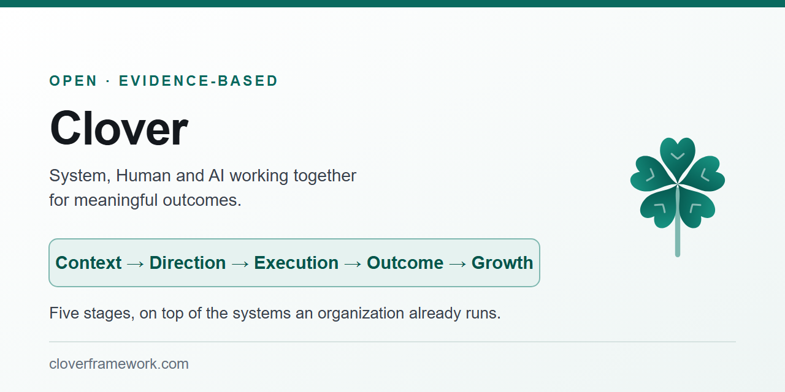

<p align="center">
  <a href="https://cloverframework.com/">
    
  </a>
</p>

<p align="center">
  <strong>Clover Framework</strong> · System, Human and AI working together for meaningful outcomes
</p>

<p align="center">
  <a href="https://cloverframework.com/"><strong>cloverframework.com</strong></a>
  ·
  <a href="QUICKSTART.md">Quickstart</a>
  ·
  <a href="AGENTS.md">AGENTS.md</a>
  ·
  <a href="docs/README.md">Docs</a>
</p>

---

# Clover

Clover is a framework for working with System, Human, and AI to produce meaningful outcomes.

The framework itself is documented at **[cloverframework.com](https://cloverframework.com/)** and in `docs/`.

This repository contains the documentation, practical guidance, case studies, and the implementation work around Clover.

## Start here

- **[Clover Framework](https://cloverframework.com/)** — understand the framework
- [`QUICKSTART.md`](QUICKSTART.md) — use Clover on real work
- [`AGENTS.md`](AGENTS.md) — AI agent operating guidance
- [`docs/README.md`](docs/README.md) — documentation index
- [`case-studies/`](docs/case-studies/) — real work and outcomes
- [Research](research/README.md) — investigations, proposals and hypotheses, with their limits
- [Clover AI v4 release notes](docs/reference/release-v4.md) — the current seven-layer system
- [Observe experiment](research/observe/README.md) — the next experiment: reciprocal observation, mutual change, and distributed learning
- [Run Clover](clover-ai-system/README.md) — the 7-layer Clover system (CPU workstation engine &amp; 8 &times; RTX 3090 GPU neuro-symbolic, compiler-verified, memory-accumulating stack): set it up, tune it to your machine, run it
- [Repository map](docs/repository-organization.md) — where each kind of material belongs

## Clover System &amp; Architecture (`Clover AI v4`)

**Clover** is both the operating methodology (`Context → Direction → Execution → Outcome → Growth` in [`AGENTS.md`](AGENTS.md)) and the unified open-source AI system built under it ([`clover-kimi-k3/`](clover-ai-system/)) — designed to produce meaningful outcomes while remaining bounded, observable, verifiable, and accountable.

It began on a single CPU host from the Clover equation of Kimi K3 and from Fareed Khan's `kimi-k3-in-c` (with its first snapshot [`clover-k3`](https://github.com/santhoshsathish94/clover-framework/tree/013cbc89a99ba506c567b081613049ac76d405a6/clover-k3/) in git history), and currently stands as a **7-layer neuro-symbolic, compiler-verified, memory-accumulating system** running on both a single CPU workstation (`Ryzen 9 7950X3D`, `124 GB` RAM) and an `8 × NVIDIA RTX 3090` GPU server (`192 GiB` VRAM), reproducibly bootstrapped from GitHub and Hugging Face ([`Santhoshsathish94/clover-kimi-k3`](https://huggingface.co/datasets/Santhoshsathish94/clover-kimi-k3)):

1. **Governance &amp; Discernment Kernel ([`AGENTS.md`](AGENTS.md)):** Operates under `Context → Direction → Execution → Outcome → Growth`, keeping epistemic states (`observed`, `externally_verified`, `hypothesis`, `user_stated_belief`, `unresolved`) distinct.
2. **File-Based Memory Tree &amp; Relational Knowledge Graph ([`k3_memory_graph.py`](clover-ai-system/src/tools/hybrid-ncm-k3/k3_memory_graph.py), [context](docs/runtime-context/engine-and-architecture/clover-memory-graph-context.md)):** Human-readable Markdown memory files with YAML front matter (`32` canonical seed entries, `65` typed cross-branch relationships), a closed-loop `staging/` promotion gate, and six mechanisms from the 11 foundational AI papers ([`foundations-11-papers-human-guide.md`](docs/runtime-context/foundational-papers-1943-to-2017/foundations-11-papers-human-guide.md) &amp; [`clover-foundations-to-clover-gpu-context.md`](docs/runtime-context/engine-and-architecture/clover-foundations-to-clover-gpu-context.md)).
3. **Ontology-Guided Neuro-Symbolic GraphRAG &amp; Symbolic Verifier ([`k3_ontology_graph.py`](clover-ai-system/src/tools/hybrid-ncm-k3/k3_ontology_graph.py), [context](docs/runtime-context/engine-and-architecture/clover-ontology-graphrag-research-context.md)):** Deterministic property graph + 4 Horn inference rules + Newell–Simon `CSm`/`VCt` signature pruning + `[E#]` / `[P#]` provenance + `CloverSymbolicVerifier`.
4. **HybridAgent Continuous `<latent>` Reasoning &amp; Live Tools ([`k3_agent_engine.py`](clover-ai-system/src/tools/hybrid-ncm-k3/k3_agent_engine.py), [context](docs/runtime-context/engine-and-architecture/clover-hybridagent-research-context.md)):** 14-step continuous `<latent>` reasoning (`K3NativeHybridLink` `7,168 → 7,168`), live `<search>` (arXiv, Wikipedia, DuckDuckGo, URL fetch), sandboxed `<python>` (math, unit tests, charts), and `MoonViT3d` vision.
5. **On-the-Fly Generative Compilation for Python &amp; Rust ([`k3_generative_compiler.py`](clover-ai-system/src/tools/hybrid-ncm-k3/k3_generative_compiler.py), [context](docs/runtime-context/engine-and-architecture/clover-generative-compilation-research-context.md)):** Statement-boundary partial-program sealors ($\mathcal{S}_{\text{PY}}, \mathcal{S}_{\text{RS}}$ via `rustc`) that catch syntax, arity, prefix-shadowing, stagnant loops, doctests, and Rust borrow/type errors mid-generation and roll back the KV cache.
6. **93-Layer 2.78T MoE GPU/CPU Engine, Validated Rust Host Path &amp; Direction B Data Movement ([`k3_gpu_experts_lib.cu`](clover-ai-system/src/tools/hybrid-ncm-k3/k3_gpu_experts_lib.cu), [`clover-kimi-k3/src/rust/`](clover-ai-system/src/rust/), [context](docs/runtime-context/engine-and-architecture/clover-data-movement-direction-b-context.md)):** Full 93-layer Kimi K3 backbone + 8 validated Rust host-path crates (`slotcache`, `poolinit`, `supply`, `copyq`, `routetable`, `planner`, `loader`, `engcfg` — `213/213` unit tests, `max_abs_diff = 0.0` C++ vs. Rust parity) + five Direction B data-movement upgrades (`95.22%–95.29%` overall VRAM hit rate, `0` PCIe D2H writebacks on cold/warm reads, `148.5 K3 tok/s` across 93 GPU layers).
7. **11-Pass Parallel Next-Concept Modeling (NCM) &amp; Native Web / VS Code Agent Surfaces ([`k3_chat_server.py`](clover-ai-system/src/tools/hybrid-ncm-k3/k3_chat_server.py), [`extension.js`](clover-ai-system/vscode-extension/extension.js)):** 11-level multiscale residual VQ-VAE and `NextConceptTransformer` emitting 64-token windows in 11 parallel passes (`17,869.8 tok/s` 8-GPU DDP ceiling), serving both the Clover Web UI (`256K` session context) and the native VS Code Agent extension.

## Core Research Thesis: The System Around the Model Matters

**Clover is a systems-level experiment, not a model-selection contest.** We deliberately chose Kimi K3—a normal, open-weights model that scored **33 of 70 tasks (47.14%)** when evaluated on its own in our custom suite—instead of choosing the strongest available model and treating its raw score as the result. The question was not, “Which model scores highest?” It was, **“What can an AI system accomplish when a model is one component of a larger, structured system?”**

The model provides underlying capability. Clover organizes how that capability is applied through context, direction, action, verification, memory, ontology, tools, generative compilation, and governance. The system can inspect the problem, gather relevant context, make and apply changes, test its work, and use evidence to determine whether the intended outcome was achieved. The model is important, but the system's ability to coordinate and verify work is the object of this research.

Our current 70-task evaluation provides an initial, concrete result:

| Configuration | Tasks passed | Strict pass rate |
| :--- | :---: | :---: |
| Kimi K3 alone (Arm 0) | **33 / 70** | **47.14%** |
| Kimi K3 + tools and generative compilation (Arm 1) | **57 / 70** | **81.43%** |
| Full Clover AI v4 system (Arm 2) | **70 / 70** | **100.0%** |

The point is not that Kimi K3 is the best model. **It wasn't selected because it was the best; it was selected to test what the system could do around a capable, ordinary model.** On this particular suite, the reported result rose from 33/70 for the model alone to 70/70 for the full Clover system. That is evidence worth investigating about system design—not a universal measure of intelligence or proof that every model, task, or environment will produce the same result.

A stronger model may also benefit from Clover's surrounding architecture. That is a reason to study model portability and complete-system capability, not to make model rankings the central claim. Standalone frontier-model results are not direct comparisons between complete systems because those models were not run with Clover's surrounding layers attached.

We welcome independent reproduction, held-out tasks, scrutiny of the evaluation protocol, alternative scoring, and published failures as well as successes. The broader claim must remain proportional to the evidence: these results are from a custom 70-task suite and need independent validation before they can support general conclusions.

> **The model provides a capability. The system organizes, extends, and verifies how that capability is used to solve problems.**

Clover's research goal is to make AI systems more capable—not to prove that one model is the winner. The practical goal is to publish an architecture and evidence that researchers can challenge, reproduce, and extend.

### The Clover cycle

Clover organizes its operating methodology as five connected stages:

```text
Context → Direction → Execution → Outcome → Growth
```

- **Context** — establish relevant information, memory, and constraints.
- **Direction** — define the objective and choose a path.
- **Execution** — determine and carry out the means within Direction and system boundaries.
- **Outcome** — establish what actually happened through evidence from the System.
- **Growth** — use validated experience to improve future work.

Growth is part of the framework's cycle; claims of persistent learning or general improvement require their own evidence.

---

### What the 70-Task Evaluation &amp; Head-to-Head Comparison Show

We ran the **exact same 70 prompts** ([`run_real_ai_benchmark_suite.py`](clover-ai-system/src/tools/hybrid-ncm-k3/run_real_ai_benchmark_suite.py)) through **Clover AI (`v4`)** on our `8 × RTX 3090` server and through **GPT-6 Astra**, **Claude Opus 5.5**, and **Gemini 4 Argon**. For the three frontier models, our benchmark harness called their raw models directly without attaching Clover's surrounding layers (tools, compiler, ontology, and memory graph). The full 3-arm ablation (`Arm 0: 33/70 → Arm 1: 57/70 → Arm 2: 70/70`) and per-category breakdown live in the [full evaluation report](docs/runtime-context/engine-and-architecture/clover-foundations-to-clover-gpu-context.md) and [`clover-kimi-k3/README.md`](clover-ai-system/README.md):

| System / Model | Public Tasks (`N=58`) | Organization Ontology + Memory (`N=12`) | All 70 Tasks | Total Time (`70` tasks) |
| :--- | :---: | :---: | :---: | :---: |
| **Clover AI (`v4`)** *(Model + 6 Surrounding Layers)* | **`58 / 58` (`100.0%`)** | **`12 / 12` (`100.0%`)** | **`70 / 70` (`100.0%`)** | `1,002.3 s` (`8 × RTX 3090`) |
| **Claude Opus 5.5** *(Clover layers not attached in harness)* | `57 / 58` (`98.3%`) | `8 / 12` (`66.7%`) | **`65 / 70` (`92.9%`)** | `263.2 s` (Cloud API) |
| **GPT-6 Astra** *(Clover layers not attached in harness)* | `56 / 58` (`96.6%`) | `7 / 12` (`58.3%`) | **`63 / 70` (`90.0%`)** | `333.6 s` (Cloud API) |
| **Gemini 4 Argon** *(Clover layers not attached in harness)* | `50 / 58` (`86.2%`) | `7 / 12` (`58.3%`) | **`57 / 70` (`81.4%`)** | `206.4 s` (Cloud API) |

**Three takeaways:**
1. **On the 58 public tasks, frontier models are already near-perfect (`96.6%–98.3%`) from their weights alone.** When Clover's own local model is run the same way without its surrounding layers (`Arm 0`), it scores **`30 / 58` (`51.7%`)** on public tasks and **`33 / 70` (`47.1%`)** overall ([full 3-arm ablation](docs/runtime-context/engine-and-architecture/clover-foundations-to-clover-gpu-context.md)).
2. **Why the 12 Ontology + Memory tasks require the surrounding layers:** Those 12 tasks test organization-specific records and prior session measurements stored in Clover's local ontology and memory files. Because our harness did not attach Clover's Ontology and Memory layers to the frontier model calls, they rightly abstained on records not present in the prompt (`7/12–8/12`).
3. **What Clover adds (`33/70 → 57/70 → 70/70`):** Surrounding Clover's local open-weights model with Tools + Generative Compilation (`57/70 = 81.4%`) and Ontology + Persistent Memory (`70/70 = 100.0%`) lifts it by **`+52.9 percentage points`** while cutting GPU-seconds per solved task by **`2.04×`** ([details & raw JSON artifacts](docs/runtime-context/engine-and-architecture/clover-foundations-to-clover-gpu-context.md)).

Its central principle is:

> **The model can propose.  
> The system decides.  
> The tools enforce.  
> Evidence verifies.  
> Humans remain accountable.**

The implementation follows the Clover cycle:

```text
Context → Direction → Execution → Outcome → Growth
```

**Upstream work:** [FareedKhan-dev/kimi-k3-in-c](https://github.com/FareedKhan-dev/kimi-k3-in-c) · [moonshotai/Kimi-K3](https://huggingface.co/moonshotai/Kimi-K3) · [togethercomputer/HybridAgent](https://github.com/togethercomputer/HybridAgent) · [HazyResearch/ncm](https://github.com/HazyResearch/ncm) · [CosmoIknosLab/ontology-guided-graphrag](https://github.com/CosmoIknosLab/ontology-guided-graphrag).

---

### Supporting areas &amp; boundaries

- **Single-workstation CPU engine (`clover-kimi-k3`):** A 2.78-trillion-parameter model runs on a single Ryzen 9 7950X3D with 124 GB of RAM ([status log](docs/runtime-context/engine-and-architecture/clover-kimi-k3-cpu-context.md)). The recorded 1,000-token prompt takes `297.5–301.0 s` (`~0.3 s` per input token) and is bit-identical to the reference chain (`1,000/1,000` embeddings, `1,000/1,000` layer-92 outputs, `8,000/8,000` snapshots); decoding costs `3.1–3.5 s` per output token plain, and `2.7 s` per token with DSpark speculative decoding.
- **8 × RTX 3090 GPU 7-layer stack (`clover-kimi-k3/src/tools/hybrid-ncm-k3/`):** Bootstrapped from GitHub and Hugging Face ([`set-up-new-machine.sh`](clover-ai-system/src/scripts/set-up-new-machine.sh), [`download-hybrid-ncm-datasets.sh`](clover-ai-system/src/scripts/download-hybrid-ncm-datasets.sh)), verified across the 70-task suite ([`benchmarks/results/1936d4eb0d53/gpu/`](benchmarks/verified-runs/run-baseline-before-foundations/gpu/)).
- **Multi-domain SWE-Bench Pro V2 (`HARD-51`) verification suite ([`benchmarks/swebench-pro-v2/`](benchmarks/swebench-pro-v2/README.md)):** Reproducible, domain-by-domain engineering challenges from SWE-Bench Pro V2 (`HARD-51`, `0/9` frontier baseline in `traj/*`) showing what fails when a model acts without surrounding system verification (`Attempt 1`, `REWARD=0`) and how the full Clover AI v4 system resolves and re-grades each problem in a pristine sandbox (`REWARD=1`), with one-command `reproduce.sh` scripts.
- **Historical &amp; research material:**
  - [`clover-k3/`, first version](https://github.com/santhoshsathish94/clover-framework/tree/013cbc89a99ba506c567b081613049ac76d405a6/clover-k3/) — historical snapshot at commit `013cbc8` (`~5.9 s` per generated token on CPU)
  - [K3 investigation](research/k3/README.md) &amp; [Model equation](research/k3/model/k3-model-equation.md) — grouped derivations, measurements, and float-for-float verification
  - [Observe experiment](research/observe/README.md) — the next experiment (reciprocal observation, mutual change, and distributed learning; tracked separately from `Clover AI v4`)
  - [`docs/framework/07-outcome.md`](docs/framework/07-outcome.md) &amp; [`docs/governance/08-governance.md`](docs/governance/08-governance.md) — what counts as evidence, accountability, and governance

## Contributing

Clover is an open, evidence-driven project. Corrections, disagreements, evidence, implementation experiments, and practical improvements are welcome.

See [`CONTRIBUTING.md`](CONTRIBUTING.md).
