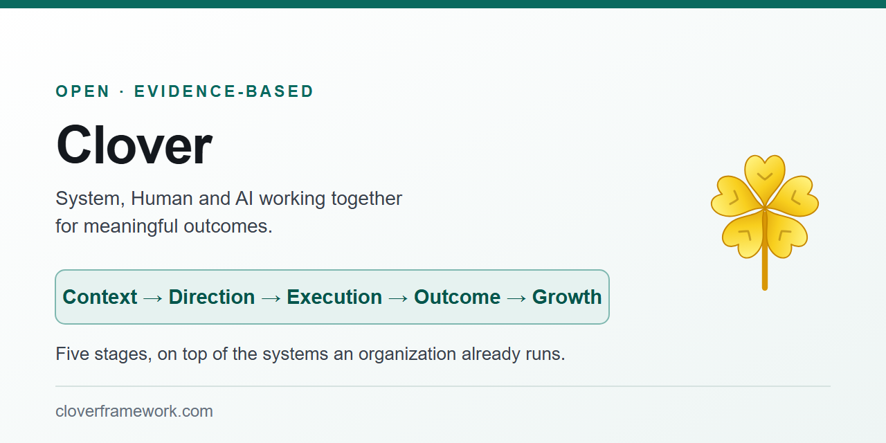

<p align="center">
  <a href="https://cloverframework.com/">
    
  </a>
</p>

<p align="center">
  <strong>Clover Framework</strong> · System, Human and AI working together for meaningful outcomes
</p>

<p align="center">
  <a href="https://cloverframework.com/"><strong>cloverframework.com</strong></a>
  ·
  <a href="https://cloverframework.com/ai-system/"><strong>AI Studio (v6.0)</strong></a>
  ·
  <a href="https://cloverframework.com/hg-format/"><strong>AI Mythbuster</strong></a>
  ·
  <a href="QUICKSTART.md">Quickstart</a>
  ·
  <a href="AGENTS.md">AGENTS.md</a>
  ·
  <a href="docs/README.md">Docs</a>
</p>

---

# Clover (`v6.0.0`)

**Clover** is a framework and open-source AI system for working with **System, Human, and AI** to produce meaningful outcomes through a repeating five-stage cycle:

```text
Context → Direction → Execution → Outcome → Growth
```

- **Context** — establish what is actually true in the system before deciding.
- **Direction** — define the objective, priorities, and boundaries *(owned by a named, accountable human)*.
- **Execution** — carry out the work within human Direction and system boundaries.
- **Outcome** — verify what the real system shows *(never claim unverified output as success)*.
- **Growth** — carry what the Outcome taught into the next cycle's Context.

> **The model can propose. The system decides. Deterministic tools compute. Evidence verifies. Humans remain accountable.**

---

## Start Here — Repository Navigation Map

| What you want to do | Where to go |
| :--- | :--- |
| **Understand the Clover Framework** | [**cloverframework.com**](https://cloverframework.com/) · [`QUICKSTART.md`](QUICKSTART.md) · [`docs/README.md`](docs/README.md) · [`docs/case-studies/`](docs/case-studies/) |
| **Operate any AI agent under Clover** | [`AGENTS.md`](AGENTS.md) — drop-in self-contained operating contract |
| **Self-Host Clover AI System `v6.0.0` From Source *(Desktop/Mobile GUI Apps: WIP)*** | [**cloverframework.com/ai-system/**](https://cloverframework.com/ai-system/) · [`clover-ai-system/README.md`](clover-ai-system/README.md) · [`download/README.md`](download/README.md) |
| **Read the 6 Broken AI Myths & `HG4` 4-Bit Hadamard Format** | [**AI Mythbuster (`cloverframework.com/hg-format/`)**](https://cloverframework.com/hg-format/) · [`site/hg-format/index.html`](site/hg-format/index.html) |
| **Reproduce all 6 Myths & `HG4` on your own machine (Zero Human Setup)** | [`site/hg-format/REPRODUCE_AGENTS.md`](site/hg-format/REPRODUCE_AGENTS.md) *(paste into any AI agent)* · [`site/hg-format/reproduce_hg_myths.py`](site/hg-format/reproduce_hg_myths.py) · [`site/hg-format/convert_to_hg.py`](site/hg-format/convert_to_hg.py) |
| **Inspect raw public benchmark ledgers (`2026-11-26`)** | [`benchmarks/public-runs-20261126/README.md`](benchmarks/public-runs-20261126/README.md) · [`research/benchmarks/`](research/benchmarks/) |
| **Read `v6.0.0` Release Notes & Changelog** | [`docs/reference/release-v6.md`](docs/reference/release-v6.md) · [`CHANGELOG.md`](CHANGELOG.md) |
| **Read the Next Milestone Roadmap (`v6.x → v7.0`: 5 Senses + 1 Brain)** | [`docs/runtime-context/one-brain-five-senses-research-context.md`](docs/runtime-context/one-brain-five-senses-research-context.md) |
| **Browse full repository layout & historical research** | [`docs/repository-organization.md`](docs/repository-organization.md) · [`research/README.md`](research/README.md) · [`TODO.md`](TODO.md) |

---

## Clover AI System (`v6.0.0` Self-Hosted Source · Desktop & Mobile GUI Apps in WIP)

In **Clover v6.0** ([`clover-ai-system/`](clover-ai-system/README.md), [`docs/reference/release-v6.md`](docs/reference/release-v6.md)), self-hosted deployments run one simpler **4-Part Steerable Clover System** directly from open source on your own hardware *(note: standalone Windows `.exe` and Android `.apk` GUI installers are **Work in Progress** and withheld until end-to-end UX verification completes)*:

1. **Part 1 — `AGENTS.md` Steering & Epistemic Boundaries:** Enforces `Context → Direction → Execution → Outcome → Growth`, pauses with `STOP_AND_ASK` before destructive or underspecified actions, and applies a Tier-0 tool-exposure gate so small `2B` models are never flooded with unrequested schemas.
2. **Part 2 — `mcp.json` (`0B` Computed Specialists First + `HG4` Specialist Mesh):**
   - **Computed > Predicted:** Built-in zero-parameter deterministic tools compute what neural weights should never guess: `x-cruncher` exact arbitrary-precision arithmetic (`A*B`, `A^B` past `6,000+` digits, `N!`, BBP hexadecimal $\pi$), a `0B` Periodogram + Split-Conformal `P10/P50/P90` time-series forecaster (`MASE = 0.3084` in `<50 ms` CPU, beating `2B/35B/120B` LLMs and `Chronos-0.2B`), a `0B` Defeasible Epistemic Rule Resolver (`180/180` accuracy), and Python AST verification.
   - **Hadamard-Grouped (`HG4-16R` / `K31H`) Models & `tsock://` `4 B/tok` Mesh:** Shrinks open models ~4× (`70 GB` BF16 → `17.4 GB` `HG4` at `99.6%+` cosine fidelity) and streams binary token IDs at `4 Bytes/token` (`49.4×` smaller than HTTP JSON SSE).
3. **Part 3 — `<task_id>.md` Context Ledger & Local-First Git Memory:** Writes human-readable per-task context files and stores chats, verified outcomes, and encrypted credentials locally on your device (Windows DPAPI / Android KeyStore) with optional sync to your own **private** GitHub repository.
4. **Part 4 — Prerequisite-Gated SQLite Todo & `CloverMetricsLedger` Telemetry:** Tracks step dependencies (`todos` + `todo_deps`) and records live runtime metrics (`GET /api/clover/metrics`): used vs. idle models and tools, measured decode `tok/s` (`mean`/`p50`/`p95`/`max`), solver cycle counts, and Cycle-2 repair signals.

### Set Up One Model — or the Full Clover AI System — on Your Own Hardware

Inside **Settings → Model → Clover System Setup** (or from first launch via *Choose models / Use server*), users can configure **1 model**, a **custom subset**, or the **complete Clover AI System** across their device and any GPU servers they provide:

- **Small models & `0B` tools run interactively on *any* phone, laptop, or CPU machine (`0` GPUs required).**
- **Big models require GPUs to be interactive** — if a machine is CPU-only or lacks the required GPU VRAM, Studio automatically skips those models and displays the exact minimum server needed rather than letting a model crawl at `<1 tok/s`.

| Model / Specialist | `HG4` Footprint | Minimum Required Hardware / Servers | Measured `RTX 3090` Single-User Decode (`batch = 1`) |
| :--- | :--- | :--- | :--- |
| **`0B` Computed Pack** (`x-cruncher` + Conformal + Defeasible) | `0 MB` | Any phone, laptop, or CPU machine (`0` GPUs) | **`0.02–52 ms`** exact on CPU (`0` GPUs) |
| **`LFM3-Omni-2B` & Small Drafters** (`HG4-16R` & `5L-DSpark`) | `0.85 GB` | Any phone, laptop, CPU, or `1×` GPU | **`240–288 decode tok/s`** on `1× 3090` · `50.3 tok/s` CPU · `33.4 tok/s` S23 |
| **`Chronos-Bolt 0.2B`** (`HG4` time-series) | `0.10 GB` | Any phone, laptop, CPU, or `1×` GPU | **`187–191 decode tok/s`** (`0.37 s`) · `<52 ms` `0B` Conformal |
| **`V-JEPA 2.1`** (`HG4-16R` physical dynamics) | `0.51 GB` | Any laptop, CPU, or `1×` GPU | **`0.12 s`/clip** (`1408-d` rollout) · `0.9 s` CPU |
| **`Boltz-2`** (`HG4-16R` 3D biomolecular folding) | `0.53 GB` (`~14 GB` resident) | `1×` GPU server `>= 16 GB` VRAM (`1× RTX 3090`) | **`~12 s`/complex** on `1× 3090` *(skipped on CPU)* |
| **`Goedel-Prover-V2-32B`** (`HG4-16R` `Lean 4` prover) | `15.8 GB` (`21.6 GB` @ 16k KV) | `1×` GPU server `>= 24 GB` VRAM (`1× RTX 3090`) | **`18.4–28.6 decode tok/s`** *(skipped on CPU: `0.9 tok/s`)* |
| **`Clover-35B-A3B` Coordinator** (`Qwen3.6-35B-A3B + LoRA`, `HG4-16R-OP`) | `17.4 GB` (`20.2 GB` @ 32k KV) | `1×` GPU server `>= 24 GB` VRAM (`1× RTX 3090`) | **`58.5 decode tok/s`** CUDA (`35.8 tok/s` HTTP; `4×` GPUs add `+0.0 tok/s`) |
| **`Nemotron 3.5 Super VL`** (`120B-A12B` `HG4-16R`, `1M` context) | `58.2 GB` (`68 GB` resident) | `4× 24 GB RTX 3090` server or `1× 80 GB` GPU (`>= 72 GB` VRAM) | **`38.4–55+ decode tok/s`** (`2L-MTP`; `8×` GPUs add `+0.0 tok/s`) |
| **`Kimi K3.1 Pro`** (`2.8T MoE` `K31H` two-tier `HG4+HG2`) | `741 GB` (`~780 GB` resident) | Same-rack GPU cluster `>= 780 GB` VRAM (`5× 8-GPU 3090` or `2× 8×80 GB`) | **`6.0–18 decode tok/s`** (`T=1` to `+DSpark`; *skipped without cluster*) |

---

## Six Broken AI Myths — Verified on Real Hardware (`2026-11-26`)

Every engineering claim in Clover v6.0 is backed by raw JSON ledgers ([`benchmarks/public-runs-20261126/`](benchmarks/public-runs-20261126/README.md)) and a standalone `<5s` zero-GPU/zero-API-key reproducibility suite (`python -W error site/hg-format/reproduce_hg_myths.py` or paste [`site/hg-format/REPRODUCE_AGENTS.md`](site/hg-format/REPRODUCE_AGENTS.md) into any coding agent):

1. **Myth 1 (*"Models need giant BF16 VRAM"*):** Block-16 Walsh-Hadamard rotation (`HG4-16R`) suppresses activation/weight outliers (`+6.0 dB` to `+20.9 dB` SQNR, `0.996–0.9985` cosine), shrinking `Qwen3.6-35B-A3B` from `70 GB` → `17.4 GB` (`1× 24 GB` GPU) and `Boltz-2` by `7.57×` (`pLDDT = 0.931` live 3D folding).
2. **Myth 2 & 3 (*"Bigger single monoliths beat coordinated specialists"*):** On `Lean 4 + Mathlib` MiniF2F, `Goedel-Prover-V2-32B + Clover` (`66.7%`) and a 10-line `0B` tactic cascade (`50.0%`) both beat standalone `120B` (`41.7%`).
3. **Myth 4 (*"Agents must chat over verbose HTTP JSON"*):** Binary token sockets (`tsock://`) pass `4 Bytes/token` (`49.4×` smaller wire payload than HTTP JSON SSE) with `T=0` priority clubbing.
4. **Myth 5 (*"Train neurons to predict math, forecasts, and rule overrides"*):** `0B` computed tools (`x-cruncher`, `0B` Periodogram+Conformal `MASE = 0.3084` in `52 ms` CPU, `0B` Defeasible Resolver `180/180`) beat `2B/35B/120B` LLMs at zero GPU cost.
5. **Myth 6 (*"AI solves real-world problems alone without human steering"*):** On 6 domain-policy & hidden-constraint tasks, unsteered AI-alone scored `0/6` (`0.0%`) while Human Steering + Clover scored `5/6` (`83.3%`) in `1.17` mean cycles using `53%` fewer tokens.

---

## Prior Research Lineage (`v4–v5`, Archived in Repo)

Earlier neuro-symbolic research milestones — including the single-workstation `Kimi K3` CPU engine ([`clover-kimi-k3-cpu-context.md`](docs/runtime-context/engine-and-architecture/clover-kimi-k3-cpu-context.md)), the 11 Foundational Papers (`1943–2017`) & Direction B hardware data-movement study ([`research/clover-ai-system-paper/README.md`](research/clover-ai-system-paper/README.md), `33/70 → 70/70` across 3 backbones), Collective Problem-Solving Learning ([`research/collective-learning/`](research/collective-learning/README.md)), and SWE-Bench Pro V2 verification ([`benchmarks/swebench-pro-v2/`](benchmarks/swebench-pro-v2/README.md)) — remain preserved with full scripts and raw logs under `research/`, `benchmarks/`, and [`docs/reference/release-v4.md`](docs/reference/release-v4.md).

## Contributing

Clover is an open, evidence-driven project. Corrections, disagreements, independent reproductions, and practical improvements are welcome — see [`CONTRIBUTING.md`](CONTRIBUTING.md).
