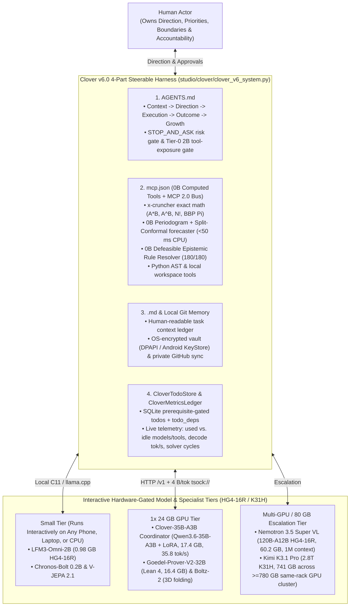

# Clover AI System — v6.0 Unified Architecture (`CLOVER_FRAMEWORK_ARCHITECTURE.md`)

**Clover v6.0** unifies self-hosted Python/C deployments and the **`HG4` Fusion Gateway** *(with standalone Windows & Android GUI apps in active **Work in Progress**)* around two core principles governed by the five-stage Clover cycle (**`Context → Direction → Execution → Outcome → Growth`** in [`../AGENTS.md`](../AGENTS.md)):

1. **Computed vs. Predicted:** Deterministic algorithms (`0B` computed tools) execute exact math, spectral/conformal forecasting, defeasible rule resolution, and syntax/type verification; neural weights are invoked only where judgment, synthesis, or open-world perception is needed.
2. **Human Direction at the Steering Wheel:** A named human owns Direction and accountability (`STOP_AND_ASK` on irreversible or underspecified risk), while Clover coordinates the smallest capable interactive model or specialist tool.

---

## 1. v6.0 4-Part Architecture Diagram

---

## 2. Hadamard-Grouped (`HG4-16R-OP` & `K31H`) Weight Format & `tsock://` Wire Protocol

- **Block-16 Walsh-Hadamard Rotation (`HG4-16R`):** Applies orthogonal block-16 Hadamard transforms before group-quantized 4-bit packing ([`../site/hg-format/convert_to_hg.py`](../site/hg-format/convert_to_hg.py)), suppressing weight/activation outliers (`+6.0 dB` to `+20.9 dB` SQNR, `0.996–0.9985` cosine) so `70 GB` BF16 models (`Qwen3.6-35B-A3B`) fit inside `17.4 GB` on a single `24 GB` GPU with deterministic parity.
- **Dedicated Binary Token Socket (`tsock://`):** Streams raw 32-bit token IDs between coordinator and specialist nodes at `4 Bytes/token` (`49.4×` smaller wire payload than HTTP JSON SSE) alongside `T=0` priority request clubbing ([`src/tools/hg4-fusion-gateway/gateway.py`](src/tools/hg4-fusion-gateway/gateway.py)).

---

## 3. Per-GPU Interactive Setup & Placement Rules

Clover AI Studio's setup engine (`plan_system_setup` & `apply_system_setup` in [`studio/clover/clover_v6_system.py`](studio/clover/clover_v6_system.py)) prevents unusable `<1 tok/s` CPU offloading:

1. **Small models & `0B` tools (`runs_on_any_device = True`):** Always ready and interactive on any phone, laptop, or CPU machine.
2. **Big GPU models (`needs_gpu_interactive = True`):** Evaluated largest-first against per-GPU discrete VRAM (including KV-cache residency) and verified via multi-token live `/v1/chat/completions` decode `tok/s` probes:
   - `ready_served`: Live remote gateway verified at interactive GPU decode speed.
   - `ready_pinned`: Fits simultaneously in free discrete GPU VRAM.
   - `ready_swap`: Fits on the GPU via on-demand swap (`~7 s` cold load) when sharing a single `24 GB` card across multiple `16–22 GB` models.
   - `needs_gateway`: GPU hardware verified over SSH; displays a safe `$CLOVER_GATEWAY_KEY` bootstrap command to start the HTTP gateway.
   - `skipped_not_interactive`: Automatically skipped when only CPU or insufficient GPU VRAM is available, reporting the exact minimum server specification required.

---

## 4. Next Milestone (`v6.x → v7.0`) & Prior Lineage (`v4–v5`)

- **Next Major Milestone (Recorded & Paused):** The 7-Horizon roadmap for **5 Deterministic Senses + Aligned Converters + 1 Compact Coordinator Brain** (`Freeze-Omni`, `IndicConformer`, 3-Signal Foveated `JEPA`, Dual-Channel `Tool-NCM`, and `Clover-Seed`) is documented in [`../docs/runtime-context/one-brain-five-senses-research-context.md`](../docs/runtime-context/one-brain-five-senses-research-context.md).
- **Historical `v4–v5` Neuro-Symbolic Stack:** Documentation and code for the earlier precomputed `CLVRTRK1` trunks, 11 Foundational Papers (`1943–2017`), Direction B data-movement kernels, and `HybridAgent`/`NCM` experiments are preserved in [`../research/clover-ai-system-paper/README.md`](../research/clover-ai-system-paper/README.md) and [`../docs/reference/release-v4.md`](../docs/reference/release-v4.md).
