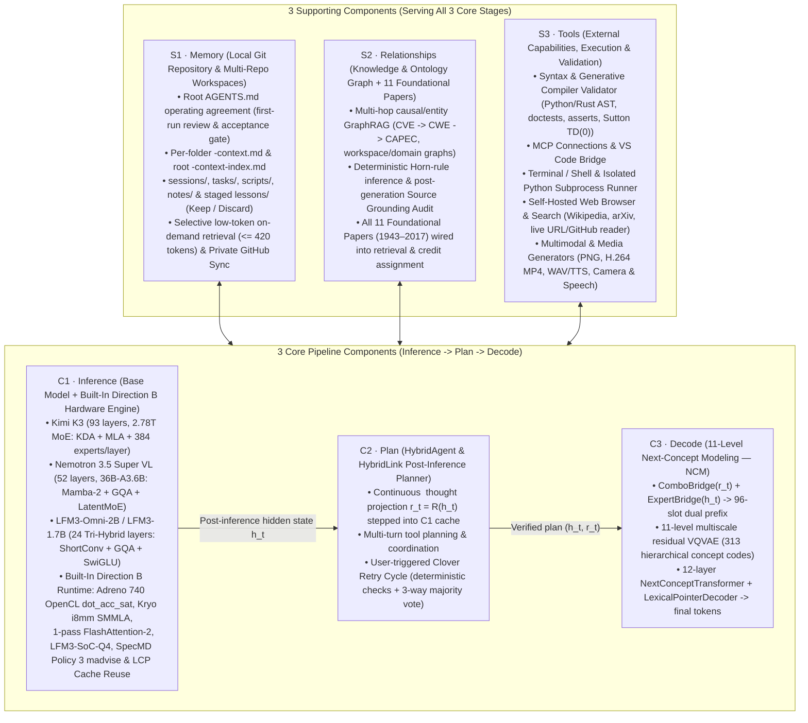

# Clover Framework — Unified System Architecture (`CLOVER_FRAMEWORK_ARCHITECTURE.md`)

**Clover AI System** is organized around **3 Core Pipeline Components (`Inference → Plan → Decode`)** supported by **3 Shared Supporting Components (`Memory · Relationships · Tools`)**, operating continuously under the five-stage Clover cycle (**Context ⇄ Direction ⇄ Execution ⇄ Outcome ⇄ Growth**).

---

## 1. Architectural Overview (`3 Core + 3 Supporting`)

---

## 2. How the 3 Core Components Store and Execute Weights (`Computed Trunks / Experts` vs. `Direct Dense Weights`)

A critical distinction in Clover is how **`C1 · Inference`**, **`C2 · Plan`**, and **`C3 · Decode`** store and stream their parameters across hardware tiers:

| Core Component | Parameter Scale | Uses Precomputed `trunk-L/` & `expert-L/`? | Uses Direct Weights? | Exact Storage Layout & Why |
| --- | --- | --- | --- | --- |
| **`C1` · Inference** (`Base Model` + Direction B Engine) | **`1.73B – 2.78T` parameters** (`894 MB` on S23 up to `1.4 TB` on K3) | **YES — Precomputed `trunk-L/` + `expert-L/` (or `ffn.4bit.bin`) + `global-0/`** | Only for tiny layer norms / gates inside `common.bin` | Because the Base Model is huge and runs layer-by-layer (`L = 0 .. N-1`), splitting it into per-layer precomputed directories (`trunk-0..N`, `expert-1..N`) lets the C/OpenCL/CUDA engine `mmap` each layer on demand, issue `SpecMD Policy 3` `madvise(MADV_WILLNEED)` lookahead for Layer `L+1`, and drop inactive layers via Red-Blue Pebble Rule `R4` (`MADV_DONTNEED`) with zero dirty writebacks: • **Kimi K3 (`93` layers)**: `trunk-0..92/` (`index.bin`, `common.bin`, composed `operator.bin`, `attention.bin` pruned) + `expert-1..92/` (`384` routed 4-bit palette-mapped experts per layer). • **Nemotron 3.5 Super VL (`52` layers)**: `trunk-0..51/` (`Mamba-2` / `GQA` composed `operator.bin`) + `expert-L/` (`128` routed 4-bit experts + `1` shared expert). • **LFM3-Omni-2B / LFM3-1.7B (`24` layers, Dense Tri-Hybrid)**: `trunk-0..23/` (`index.bin` `LFM3TRK1`, `common.bin`, composed `operator.bin` / `operator.4bit.bin`, and 4-bit SwiGLU `ffn.4bit.bin` — which acts as the dense FFN counterpart to `expert-L/`), plus `global-0/` (`embed_tokens.bf16.bin`, 4-bit `lm_head.4bit.bin`, `embedding_norm.bf16.bin`, `rope_inv_freq.bin`). |
| **`C2` · Plan** (`HybridAgent` / `HybridLink`) | **`2.1M – 50.4M` parameters** (`4.2 MB – 100 MB`) | **NO trunks or experts** | **YES — Direct dense matrices in RAM/VRAM** | `HybridLink` (`r_t = R(h_t)`) is a single compact residual MLP (`LayerNorm -> Linear -> SiLU/GELU -> Linear -> LayerNorm`, e.g., `2048 -> 512 -> 2048` or `2048 -> 2048` on LFM3; `7168 -> 7168` on K3) that runs **after** `C1` inference on the final hidden state $h_t$. Because it is only a few megabytes and is invoked on every `<latent>` step, its weights live **directly in resident memory** (`lfm3_ncm_core_bf16.pt` / `hybridlink_adapter_2048.pt`) with zero disk streaming. |
| **`C3` · Decode** (`11-Level NCM` Concept Renderer) | **`~148M` core parameters + `188 MB` vocab tables** | **NO trunks or experts** | **YES — Direct dense weights in RAM + 2 `mmap`ped BF16 vocab tables** | `NCM` runs **once per answer window** after `C2` planning finishes. It does not use MoE routing or `trunk-L/` folders; instead it uses: 1. **Direct resident weights** (`lfm3_ncm_core_bf16.pt`): `ComboBridge(D -> 384)`, `ExpertBridge(D -> 384)`, 6-layer `VQVAE` encoder/decoder + 11-level multiscale codebooks (`[1, 4, 8, 14, 20, 26, 32, 40, 48, 56, 64]` = `313` codes), 12-layer dense `NextConceptTransformer` (`d = 768`), and 3-layer `LexicalPointerDecoder`. 2. **Two flat `mmap`ped BF16 vocabulary tables**: `vqvae_wte.bf16.bin` (`[128000, 384]`, `94 MB`) and `vqvae_dec.bf16.bin` (`[128000, 384]`, `94 MB`), indexed only on the **active vocabulary subset** (`~190` allowed token IDs per plan window = `33.8×` faster than a full `128,000`-row matmul, `max_abs_diff = 0.0`). |

### Why Only `C1` Uses `trunk-L/` & `expert-L/` While `C2` and `C3` Use Direct Values
1. **`C1` (Base Model Inference)** is the heavy per-layer sequence processor (`24`, `52`, or `93` layers, up to trillions of parameters). Precomputing its weights into `trunk-L/` (attention / ShortConv / Mamba-2 operators, with unused records pruned) and `expert-L/` / `ffn.4bit.bin` (SwiGLU FFN or routed MoE experts) allows the Direction B hardware engine to stream layers through `L3` / `SLC` / `Adreno GMEM` / `VRAM` without ever holding the entire unquantized model in heap memory.
2. **`C2` (`HybridLink` Planner)** and **`C3` (`11-Level NCM` Decoder)** are compact post-inference heads that operate on the summary vectors `(h_t, r_t)` emitted by `C1`. Keeping `C2` and `C3` as direct dense tensors in resident memory (with active-vocabulary `mmap` slicing for `vqvae_wte` and `vqvae_dec`) avoids any file-header or trunk-dispatch overhead during `<latent>` stepping and concept decoding.

---

## 3. Detailed Specification of the 3 Supporting Components (`Memory · Relationships · Tools`)

### `S1` · Memory (`Local Git Repository & Multi-Repo Workspaces` — `clover_git_memory_repo.py`)
- **Root `AGENTS.md` Onboarding & Acceptance Gate**: Lives at `clover-memory-repo/AGENTS.md`. Presented on first launch so the human can read, customize, and accept the operating rules (`git commit`) before starting.
- **Multi-Repo Working Repository Support**: Users can switch between `clover-memory-repo` and any local project folder or cloned GitHub repository (`workspaces/<repo>`).
- **Hierarchical Per-Folder & Root Context Index**: Automatically maintains `<folder>/<folder>-context.md` inside every subfolder (`notes/notes-context.md`, `scripts/scripts-context.md`, `src/src-context.md`, etc.) and `<repo>-context-index.md` at the repository root.
- **Selective Low-Token Retrieval & Staged Growth**: Injects at most `<= 420` tokens of matching snippets per turn; stages lessons learned during Clover Retry Cycles in `lessons/MEM-LESSON-*.md` for the human to **Keep** (promote to `notes/`) or **Discard**; syncs with the user's **private** personal GitHub repository (`"private": true` enforced).

### `S2` · Relationships (`Knowledge & Ontology Graph` + 11 Foundational Papers — `k3_ontology_graph.py` & `k3_memory_graph.py`)
- **Deterministic Horn-Rule Inference & Stratified Traversal**: Prioritizes multi-hop causal/remediation chains (`CVE -> CWE -> CAPEC`, system architecture & domain relations) ahead of leaf edges.
- **Post-Generation Source Grounding Audit**: Verifies that numbers and canonical identifiers in the model's reply are grounded in the prompt, retrieved memory/ontology context, or tool outputs.
- **All 11 Foundational Papers (`1943–2017`)**:
  1. **McCulloch & Pitts (1943)** all-or-none inhibitory veto.
  2. **Turing (1950)** $M_0 / M_1$ diagonal self-reference stratifier.
  3. **Newell & Simon (1956)** Logic Theorist `CSm` 3-number structural filter (`*2.07` fix) & `VCt` premise contraction.
  4. **Rosenblatt (1958)** $\gamma$-system zero-sum parasitic conservation.
  5. **Minsky & Papert (1969)** Order-$k$ *One-in-a-Box* local conjunctive predicates.
  6. **Hopfield (1982)** bipolar constellation cleanup & familiarity energy.
  7. **Rumelhart, Hinton & Williams (1986)** non-saturating `{0.1, 0.9}` terminal targets.
  8. **Sutton (1988)** `TD(lambda)` trajectory eligibility traces & Absorbing Markov `TD(0)` MLE.
  9. **LeCun et al. (1998)** Graph Transformer Network (`GTN`) forward `logadd` confidence.
  10. **Krizhevsky, Sutskever & Hinton (2012)** cross-channel Local Response Normalization (`LRN`).
  11. **Vaswani et al. (2017)** $h = 3$, $1/\sqrt{d_k}$ orthogonal subspace multi-head retrieval.

### `S3` · Tools (`External Capabilities, Execution & Validation`)
All external actions and verifications are unified under `S3 · Tools` and governed by explicit user permissions (`Allow`, `Ask`, `Off`):
1. **Syntax & Generative Compiler Validator (`k3_generative_compiler.py`)**: Extracts model-written Python/Rust code (`_PY_HINT`), checks AST syntax, variable scope, call arity, `>>>` doctests (`spec_prompt`), and `assert` test cases, computes Sutton (1988) Absorbing Markov statement survival $V_{\text{MLE}}$, and drives an automatic repair turn if needed.
2. **MCP Connections & VS Code Bridge**: Connects to Model Context Protocol servers and VS Code workspace tools (`search_tools` deferred loading, file edits, diagnostics).
3. **Terminal / Shell & Isolated Python Runner**: Executes Python calculations, scripts, and shell commands in bounded subprocesses with timeouts.
4. **Self-Hosted Web Browser & Search (`live-web-search-tool.py`)**: Queries Wikipedia REST/Search APIs, arXiv scientific APIs, and fetches live HTTP/HTTPS URLs & GitHub files directly without requiring any paid third-party search API key.
5. **Multimodal & Media Generators**: Inspects attached images (Pillow) and WAV audio, and generates PNG scenes, H.264 MP4 videos (FFmpeg), and spoken WAV audio (eSpeak NG / Android TTS / Omni `/tts`).
