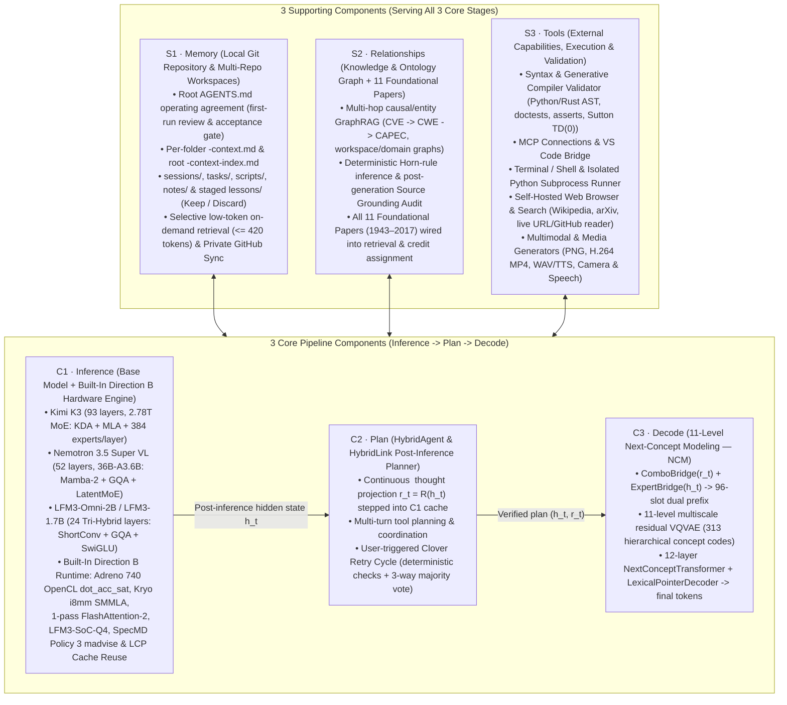

# Clover Framework — Unified System Architecture (`CLOVER_FRAMEWORK_ARCHITECTURE.md`)

**Clover AI System** is organized around **3 Core Pipeline Components (`Inference → Plan → Decode`)** supported by **3 Shared Supporting Components (`Memory · Relationships · Tools`)**, operating continuously under the five-stage Clover cycle (**Context ⇄ Direction ⇄ Execution ⇄ Outcome ⇄ Growth**).

---

## 1. Architectural Overview (`3 Core + 3 Supporting`)



---

## 2. How All 3 Core Components Store and Execute Precomputed `Trunk + Expert` Weights (`CLVRTRK1` + `CLVR4B01`)

Across **`C1 · Inference`**, **`C2 · Plan`**, and **`C3 · Decode`**, Clover precomputes every layer, bridge, codebook, and decoder block into unified **`trunk` + `expert`** directories (`index.bin`, `common.bin`, algebraically fused `operator.bin` + `operator.4bit.bin`, `ffn.bin` + `ffn.4bit.bin`, with redundant `attention.bin` pruned where attention is fused into `operator.bin`). For `C2 · Plan` and `C3 · Decode`, `mobile/prepare_c2_c3_precomputed_trunks.py` builds all **31 precomputed trunk & expert directories (`377.97 MB` BF16/F32 + `83.17 MB` 4-bit group-64)** directly on CPU in **`1.98s` on `k3`** and **`14.76s` on `s23`**:

| Core Component | Parameter Scale | Precomputed `trunk` & `expert` Directories | Offline Algebraic Operator Fusions & Precomputations | Exact Parity & Hardware Execution |
| --- | --- | --- | --- | --- |
| **`C1` · Inference** (`Base Model` + Direction B Engine) | **`1.73B – 2.78T` parameters** (`894 MB` on S23 up to `1.4 TB` on K3) | • **Kimi K3 (`93` layers)**: `trunk-0..92/` + `expert-1..92/` (`384` routed 4-bit experts/layer)<br>• **Nemotron 3.5 Super VL (`52` layers)**: `trunk-0..51/` + `expert-L/` (`128` routed + `1` shared expert)<br>• **LFM3-Omni-2B (`24` layers)**: `trunk-0..23/` (`index.bin`, `common.bin`, `operator.bin`, `operator.4bit.bin`, `ffn.4bit.bin`) + `global-0/` | • Composed attention / ShortConv / Mamba-2 / MLA projections packed into `operator.bin` (`+ operator.4bit.bin`) with `attention.bin` pruned.<br>• Symmetric 4-bit group-64 planar quantization (`[nibbles: N/2 uint8] [scales: N/64 fp16]`) across `ffn.4bit.bin`, `operator.4bit.bin`, and `lm_head.4bit.bin`. | Streamed via `mmap` + `SpecMD Policy 3` (`MADV_WILLNEED` lookahead + Red-Blue Pebble Rule `R4` `MADV_DONTNEED` clean drop) across Adreno 740 OpenCL `dot_acc_sat`, Kryo ARMv9 `i8mm` `SMMLA`, and 1-pass `FlashAttention-2`. |
| **`C2` · Plan** (`HybridAgent` / `HybridLink`) | **`2.1M – 50.4M` parameters** (`plan-trunk-0/`, `36.02 MB` BF16/F32 + `5.29 MB` 4-bit) | **`ncm/precomputed/plan-trunk-0/`** (`index.bin`, `common.bin`, `operator.bin`, `operator.4bit.bin`, `ffn.bin`, `ffn.4bit.bin`, `attention.bin` pruned) | • **Fuses `pre_ln` affine ($\gamma_1, \beta_1$) into `proj1`**: $\widetilde{W}_1 = W_1 \operatorname{diag}(\gamma_1)$, $\widetilde{b}_1 = W_1 \beta_1 + b_1$ (`operator.bin` + `operator.4bit.bin`) for both `Lfm3NativeHybridLink` (`2048 -> 512 -> 2048`) and `HybridLink2048` (`2048 -> 2048 -> 2048`).<br>• **Fuses `out_scale` (`0.024`) into `post_ln`**: $\widetilde{\gamma}_2 = 0.024 \gamma_2$, $\widetilde{\beta}_2 = 0.024 \beta_2$ (`common.bin`). | Verified on `k3` & `s23` CPU with **`max_abs_diff = 2.24e-08`** (`3.73e-08` on ARMv9) and bound in-place at startup with zero extra RAM. |
| **`C3` · Decode** (`11-Level NCM` Concept Renderer) | **`~148M` core parameters + `188 MB` `mmap` vocab tables** (`30` trunk/expert dirs: `341.95 MB` BF16/F32 + `77.88 MB` 4-bit) | • **`bridge-trunk-0/`** (`ComboBridge` + `ExpertBridge`)<br>• **`vqvae-trunk-0/`** + **`vqvae-expert-0..10/`** (`11` multiscale codebook experts)<br>• **`ncm-trunk-0..11/`** (`12` transformer blocks) + **`ncm-global-0/`** (`11` fused level heads)<br>• **`ptr-trunk-0..2/`** (`3` cross-attention pointer blocks) + **`ptr-global-0/`**<br>• **`vqvae_wte.bf16.bin`** & **`vqvae_dec.bf16.bin`** (`mmap`) | • **`bridge-trunk-0/`**: Fuses `ln_in` into `fc1`/`proj1`; fuses `(scale * gate)` and `+ seg_rh` into `ComboBridge.ln_out`; fuses $\tanh(\alpha)$ into `ExpertBridge.ln_out`.<br>• **`vqvae-trunk-0/` & `vqvae-expert-0..10/`**: Fuses `middle_block.ln_1 -> attn.c_attn` and `ln_2 -> mlp.c_fc`; precomputes $\ell_2$-normalized codebooks $\hat{E}_s$, squared norms $\|e_j\|_2^2$, `quant_resi`, and `4-bit` codebooks across all 11 scales.<br>• **`ncm-trunk-0..11/` & `ncm-global-0/`**: Fuses `ln_1 -> attn.c_attn` (`operator.bin`) and `ln_2 -> mlp.c_fc` (`ffn.bin`) in all 12 blocks; fuses `transformer.ln_f` ($\gamma_f, \beta_f$) into **all 11 concept level heads** (`lm_head_l0` + `lm_heads.0..9`: $\widetilde{H}_s = H_s \operatorname{diag}(\gamma_f), \widetilde{b}_{H_s} = H_s \beta_f$).<br>• **`ptr-trunk-0..2/` & `ptr-global-0/`**: Fuses `ln1 -> qkv`, `ln_q -> cx_q`, `ln_kv -> cx_kv` (`operator.bin`), `ln2 -> mlp.0` (`ffn.bin`), and `res_scale -> ln_out`. | Verified on `k3` & `s23` CPU with **`ComboBridge max_abs_diff = 1.14e-05`**, **`NCM Block 0 max_abs_diff = 5.07e-07`**, and **100% bit-exact 313-code concept generation & pointer decoding**. |

### Unified 5-Subfolder Hugging Face Repository Layout (`Santhoshsathish94/clover-ai-studio`)

Every model family (`kimi/`, `nemotron/`, and `liquid-lfm3/`) in [`Santhoshsathish94/clover-ai-studio`](https://huggingface.co/datasets/Santhoshsathish94/clover-ai-studio) shares the **identical 5-folder structure** (`3,266` files, `1,528.08 GiB` total):

```text
<model>/
├── experts/       # Precomputed routed MoE experts, dense SwiGLU FFN experts & 11-level VQ codebook experts
├── trunks/        # Precomputed per-layer trunks (index.bin, common.bin, operator.bin, operator.4bit.bin), vision trunks & global-0/
├── hybridagent/   # Core 2 (Plan): precomputed plan-trunk-0/ + Stage-1..3 HybridLink / HybridAgent trunks & checkpoints
├── ncm/           # Core 3 (Decode): precomputed vqvae-trunk-0/, ncm-trunk-0..11/, ptr-trunk-0..2/, mmap vocab bins & NCM weights
└── bridges/       # Core 3 Bridges: precomputed bridge-trunk-0/ (ComboBridge + ExpertBridge) & cross-model latent bridge trunks
```

| Subfolder | `kimi/` (`1,712` files, `1,434.34 GiB`) | `nemotron/` (`1,084` files, `89.58 GiB`) | `liquid-lfm3/` (`468` files, `4.16 GiB`) |
| --- | --- | --- | --- |
| **`experts/`** | `expert-1..92/` (`constants.bin`, `experts.bin`, `experts.direct`, `maps.json`) + `vqvae-expert-0..10/` (`434` files, `1,347.30 GiB`) | All `40` backbone MoE layers (`expert-1, 3, 5, ..., 87/`) + `expert-mtp-1/` (`constants.bin`, `experts.4bit.direct`, `maps.json`, plus `experts.direct` on `expert-1` & `expert-mtp-1`) + `vqvae-expert-0..10/` (`191` files, `66.37 GiB`) | `expert-0..23/` (`constants.bin`, `maps.json`, `ffn.4bit.bin`) + `vqvae-expert-0..10/` (`138` files, `0.63 GiB`) |
| **`trunks/`** | `global-0/` (`embed_tokens.bf16.bin`, `embedding_norm.bf16.bin`, `lm_head.bf16.bin`, `lm_head.4bit.bin`, `output_attn_res_norm.bf16.bin`, `output_attn_res_proj.bf16.bin`) + `trunk-0..92/` + `vision-trunk-0..26/` + `vision-global-0/` + `open-weights/` + `engine-inputs/` (`621` files, `63.28 GiB`) | `global-0/` (`embeddings.bf16.bin`, `lm_head.bf16.bin`, `lm_head.4bit.bin`, `norm_f.bf16.bin`) + all `88` backbone trunks (`trunk-0..87/`) + `trunk-mtp-0..1/` + `vision-trunk-0..31/` + `vision-global-0/` + `prepare-manifest.json` + `tokenizer.json` (`476` files, `17.41 GiB`) | `global-0/` (`embed_tokens.bf16.bin`, `embedding_norm.bf16.bin`, `lm_head.4bit.bin`, `rope_inv_freq.bin`) + `trunk-0..23/` (`index.bin`, `common.bin`, `operator.bin`, `operator.4bit.bin`, `ffn.4bit.bin`) + `tokenizer.json` (`126` files, `1.96 GiB`) |
| **`hybridagent/`** | `plan-trunk-0/` (`CLVRTRK1` + `CLVR4B01`), `checkpoint-clover-true-hybrid-agent-ncm.pt`, `checkpoint-clover-agent-experts.pt` (`12` files, `7.51 GiB`) | `plan-trunk-0/` + `plan-stage-1..3/` (`CLVRTRK1` + `CLVR4B01`), `nemotron_hybridagent_final.pt`, `stage1..3/` (`35` files, `1.41 GiB`) | `plan-trunk-0/` (`CLVRTRK1` + `CLVR4B01`), `hybridlink_adapter_2048.pt` (`7` files, `0.04 GiB`) |
| **`ncm/`** | `vqvae_wte.bf16.bin`, `vqvae_dec.bf16.bin`, `vqvae-trunk-0/`, `vqvae-expert-0..10/`, `ncm-trunk-0..11/`, `ncm-global-0/`, `ptr-trunk-0..2/`, `ptr-global-0/`, `vision-trunk-0..26/`, `vision-global-0/`, `tinystories/precomputed/`, `wmt14/precomputed/`, `manifest.json` (`627` files, `15.37 GiB`) | `vqvae_wte.bf16.bin`, `vqvae_dec.bf16.bin`, `vqvae-trunk-0/`, `vqvae-expert-0..10/`, `ncm-trunk-0..11/`, `ncm-global-0/`, `ptr-trunk-0..2/`, `ptr-global-0/`, `vision-trunk-0..31/`, `vision-global-0/`, `manifest.json`, `nemotron_ncm_core_bf16.pt` (`374` files, `3.17 GiB`) | `vqvae_wte.bf16.bin`, `vqvae_dec.bf16.bin`, `vqvae-trunk-0/`, `vqvae-expert-0..10/`, `ncm-trunk-0..11/`, `ncm-global-0/`, `ptr-trunk-0..2/`, `ptr-global-0/`, `manifest.json`, `lfm3_ncm_core_bf16.pt` (`188` files, `0.93 GiB`) |
| **`bridges/`** | `bridge-trunk-0/` + `q2k3-bridge-trunk-0/` (`CLVRTRK1` + `CLVR4B01`), `checkpoint-latent-representation-bridges.pt`, `k3_hybrid_bridges.pt` (`18` files, `0.89 GiB`) | `bridge-trunk-0/` (`CLVRTRK1` + `CLVR4B01`), `nemotron_hybrid_ncm_bridges.pt` (`8` files, `1.22 GiB`) | `bridge-trunk-0/` (`CLVRTRK1` + `CLVR4B01`), `lfm3_hybrid_ncm_bridges.pt`, `lfm3_s23_bridges_fp16.npz` (`9` files, `0.60 GiB`) |

---

## 3. Detailed Specification of the 3 Supporting Components (`Memory · Relationships · Tools`)

### `S1` · Memory (`Local Git Repository & Multi-Repo Workspaces` — `clover_git_memory_repo.py`)
- **Root `AGENTS.md` Onboarding & Acceptance Gate**: Lives at `clover-memory-repo/AGENTS.md`. Presented on first launch so the human can read, customize, and accept the operating rules (`git commit`) before starting.
- **Multi-Repo Working Repository Support**: Users can switch between `clover-memory-repo` and any local project folder or cloned GitHub repository (`workspaces/<repo>`).
- **Hierarchical Per-Folder & Root Context Index**: Automatically maintains `<folder>/<folder>-context.md` inside every subfolder (`notes/notes-context.md`, `scripts/scripts-context.md`, `src/src-context.md`, etc.) and `<repo>-context-index.md` at the repository root.
- **Selective Low-Token Retrieval & Staged Growth**: Injects at most `<= 420` tokens of matching snippets per turn; stages lessons learned during Clover Retry Cycles in `lessons/MEM-LESSON-*.md` for the human to **Keep** (promote to `notes/`) or **Discard**; syncs with the user's **private** personal GitHub repository (`"private": true` enforced).

### `S2` · Relationships (`Knowledge & Ontology Graph` + 11 Foundational Papers — `k3_ontology_graph.py` & `k3_memory_graph.py`)
- **Deterministic Horn-Rule Inference & Stratified Traversal**: Prioritizes multi-hop causal/remediation chains (`CVE -> CWE -> CAPEC`, system architecture & domain relations) ahead of leaf edges.
- **Post-Generation Source Grounding Audit**: Verifies that numbers and canonical identifiers in the model's reply are grounded in the prompt, retrieved memory/ontology context, or tool outputs.
- **All 11 Foundational Papers (`1943–2017`)**:
  1. **McCulloch & Pitts (1943)** all-or-none inhibitory veto.
  2. **Turing (1950)** $M_0 / M_1$ diagonal self-reference stratifier.
  3. **Newell & Simon (1956)** Logic Theorist `CSm` 3-number structural filter (`*2.07` fix) & `VCt` premise contraction.
  4. **Rosenblatt (1958)** $\gamma$-system zero-sum parasitic conservation.
  5. **Minsky & Papert (1969)** Order-$k$ *One-in-a-Box* local conjunctive predicates.
  6. **Hopfield (1982)** bipolar constellation cleanup & familiarity energy.
  7. **Rumelhart, Hinton & Williams (1986)** non-saturating `{0.1, 0.9}` terminal targets.
  8. **Sutton (1988)** `TD(lambda)` trajectory eligibility traces & Absorbing Markov `TD(0)` MLE.
  9. **LeCun et al. (1998)** Graph Transformer Network (`GTN`) forward `logadd` confidence.
  10. **Krizhevsky, Sutskever & Hinton (2012)** cross-channel Local Response Normalization (`LRN`).
  11. **Vaswani et al. (2017)** $h = 3$, $1/\sqrt{d_k}$ orthogonal subspace multi-head retrieval.

### `S3` · Tools (`External Capabilities, Execution & Validation`)
All external actions and verifications are unified under `S3 · Tools` and governed by explicit user permissions (`Allow`, `Ask`, `Off`):
1. **Syntax & Generative Compiler Validator (`k3_generative_compiler.py`)**: Extracts model-written Python/Rust code (`_PY_HINT`), checks AST syntax, variable scope, call arity, `>>>` doctests (`spec_prompt`), and `assert` test cases, computes Sutton (1988) Absorbing Markov statement survival $V_{\text{MLE}}$, and drives an automatic repair turn if needed.
2. **MCP Connections & VS Code Bridge**: Connects to Model Context Protocol servers and VS Code workspace tools (`search_tools` deferred loading, file edits, diagnostics).
3. **Terminal / Shell & Isolated Python Runner**: Executes Python calculations, scripts, and shell commands in bounded subprocesses with timeouts.
4. **Self-Hosted Web Browser & Search (`live-web-search-tool.py`)**: Queries Wikipedia REST/Search APIs, arXiv scientific APIs, and fetches live HTTP/HTTPS URLs & GitHub files directly without requiring any paid third-party search API key.
5. **Multimodal & Media Generators**: Inspects attached images (Pillow) and WAV audio, and generates PNG scenes, H.264 MP4 videos (FFmpeg), and spoken WAV audio (eSpeak NG / Android TTS / Omni `/tts`).
