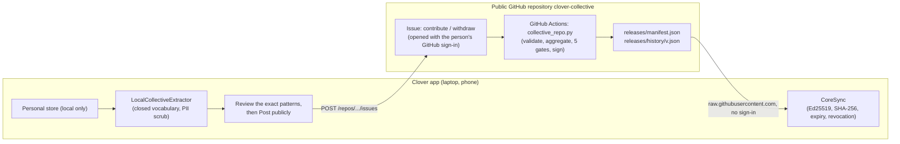

# Clover AI Studio — Collective Learning Architecture

Updated 2026-11-11. Collective learning has no server. The Google sign-in and the k3 gateway are retired.

## 1. Overview

Clover separates learning into two strictly ordered tiers (`Personal > Collective > General`).

1. **Personal process learning (`personal.py`)**
   - On by default, and fully local in `<base>/personal`, with git-backed history.
   - Learns the person's own phrasing habits and presentation preferences.
   - Never leaves the device. When memory sync is set up, it is kept in the person's own private repository.
2. **Collective problem-solving learning (`collective.py`, `collective_gateway.py`, `collective_evaluator.py`,
   `core_registry.py`, `core_sync.py`, `collective_repo.py`)**
   - Shared by every Clover user through the public repository
     [`santhoshsathish94/clover-collective`](https://github.com/santhoshsathish94/clover-collective).
   - Two opt-in switches, both off by default:
     - **Receive** needs no account.
     - **Contribute** needs the GitHub sign-in. Each contribution is a **public GitHub issue under the person's GitHub
       name**, sent only after they review it.

## 2. Data flow

## 3. Components

### 3.1 The app: extract and review (`collective.py`, `core_sync.py`)
- **Scrubbing:** every local experience is scrubbed against the closed general vocabulary (Open English WordNet 2025
  plus `CORE_GENERAL_VOCAB`) before the learner runs.
- **Local check:** `collective_gateway.CollectiveGateway.validate_package` checks every package before anything
  leaves the device.
- **The issue body:** `collective_gateway.request_body` builds it. The device's own installation id is removed.
- **Withdrawing:** this opens a "withdraw" issue. The automation then removes the account's patterns from future
  releases. Issues and git history stay public.

### 3.2 The repository's automation (`collective_repo.py`, GitHub Actions)
- **When it runs:** on every new issue, daily, or by hand. Issues that are not Clover requests are left alone.
- **Identity:** GitHub says who opened an issue, so no other identity check is needed.
  - Contributor id: `github-<numeric account id>`.
  - Bots and accounts younger than 30 days are refused.
- **Package checks:**
  - schema
  - closed vocabulary
  - forbidden personal fields
  - known tools only
  - **only the canonical strategy text for the package's tools**, because a rule's strategy becomes prompt guidance
    in every app
- **Storage:** accepted packages are kept per account in `contributions/github-<id>.json`.
- **The 5 gates (`collective_evaluator.py`):**
  - G1: at least 3 accounts
  - G2: at least 75% agreement
  - G3: held-out generalisation, with at least 2 probes matched, accuracy of at least 0.80, and a positive lift
  - G4: cross-domain transfer
  - G5: zero regressions
- **Seed rules:** `seed/rules.json` holds the 5 rules from the earlier k3 core (1.0.327). Each stays until
  contributions promote a rule for the same trigger.
- **Releases:** a new release is signed only when the promoted rules change. The automation then commits, pushes,
  replies on each issue and closes it.

### 3.3 Signed releases (`core_registry.py`, `core_sync.py`)
- **Signing:** `releases/manifest.json` is signed with Ed25519. The private seed is the repository secret
  `CLOVER_CPSL_PRIVATE_KEY`. It was generated on the owner's PC straight into the secret, and no other copy exists.
- **Downloading:** `Collective.sync_from_repo` downloads the manifest, then that version's bundle
  (`releases/history/v<version>.json`). It stages the files and verifies them before applying anything:
  1. the Ed25519 signature against the pinned public key
     `a4d9d040035a19a5f1214bd30881b40842d4b06d0990c1bfdd6252fd90280283`
  2. revocation (`revoked_versions` / `revoked`)
  3. expiry (`expires_utc`)
  4. the SHA-256 of every rule file, with paths limited to `core/<category>/<name>.json`

## 4. Limits
- **Contributions are public** and show the contributor's GitHub name.
- **New kinds of rules:** G3 can only promote rules its probes cover (today: audit, benchmark, corroborate, forecast,
  reconcile). A new kind of rule needs probes added first.
- **Who controls releases:** whoever controls the repository and its secret controls the releases. Replacing the key
  means shipping the new public key in the apps.
- **Download limits:** unauthenticated downloads from raw.githubusercontent.com are rate limited by GitHub. A sync makes
  at most 2 requests, and a signed-in app may send its token for higher limits.
- **The engine copy:** the repository runs a copy of the engine modules (`engine/SOURCE.md` records the framework
  commit and blob ids). Updating the framework does not update the repository by itself.
