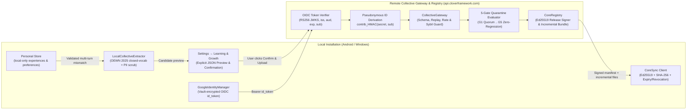

# Clover AI Studio — Google Identity & Collective Learning Architecture

## 1. Overview

Clover AI Studio separates learning into two strictly ordered tiers (`Personal > Collective > General`):

1. **Personal Process Learning (`personal.py`)**:
   - Enabled by default (`personal: true`).
   - Runs 100% locally in `<base>/personal` (with git-backed revision/deletion history).
   - Works offline without Google sign-in or network access.
   - Learns individual phrasing habits (`trigger -> capabilities`) and presentation preferences (`format`, `length`, `sources`, `plan`, `options`, `confirm`) solely from the user's own validated interactions.
   - Never leaves the device.

2. **Collective Problem-Solving Learning (`collective.py`, `collective_gateway.py`, `collective_evaluator.py`, `core_registry.py`, `core_sync.py`)**:
   - Strictly opt-in via two independent switches in **Settings → Learning & Growth**:
     - **Contribute to Collective Learning** (`collective_contribute: false` by default).
     - **Receive Collective Learning** (`collective_receive: false` by default).
   - Both switches require **Google OpenID Connect (OIDC)** authentication (`google_identity.py`) and explicit user consent. Signing in with Google never auto-enables either switch.

---

## 2. End-to-End Data Flow

---

## 3. Component Responsibilities

### 3.1 Google OpenID Connect Identity (`google_identity.py`)
- **No Separate Clover Account**: Clover has no user registration, password database, email verification, or profile store.
- **Android**: Uses `CloverAndroidBridge.startGoogleSignIn` / Credential Manager OIDC flow or Custom Tabs PKCE callback (`http://127.0.0.1:<port>/api/identity/google/callback`).
- **Windows**: Uses system-browser OAuth 2.0 + OIDC flow with **PKCE (`S256`)** and loopback callback (`http://127.0.0.1:<port>/api/identity/google/callback`).
- **Backend Token Verification (`verify_google_id_token`)**:
  - Verifies the JWT RS256 (`EMSA-PKCS1-v1_5` SHA-256) signature against Google's OIDC JWKS (`https://www.googleapis.com/oauth2/v3/certs`).
  - Validates `iss` (`https://accounts.google.com` or `accounts.google.com`), `aud` (configured Google OAuth Client IDs), `exp`, `iat`, `nonce`, and `sub`.
  - Uses Google's stable `sub` claim as the sole identity key (never `email`).
  - Discards `access_token` and `refresh_token` immediately upon token exchange; stores only `{id_token, sub_hash, aud, iss, iat, exp, connected_at}` encrypted in `vault` (Windows DPAPI / Android Keystore AES-256-GCM).

### 3.2 Local Candidate Extraction & Confirmation (`collective.py`)
- Pre-scrubs every local experience against the closed general English vocabulary (`Open English WordNet 2025` + `CORE_GENERAL_VOCAB`) **before** running the intersection learner, preventing the Symbolic Unlearning Ripple Effect.
- Strips all personal preferences, single-turn statements, personal routine words (`usual`, `morning`, `friday`, etc.), URLs, file paths, numbers, emails, and private identifiers.
- Requires the user to review the exact candidate JSON in **Settings → Learning & Growth** and click **Confirm & Upload** (`confirmed=True`) before any candidate package leaves the device.

### 3.3 Remote Gateway & 5-Gate Evaluator (`collective_gateway.py`, `collective_evaluator.py`)
- Validates the `Authorization: Bearer <google_id_token>` header on every request.
- Derives an irreversible pseudonymous contributor ID:
  $$\text{contributor\_id} = \text{contrib\_} \parallel \text{HMAC-SHA256}(\text{gateway\_secret}, \text{"clover-cpsl-contributor-v1:"} \parallel \text{sub})_{0..24}$$
- Enforces replay protection (`nonce` + $\pm 300\text{s}$ timestamp window), per-contributor rate limiting, and forbidden-field rejection (rejects any payload containing `messages`, `history`, `memories`, `experiences`, `email`, `prompt`, etc.).
- Evaluates aggregated candidates across 5 quarantine gates:
  - **G1 (Independent Quorum)**: Requires corroboration across independent contributor IDs (collapsing duplicate/Sybil submissions from the same contributor to 1 vote).
  - **G2 (Cross-User Consistency)**: Requires $\ge 75\%$ cross-contributor target agreement.
  - **G3 (Held-Out Generalisation)**: Requires $\ge 80\%$ accuracy and positive lift over baseline `semantics.asked_caps` on held-out probes.
  - **G4 (Cross-Domain Transfer)**: Verifies context-free rules transfer cleanly across device contexts.
  - **G5 (Zero-Regression & Safety)**: Requires $0$ regressions and $0$ personal hijacks on `DEFAULT_SEMANTICS_REGRESSION_SUITE`.

### 3.4 Signed Release Registry & Incremental Synchronization (`core_registry.py`, `core_sync.py`)
- Signs `releases/manifest.json` with RFC 8032 **Ed25519** using the private seed held exclusively in `/opt/clover-k3/web-studio/vault/cpsl_release_ed25519.key` (mode `0600`).
- Supports incremental synchronization (`GET /api/collective/gateway/releases?since_version=<ver>`), returning `up_to_date: true` when current or transferring only changed rule files and `removed_files`.
- `CoreSync.verify_and_load()` verifies:
  1. Ed25519 signature against the pinned public key (`dba3f7e2e969a26c57a24d50e2ecd654249b42e25eecc1f9140a514d7dcedb8a`).
  2. Release revocation list (`revoked_versions` / `revoked`).
  3. Release expiration timestamp (`expires_utc`).
  4. SHA-256 digest of every rule file in `file_hashes`.
