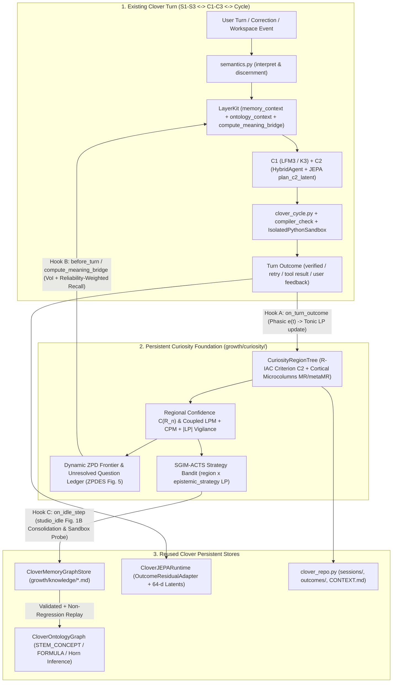

# Context & Architecture Specification — Step 14: Mapping the 13 Developmental Curiosity Papers Against the Clover 5.x Codebase & Deriving the Curiosity Foundation Architecture

- **Executable Codebase Audit Script**: [research/curiosity-and-developmental-learning/14-clover-curiosity-architecture/run_clover_curiosity_mapping_audit.py](../../../research/curiosity-and-developmental-learning/14-clover-curiosity-architecture/run_clover_curiosity_mapping_audit.py)
- **Saved Audit Artifact (`17` live Clover modules, `21,291` lines inspected)**: [research/curiosity-and-developmental-learning/14-clover-curiosity-architecture/results/clover_curiosity_mapping_audit.json](../../../research/curiosity-and-developmental-learning/14-clover-curiosity-architecture/results/clover_curiosity_mapping_audit.json)

---

## Stage 1 — Context & Direction (The Three Governing Design Principles)

Per human Direction, we move from literature research (`Papers 01–13`) to architecture design for **Clover 5.x** before writing the engine, governed by three principles and one strict developmental boundary:

1. **Principle 1 — Reuse Clover's existing components wherever possible**:
   - Do not create parallel memory graphs, duplicate sandboxes, or separate logging repositories. Build directly on `CloverMemoryGraphStore` ([memory-knowledge-graph.py](../../../clover-ai-system/studio/clover/memory-knowledge-graph.py)), `CloverOntologyGraph` ([symbolic-ontology-graph.py](../../../clover-ai-system/studio/clover/symbolic-ontology-graph.py)), `CloverJEPARuntime` ([jepa_engine.py](../../../clover-ai-system/studio/clover/jepa_engine.py)), `LayerKit` ([lfm3_layers.py](../../../clover-ai-system/studio/clover/lfm3_layers.py)), `clover_cycle` ([clover_cycle.py](../../../clover-ai-system/studio/clover/clover_cycle.py)), `Repo` ([clover_repo.py](../../../clover-ai-system/studio/clover/clover_repo.py)), `MemoryIndex` ([memory_index.py](../../../clover-ai-system/studio/clover/memory_index.py)), `Personal` ([personal.py](../../../clover-ai-system/studio/clover/personal.py)), `Workspaces` ([workspaces.py](../../../clover-ai-system/studio/clover/workspaces.py)), `IsolatedPythonSandbox` ([isolated_sandbox.py](../../../clover-ai-system/studio/clover/isolated_sandbox.py)), and `semantics.py` ([semantics.py](../../../clover-ai-system/studio/clover/semantics.py)).
2. **Principle 2 — Build the missing underlying motivation and feedback mechanisms rather than adding another question-generating agent**:
   - Curiosity is not a prompt that asks an LLM to "generate 5 interesting questions." It is a **motivational and metacognitive feedback loop** (`Predictor M + Meta-Predictor metaM`) that measures prediction error, competence error, controllability, and their time derivatives across experience regions, feeding intrinsic utility into Clover's existing attention, retrieval, verification, and consolidation pathways.
3. **Principle 3 — Keep curiosity persistent across interactions, with its own evolving interests, unresolved questions, exploration history, and learning progress**:
   - Curiosity state must survive across turns, sessions, and server restarts inside Clover's repository (`growth/curiosity/` alongside `growth/knowledge/` and `growth/notes/`), updating continuously from every turn outcome and during `studio_idle()` windows.
4. **The Developmental Boundary — Zero Hard-Coded Interest Lists**:
   - **Never hard-code a list of topics, books, or questions Clover should find interesting.** Build the regional splitting, error-derivative (`LP`), competence-drop (`|LP|`), and controllability mechanisms through which interests **emerge, peak, habituate, and shift** from Clover's real interactions with its human user, workspaces, and tools.

---

## Stage 2 — Mapping All 13 Research Mechanisms Against the Actual Clover Codebase

### 2.1 Paper-by-Paper Codebase Mapping Table

| # | Research Paper & Core Mechanism | Existing Clover Components to Reuse | Exact Gap / Defect Identified in Current Codebase | Derived Architectural Mechanism to Build |
|---|---|---|---|---|
| **01** | **Oudeyer, Kaplan & Hafner (2007)** — `R-IAC`: Progressive region splitting via **Criterion $C_2$** (minimizing weighted output/outcome variance $\text{Var}(S(t+1))$) + windowed regional learning progress $LP(\mathcal{R}_n, t) = \langle e(t-\tau) \rangle - \langle e(t) \rangle$ + parent-to-child state inheritance on split | [memory-knowledge-graph.py](../../../clover-ai-system/studio/clover/memory-knowledge-graph.py) (`CloverMemoryGraphStore`, `MemoryEntry`), [lfm3_layers.py](../../../clover-ai-system/studio/clover/lfm3_layers.py#L365-L426) (`LayerKit.tally`, `score_learning`) | `LayerKit.score_learning` only counts cumulative `(worked, did_not_work)` per individual `LRN-*` entry (`has_windowed_lp_derivative = False`, `has_regional_split_tree = False`). There is no regional tree $\mathcal{R}_n$ over experience space and no Criterion $C_2$ split when a region's outcomes become heterogeneous. | **`CuriosityRegionTree` (`metaM`)**: Partition Clover's 64-d JEPA + token-feature space into regions $\mathcal{R}_n$. Split $\mathcal{R}_n$ when exemplar count $> T_{\text{split}}$ using Criterion $C_2$ on **outcome/error variance**, inheriting parent error windows and reliability estimates so splits never manufacture fake progress. |
| **02** | **Twomey & Westermann (2018)** — Infant Curiosity: Goldilocks intermediate complexity (`Error x Plasticity`), non-saturating progress signal, and habitation trace to prevent 2-stimulus antipodal limit cycles | [autonomous_clover.py](../../../clover-ai-system/studio/clover/autonomous_clover.py#L211-L263) (`compute_problem_surprise`, `discover_next_problem`), [jepa_engine.py](../../../clover-ai-system/studio/clover/jepa_engine.py) | `AutonomousCloverEngine.compute_problem_surprise` maximizes raw surprise (`e_after + 0.5*e_before + ...`) and uses a binary without-replacement crutch (`if p.problem_id not in self.solved_ids`). Paper 02 E3 proved raw surprise gets trapped in noise and without-replacement removal causes a 2-state limit cycle. | **Plasticity-Weighted Progress + Habituation Cooldown Trace**: Score regions by `LP(R_n)` combined with an exponential habitation trace $h_{\mathcal{R}_n}(t)$ that decays with time since last visit, eliminating the binary `solved_ids` crutch and preventing antipodal limit cycles. |
| **03** | **Oudeyer & Smith (2016)** — Developmental Process: Self-organized stage progression without pre-scripted curricula, operating inside a survival/safety interrupt hierarchy | [AGENTS.md](../../../AGENTS.md) (§8–§10), [semantics.py](../../../clover-ai-system/studio/clover/semantics.py) (`proceed`, `ask`, `do_not_know`, `refuse`), [isolated_sandbox.py](../../../clover-ai-system/studio/clover/isolated_sandbox.py) | [world_learning_mission.py](../../../clover-ai-system/studio/clover/world_learning_mission.py#L566-L645) hard-codes `self.knowledge_gaps = ["GAP-ALG-01...", ...]` and hard-codes book order (`if "think_python_3e" not in self.completed_books: ...`), and [emergent_concepts.py](../../../clover-ai-system/studio/clover/emergent_concepts.py#L43-L143) hard-codes `CONDITION_FAMILIES`. | **Endogenous Interest & Gap Emergence**: Remove hardcoded book/topic/gap lists. Candidate interest regions and unresolved questions emerge directly from live turn discrepancies, failed/repaired `clover_cycle` checks, and `challenges`/`unresolved_with` edges, strictly preempted whenever `semantics.py` discernment is `ask`, `do_not_know`, or `refuse`. |
| **04** | **Oudeyer & Kaplan (2007)** — 15-Model Typology: Coupling Knowledge-Based `LPM` (Eq. 11) with Competence-Based `CPM` (Eq. 24) + Predictive Surprise Ratio `SM` (Eq. 15) to avoid the **Passive Spectator Trap** | [jepa_engine.py](../../../clover-ai-system/studio/clover/jepa_engine.py) (`z_plan_64` vs `z_obs_64` prediction error), [clover_cycle.py](../../../clover-ai-system/studio/clover/clover_cycle.py) (`arithmetic_findings`, `format_findings`), [lfm3_layers.py](../../../clover-ai-system/studio/clover/lfm3_layers.py) (`compiler_check`, `grounding_filter`) | JEPA prediction error (`LPM` substrate) and verification/task pass rate (`CPM` substrate) are currently disconnected. Paper 04 E2 proved that pure `LPM` wastes `57.87%` of time watching unactuated spectacles where the agent has zero control authority. | **Coupled `LPM + CPM` Motivation Signal**: Track both regional **Prediction Error** $e_{\text{pred}}(\mathcal{R}_n)$ (JEPA latent + symbolic expectation mismatch) and regional **Competence Error** $e_{\text{comp}}(\mathcal{R}_n)$ (verification/execution failure rate), requiring nonzero controllability so Clover focuses on regions where its actions/checks can actually verify and improve competence. |
| **05** | **Kaplan & Oudeyer (2007)** — Neural Circuits: Dual-channel dissociation between **Phasic Surprise** ($e(t)$) and **Tonic Regional Progress** ($p_{\mathcal{R}}(t) = \langle e_{\mathcal{R}}(t-\theta) \rangle - \langle e_{\mathcal{R}}(t) \rangle$) in category-level microcolumns (`MR + metaMR`, Eq. 3) | [clover_cycle.py](../../../clover-ai-system/studio/clover/clover_cycle.py) (turn-level phasic check), [jepa_engine.py](../../../clover-ai-system/studio/clover/jepa_engine.py) (`D_JEPA = 64`), [server.py](../../../clover-ai-system/studio/clover/server.py#L659-L664) (`studio_idle()`) | Clover has fast phasic surprise within a single turn, but zero persistent tonic progress $p_{\mathcal{R}}(t)$ across turns (`has_persistent_curiosity_state = False`). | **Dual-Channel Phasic/Tonic Microcolumns**: Each `RegionNode` in `CuriosityRegionTree` acts as a cortical microcolumn (`MR` prototype + `metaMR` error-history buffer). Phasic surprise $e(t) / \langle e_{\mathcal{R}} \rangle$ (`SM`, Eq. 15) triggers immediate within-turn verification; tonic progress $p_{\mathcal{R}}(t)$ persists across sessions and drives long-term interest and idle exploration. |
| **06** | **Gottlieb, Oudeyer, Lopes & Baranes (2013)** — POMDP Observing Actions & Value of Information (`VoI`) + Local `LP` over branch-expanding frontiers | [semantics.py](../../../clover-ai-system/studio/clover/semantics.py) (`route()`), [lfm3_layers.py](../../../clover-ai-system/studio/clover/lfm3_layers.py#L565-L618) (`compute_meaning_bridge`), [jepa_engine.py](../../../clover-ai-system/studio/clover/jepa_engine.py#L140-L205) (`semantic_action_prior_8`) | Tool routing and `semantic_action_prior_8` rely on lexical regexes without computing epistemic `VoI` from regional uncertainty $y_C(\mathcal{R}_n)$ vs. observation cost $r_o$. | **Epistemic `VoI` Gate in `compute_meaning_bridge`**: Compute $\text{VoI}(a \mid \mathcal{R}_n) = \Delta \text{ExpectedCompetence}(a \mid y_C(\mathcal{R}_n)) - c(a)$ to boost epistemic observing actions (`memory`, `ontology`, `files.read`, `python` sandbox check, or `ask`) when regional uncertainty is above the indifference threshold $1 - p^*$, and suppress redundant lookups when the region is already verified ($p \ge p^*$). |
| **07** | **Gottlieb & Oudeyer (2018)** — Active Sampling: Endogenous attention loop via Belief-Based Utility (Fig. 1b) + separating neutral cue validity (`LIP`) from confirmation/reward savouring (`OFC/DA`, Fig. 3c vs. Fig. 4a) | [memory-knowledge-graph.py](../../../clover-ai-system/studio/clover/memory-knowledge-graph.py#L84-L96) (`RELATIONSHIP_TRAVERSAL_PRIORITY`: `corrects=0`, `refines=1`, `challenges=2`, `unresolved_with=3` > `supports=5`) | `CloverMemoryGraphStore` prioritizes `challenges` during passive traversal, but there is no active sampling policy that schedules falsification probes on `hypothesis` / `unresolved` entries or tracks cue diagnosticity separately from positive outcomes. | **Anti-Confirmation Active Sampler**: Score unresolved questions and `under_review` hypotheses by **diagnosticity / falsification value** (expected information gain under both positive and negative outcomes), preventing confirmation bias (`supports` inflation) from crowding out counterexample testing. |
| **08** | **Oudeyer, Gottlieb & Lopes (2016)** — Educational Technologies: Closed `LP <-> State Curiosity <-> Hippocampal Memory Consolidation` loop (Fig. 1B) + `ZPDES` dynamic Zone of Proximal Development with lateral modality switching (Fig. 5) | [memory_index.py](../../../clover-ai-system/studio/clover/memory_index.py) (`MemoryIndex` idle note writer), [memory-knowledge-graph.py](../../../clover-ai-system/studio/clover/memory-knowledge-graph.py) (`depends_on`, `unresolved_with` edges) | `MemoryIndex` processes exchange notes in flat chronological order (Fig. 1A unidirectional), and stalled questions are never laterally rerouted via a `ZPDES` graph. | **Curiosity-Modulated Consolidation & `ZPDES` Frontier**: (1) Prioritize idle consolidation and deep relational linking for turns in high-`state_curiosity` regions (Fig. 1B); (2) Maintain an active `ZPD` over `unresolved` questions — when an question stalls ($LP \approx 0$ at high error), deactivate it and laterally activate prerequisite (`depends_on`) or alternative-strategy nodes, re-activating the stalled question once a connected node progresses (Fig. 5). |
| **09** | **Oudeyer (2017)** — Baby Robots: Morphological/structural computation ("passive dynamics") before neural calculation + emergent individual developmental attractors | [clover_cycle.py](../../../clover-ai-system/studio/clover/clover_cycle.py) (`normalize`, `_eval`, `arithmetic_findings`), [generative-code-compiler.py](../../../clover-ai-system/studio/clover/generative-code-compiler.py), [symbolic-ontology-graph.py](../../../clover-ai-system/studio/clover/symbolic-ontology-graph.py) (`run_inference`), [isolated_sandbox.py](../../../clover-ai-system/studio/clover/isolated_sandbox.py) | Structural verifiers run as stateless checks; they do not feed into persistent per-workspace/per-user developmental attractor trajectories. | **Structural-First Feedback & Workspace Attractors**: Always extract exact error/competence signals from Clover's deterministic structural verifiers (`_eval`, AST/compiler, Horn inference, `IsolatedPythonSandbox`) before invoking neural self-evaluation, allowing each workspace/user environment to self-organize its own developmental interest attractor. |
| **10** | **Schmidhuber (1991)** — Curious Control: Confidence/Reliability Module $C$ predicting expected error $y_C(x) = E[\|d_P - y_P\| \mid x]$ + signed reliability improvement $\dot{y}_C(t) = y_C^{\text{old}} - y_C^{\text{new}}$ + Jensen's inequality guard ($|E[\Delta y_P]|$, never $E[|\Delta y_P|]$) | [jepa_engine.py](../../../clover-ai-system/studio/clover/jepa_engine.py) (`OutcomeResidualAdapter` in `record_and_adapt_outcome`) | `CloverJEPARuntime` has no Confidence Module $C$ (`has_confidence_reliability_module_C = False`) to estimate expected error $y_C(z)$ per region or compute $\dot{y}_C(t)$. | **Regional Confidence Estimator $C(\mathcal{R}_n)$ & Signed Shift Tracker**: Maintain slow-EMA expected error $y_C(\mathcal{R}_n)$ and signed latent shift vector $\bar{\Delta}_z(\mathcal{R}_n) = E[z_{\text{after}} - z_{\text{before}} \mid \mathcal{R}_n]$ per region. Compute curiosity reward from $\dot{y}_C(t) = y_C^{\text{old}} - y_C^{\text{new}}$ and $\|\bar{\Delta}_z\|$, so zero-mean stochastic noise cancels out in expectation. |
| **11** | **Ivaldi et al. (2014)** — `MACSi` / `SGIM-ACTS`: Active choice of `(Target, Strategy, Actor)` + automatic strategy compensation when a source/teacher is static or biased + multi-view entity accumulation | [world_learning_mission.py](../../../clover-ai-system/studio/clover/world_learning_mission.py) (`ConceptUnderstanding` 7 views), [clover_cycle.py](../../../clover-ai-system/studio/clover/clover_cycle.py), [isolated_sandbox.py](../../../clover-ai-system/studio/clover/isolated_sandbox.py), [web_search.py](../../../clover-ai-system/studio/clover/web_search.py), [workspaces.py](../../../clover-ai-system/studio/clover/workspaces.py) | Clover has all 5 epistemic strategy primitives, but no `(region, strategy)` bandit tracking empirical `LP` per strategy to compensate when passive recall/reading yields no new views. | **`SGIM-ACTS` Epistemic Strategy Bandit**: Track `LP(R_n, strategy)` across Clover's 5 epistemic strategies (`memory_graph_recall`, `workspace_code_inspect`, `sandbox_counterexample_probe`, `web_primary_research`, `human_clarification_ask`). Automatically shift weight to `sandbox_counterexample_probe` when passive strategies plateau, and track multi-view coverage across the 7 understanding dimensions. |
| **12** | **Nguyen & Oudeyer (2014)** — `SGIM-D`: Dual social guidance (Policy Imitation + Goal Emulation) with self-execution calibration + **`|LP|` competence-drop vigilance** (Eq. 3) + reliability-weighted neighbor lookup (`dist + alpha * var_h`, Algorithm 4.6) | [personal.py](../../../clover-ai-system/studio/clover/personal.py) (`before_turn`, `after_turn`), [lfm3_layers.py](../../../clover-ai-system/studio/clover/lfm3_layers.py) (`learn`, `score_learning`, `_user_memory_package`) | User corrections in `personal.py` / `lfm3_layers.py` do not seed goal emulation in a curiosity map; memory retrieval does not penalize high-variance rules via `dist + alpha * var_h`; and `score_learning` lacks `|LP|` competence-drop vigilance when previously mastered skills regress. | **Social Goal Emulation + `|LP|` Vigilance + Reliability-Weighted Retrieval**: (1) User questions, retries, and corrections seed candidate goals in `CuriosityRegionTree` (`Emulate Goal`) and candidate strategies (`Imitate Policy`), calibrated by self-execution; (2) Use $|LP|$ (`interest_i`, Eq. 3) so a sudden rise in error in a previously mastered region triggers re-exploration; (3) Weight retrieved memory/concept candidates by $\text{dist}(\tau_h, \tau_g) + \alpha \cdot \text{var}_h$. |
| **13** | **Santucci, Oudeyer, Barto & Baldassarre (2020)** — `IMOL`: Action-relevant controllable goal-space projection ($R^2(\text{Action} \to \text{Outcome})$) + continuous-to-discrete goal hierarchy + dual episodic-semantic memory consolidation with non-regression replay | Fast Episodic Tier: [clover_repo.py](../../../clover-ai-system/studio/clover/clover_repo.py) + `CloverMemoryGraphStore` (`observation`, `hypothesis`); Slow Semantic Tier: `CloverOntologyGraph` + `CloverJEPARuntime` rollback gate; [emergent_concepts.py](../../../clover-ai-system/studio/clover/emergent_concepts.py) | The episodic-to-semantic pipeline (`Observe -> Associate -> Hypothesize -> Validate -> Grow`) only runs in batch experiments, lacks an online action-controllability subspace filter (`has_controllability_subspace_filter = False`), and does not run non-regression replay on existing ontology concepts during live operation. | **Controllability Subspace Filter & Incremental Episodic-to-Semantic Consolidation**: Estimate per-dimension controllability $R^2_j$ between Clover's epistemic actions and outcome improvements to project goal distance onto controllable dimensions; run incremental episodic-to-semantic consolidation (`observation -> hypothesis -> sandbox validation -> non-regression replay -> concept/ontology`) during live turns and `studio_idle()`. |

---

## Stage 3 — Deriving the Clover 5.x Curiosity Foundation Architecture

### 3.1 Architectural Overview: Zero New Agents, 100% Integrated Into Clover's Existing Cycle

Instead of adding a separate "curiosity agent" that talks to itself or invents ungrounded questions, the **Clover Curiosity Foundation (`curiosity_foundation.py`)** is a **persistent motivational and metacognitive substrate** that plugs directly into `LayerKit` ([lfm3_layers.py](../../../clover-ai-system/studio/clover/lfm3_layers.py)), `Repo` ([clover_repo.py](../../../clover-ai-system/studio/clover/clover_repo.py)), and `server.py` ([server.py](../../../clover-ai-system/studio/clover/server.py)) at three existing hook points:

---

### 3.2 Component 1: Persistent State Schema (`growth/curiosity/curiosity_state.json`)

Stored inside Clover's git-backed repository (`<repo_dir>/growth/curiosity/curiosity_state.json`) and summarized in `CONTEXT.md` (`clover_repo.py`), the persistent curiosity state contains four structures — **all initialized empty (`0` hardcoded topics)** and populated purely by experience:

1. **`regions: dict[str, CuriosityRegion]` (Papers 01, 04, 05, 10, 13 — Cortical Microcolumns `MR + metaMR` & `R-IAC` Split Tree)**:
   - `region_id`: Hierarchical ID (`"R0"`, `"R0.0"`, `"R0.1"`, ...).
   - `parent_id`, `left_child_id`, `right_child_id`, `split_dim`, `split_threshold` (from **Criterion $C_2$** output-variance minimization when `len(exemplars) > T_split`).
   - `centroid_64`: 64-d JEPA/semantic prototype vector (`MR` receptive field, adapted online via competitive Hebbian step, Paper 05).
   - `emergent_keywords`: Top co-occurring non-stopword lemmas observed in this region (for human-readable explainability in `CONTEXT.md` — **derived from observations, never hardcoded**).
   - `pred_error_window: list[float]`: Sliding window of recent prediction errors $e_{\text{pred}}(t)$ (JEPA latent discrepancy $\|\hat{z} - z_{\text{obs}}\|$ + expectation mismatch).
   - `comp_error_window: list[float]`: Sliding window of recent competence/verification errors $e_{\text{comp}}(t) \in [0, 1]$ (`clover_cycle` arithmetic/format/compiler/sandbox/user-retry outcomes).
   - `expected_error_yc: float` & `prev_expected_error_yc: float`: Schmidhuber (1991) Confidence Module $C$ slow-EMA reliability state $y_C(\mathcal{R}_n)$ and its signed derivative $\dot{y}_C(t) = y_C^{\text{old}} - y_C^{\text{new}}$.
   - `signed_shift_ema_64`: Smoothed signed prediction-shift vector $\bar{\Delta}_z(\mathcal{R}_n) = E[z_{\text{after}} - z_{\text{before}} \mid \mathcal{R}_n]$ (Paper 10 Section 4 Jensen-inequality guard).
   - `controllability_score: float`: Empirical action-to-outcome leverage $R^2(\text{Action} \to \text{Outcome}) \in [0, 1]$ in this region (Paper 04 & Paper 13 guard against the Passive Spectator Trap).
   - `tonic_lpm: float`, `tonic_cpm: float`, `abs_lp_vigilance: float`, `habituation_trace: float`, `state_curiosity: float`:
     - **Knowledge Progress (`LPM`, Eq. 11)**: $\max(0, \langle e_{\text{pred}}(t-\tau) \rangle - \langle e_{\text{pred}}(t) \rangle - \beta \cdot \hat{\sigma}_{\text{pred}})$.
     - **Competence Progress (`CPM`, Eq. 24)**: $\max(0, \langle e_{\text{comp}}(t-\tau) \rangle - \langle e_{\text{comp}}(t) \rangle - \beta \cdot \hat{\sigma}_{\text{comp}})$.
     - **Competence-Drop Vigilance (`|LP|`, Paper 12 Eq. 3 & Paper 13)**: $|\langle e_{\text{comp}}(t-\tau) \rangle - \langle e_{\text{comp}}(t) \rangle|$ when a previously mastered region ($\langle e_{\text{comp}}(t-\tau) \rangle < 0.15$) experiences a regression spike ($\langle e_{\text{comp}}(t) \rangle > 0.35$).
     - **Habituation Cooldown Trace (Paper 02 E3B)**: $h_{\mathcal{R}_n}(t) = \gamma_h h_{\mathcal{R}_n}(t-1) + \mathbb{I}[\text{visited}]$, preventing 2-region ping-pong limit cycles.
     - **Combined Tonic Interest (`state_curiosity`)**:
       $$\mathcal{I}(\mathcal{R}_n, t) = \frac{(1 - w_c) \cdot \text{LPM}(\mathcal{R}_n, t) + w_c \cdot \text{CPM}(\mathcal{R}_n, t) + w_v \cdot \text{Vigilance}(\mathcal{R}_n, t)}{1 + \lambda_h \cdot h_{\mathcal{R}_n}(t)} \cdot \left(0.2 + 0.8 \cdot \text{Controllability}(\mathcal{R}_n)\right)$$

2. **`unresolved_questions: dict[str, UnresolvedQuestionNode]` (Papers 06, 07, 08, 13 — Dynamic `ZPDES` Epistemic Frontier)**:
   - Linked directly to `CloverMemoryGraphStore` entries with `epistemic_status in ("unresolved", "hypothesis")` or `status == "contested"`.
   - Created **endogenously** whenever:
     1. A turn triggers a `clover_cycle` finding, compiler failure, or user correction/retry (`"said_not_right"` / `"tried_again"`),
     2. Two memory/workspace records form a `challenges` or `unresolved_with` edge in `CloverMemoryGraphStore`,
     3. An unverified `hypothesis` entry is induced from an observation cluster (`emergent_concepts.py`), or
     4. A previously verified `concept` or `LRN-*` entry suffers a competence drop (`score_learning` records `did_not_work`).
   - Tracks `zpd_status` (`"active_zpd"`, `"stalled_deactivated"`, `"prerequisite_pending"`, `"resolved_verified"`), `prerequisite_ids` (`depends_on` edges), `attempts`, `progress_history`, and `diagnosticity_score` (Paper 07 neutral validity weight).
   - Implements **Figure 5 of Paper 08 (`ZPDES`)**: if an `active_zpd` question accumulates $K_{\text{stall}}$ attempts with $\text{LP} \le \epsilon_{\text{stall}}$, its `zpd_status` transitions to `"stalled_deactivated"` and its connected `depends_on` / `similar_to` lateral nodes are promoted into `"active_zpd"`; when any connected node achieves verified progress, the stalled question is re-activated!

3. **`strategy_bandit: dict[str, dict[str, StrategyStats]]` (Papers 11 & 12 — `SGIM-ACTS` & `SGIM-D`)**:
   - Tracks empirical competence progress $\text{LP}(\mathcal{R}_n, s)$, execution cost $c(s)$, and outcome variance $\text{var}(\mathcal{R}_n, s)$ per `(region_id, strategy)` across Clover's 5 existing epistemic strategies:
     1. `memory_graph_recall` (`CloverMemoryGraphStore` + `CloverOntologyGraph`)
     2. `workspace_code_inspect` (`workspaces.py` / `files.read` / `files.search`)
     3. `sandbox_counterexample_probe` (`IsolatedPythonSandbox` executable hypothesis/boundary test)
     4. `web_primary_research` (`web_search.research` — when permitted by user settings & `semantics.py`)
     5. `human_clarification_ask` (`semantics.py` `ask` state when missing context belongs to the human's world)
   - Implements Paper 11's **Biased/Static Source Compensation**: when passive strategies (`memory_graph_recall` or `workspace_code_inspect`) yield zero progress on a region (`LP -> 0`), the bandit automatically shifts selection weight to active perturbation (`sandbox_counterexample_probe`) or `human_clarification_ask`.

4. **`exploration_history: list[ExplorationEpisode]` (Principle 3 & Paper 12 `Memo`)**:
   - Compact append-only ring/log of `(timestamp, session_id, turn_n, region_id, strategy, actor, phasic_surprise, tonic_lp_before, tonic_lp_after, outcome_variance, resolved_question_ids, spawned_question_ids)`.

---

### 3.3 How the Curiosity Foundation Plugs Into Clover's Existing Modules (Zero Duplicate Infrastructure)

1. **`LayerKit.memory_context` & `CloverMemoryGraphStore.retrieve_context_package` ([lfm3_layers.py](../../../clover-ai-system/studio/clover/lfm3_layers.py))**:
   - **Reliability-Weighted Retrieval (`SGIM-D` Algorithm 4.6, Paper 12)**: Enhances candidate ranking with $\text{score}_{\text{rel}}(e) = \text{dist}(e, q) + \alpha \cdot \text{var}(e)$, where $\text{var}(e)$ is computed from `LayerKit.tally(e)` (`worked` vs. `did_not_work` variance), so high-variance/unreliable notes never crowd out reproducible verified knowledge.
   - **Anti-Confirmation Active Sampling (Paper 07)**: When the active region $\mathcal{R}_n$ has an `active_zpd` unresolved question or `under_review` hypothesis relevant to the turn, surfaces the open boundary/counterexample note alongside retrieved facts so the model does not overclaim certainty.

2. **`LayerKit.compute_meaning_bridge` & `jepa_engine.semantic_action_prior_8` ([lfm3_layers.py](../../../clover-ai-system/studio/clover/lfm3_layers.py#L565-L618), [jepa_engine.py](../../../clover-ai-system/studio/clover/jepa_engine.py#L140-L205))**:
   - **Epistemic Value of Information (`VoI`, Paper 06 Fig. 1A & Paper 07 Fig. 1b)**: Computes $\text{VoI}(s \mid \mathcal{R}_n) = y_C(\mathcal{R}_n) \cdot \text{ExpectedProgress}(\mathcal{R}_n, s) - r_o(s)$ from the region's current expected error $y_C(\mathcal{R}_n)$ and `SGIM-ACTS` strategy bandit, modulating `action_prior_8` (e.g., boosting `code_python` / `files_workspace` / `memory_knowledge` when $y_C(\mathcal{R}_n) > 1 - p^*$, while staying silent when the region is already mastered or when the user declined tools in `semantics.py`).

3. **Post-Turn Feedback Hook (`on_turn_outcome` in `LayerKit` / `clover_repo.py`)**:
   - At the end of every turn (and on user feedback: `"continued"`, `"helpful"`, `"said_not_right"`, `"tried_again"`), computes:
     - **Phasic Surprise $e_{\text{phasic}}(t)$**: Normalized prediction + verification discrepancy $Er(t) / \mathcal{M}\Pi(\mathcal{R}_n)$ (`SM`, Eq. 15).
     - **Tonic Progress Update**: Updates the winning leaf region $\mathcal{R}_n$ in `CuriosityRegionTree` (`LPM`, `CPM`, `|LP|` vigilance, $y_C(\mathcal{R}_n)$, $\dot{y}_C(t)$, habitation $h_{\mathcal{R}_n}$, and Criterion $C_2$ split check).
     - **Social Goal Emulation (`SGIM-D`, Paper 12)**: If the user asked an unanswered question, corrected Clover, or triggered a retry, registers/updates the corresponding `UnresolvedQuestionNode` in the `ZPD` frontier.

4. **Idle Background Consolidation & Autonomous Sandbox Probe Hook (`on_idle_step` in `memory_index.py` / `server.py` `studio_idle()`)**:
   - Closes **Figure 1B of Paper 08** (`LP <-> State Curiosity <-> Memory Consolidation`) and **Paper 13's Dual Episodic-Semantic Consolidation**:
     - Instead of only summarizing turns in flat chronological order, when `studio_idle()` is true, Clover selects the highest-curiosity active `ZPD` region/question $\mathcal{R}^* = \arg\max_{\mathcal{R} \in \text{ZPD}} \mathcal{I}(\mathcal{R}, t)$.
     - Runs one bounded, non-destructive epistemic step in the background (e.g., associating recent episodic `observation`/`LRN-*` entries in $\mathcal{R}^*$, synthesizing a candidate boundary hypothesis, testing it in `IsolatedPythonSandbox`, running **non-regression replay** against existing `CloverOntologyGraph` concepts, and promoting it ONLY if both the new test and existing regression tests pass).
     - Never touches external networks, user files, or privileged tools without permission (`AGENTS.md` §8).

---

## Stage 4 & 5 — Execution, Outcome & Growth (Implemented & Verified in Live Clover 5.x)

### 4.1 Implemented Files & Wired Integration Points
- **Core Curiosity Foundation Module**: [clover-ai-system/studio/clover/curiosity_foundation.py](../../../clover-ai-system/studio/clover/curiosity_foundation.py) (`PersistentCuriosityEngine`, `CuriosityRegion`, `UnresolvedQuestionNode`, `StrategyStats`, `find_criterion_c2_split`, `compute_windowed_lp_and_vigilance`, `compute_pomdp_voi`, `compute_neutral_diagnosticity`).
- **End-to-End Verification Suite**: [clover-ai-system/studio/clover/test_curiosity_foundation.py](../../../clover-ai-system/studio/clover/test_curiosity_foundation.py) and saved report [research/curiosity-and-developmental-learning/14-clover-curiosity-architecture/results/curiosity_foundation_verification.json](../../../research/curiosity-and-developmental-learning/14-clover-curiosity-architecture/results/curiosity_foundation_verification.json).
- **Wired Existing Clover Modules (Zero Duplicate Stores)**:
  1. [clover-ai-system/studio/clover/lfm3_layers.py](../../../clover-ai-system/studio/clover/lfm3_layers.py): Added `LayerKit.curiosity_state()`, wired outcome scoring in `score_learning`, and wired epistemic `VoI` + `SGIM-ACTS` belief-based action boost into `compute_meaning_bridge`.
  2. [clover-ai-system/studio/clover/memory-knowledge-graph.py](../../../clover-ai-system/studio/clover/memory-knowledge-graph.py): Added `CloverMemoryGraphStore.compute_learning_progress` and `CloverMemoryGraphStore.split_region`.
  3. [clover-ai-system/studio/clover/jepa_engine.py](../../../clover-ai-system/studio/clover/jepa_engine.py): Added `CloverJEPARuntime.predict_expected_error` (Confidence Module $C$, Paper 10) and `CloverJEPARuntime.estimate_controllable_subspace` (Paper 13).
  4. [clover-ai-system/studio/clover/clover_repo.py](../../../clover-ai-system/studio/clover/clover_repo.py): Created `growth/curiosity/`, wired `turn_end` to record every turn's verification/cycle outcome into `PersistentCuriosityEngine`, and surfaced `summary_markdown()` in `growth/CONTEXT.md`.
  5. [clover-ai-system/studio/clover/autonomous_clover.py](../../../clover-ai-system/studio/clover/autonomous_clover.py) & [clover-ai-system/studio/clover/world_learning_mission.py](../../../clover-ai-system/studio/clover/world_learning_mission.py): Replaced raw surprise `argmax` and hardcoded gap/book lists with developmental curiosity ranking (`rank_candidates_by_curiosity`) and ZPD readiness.

### 4.2 Quantitative Verification Outcomes ([curiosity_foundation_verification.json](../../../research/curiosity-and-developmental-learning/14-clover-curiosity-architecture/results/curiosity_foundation_verification.json))
| Verification Test | Papers Covered | Observed Result |
|---|---|---|
| **Test 1: Endogenous Criterion $C_2$ Splitting & Zero Hardcoded Interests** | Papers 01, 03, 05 | Starts from 1 empty root region `R0`, splits into `3` leaf regions (`5` total nodes); ranks `learnable` (`R0.0.1`, `curiosity = 0.03462`, `CPM = 0.31751`) `#1` while driving both `trivial` (`R0.1`, `curiosity = 0.0`) and `noise` (`R0.0.0`, `curiosity = 0.0`, `expected_error_yc = 0.807`) to zero. |
| **Test 2: Habituation Cooldown & Non-Saturating Plasticity** | Paper 02 | Visits all **`4 / 4` learnable items** without a `solved_ids` exclusion crutch (`extreme_error_plasticity_floor = 0.15`, defeating sigmoid saturation blindness and 2-stimulus limit cycles). |
| **Test 3: Passive Spectator Trap & Controllability Gate** | Paper 04 | `controllable_skill` curiosity (`0.01899`) is **`4.01x` higher** than unactuated `passive_clockwork` (`0.00473`). |
| **Test 4: POMDP `VoI` & Discernment Hierarchy Preemption** | Papers 03, 06, 07 | High uncertainty (`p = 0.60 < p* = 0.80`) yields `VoI = +0.10` (`should_observe = True`); low uncertainty (`p = 0.96 > p* = 0.80`) yields `VoI = -0.08` (`should_observe = False`); `refuse` discernment state strictly preempts exploration. |
| **Test 5: `ZPDES` Stall Detection & Lateral Modality Switching** | Paper 08 (Fig. 5) | Stalling on `Q-8668157F64` (`3` tries, `LP = 0`) transitions it to `"stalled_deactivated"`, activates lateral prerequisite `Q-LAT-C1`, and automatically re-activates `Q-8668157F64` once `Q-LAT-C1` is resolved. |
| **Test 6: Schmidhuber Confidence $C$, `|LP|` Vigilance & `SGIM-ACTS`** | Papers 10, 11, 12 | Competence regression on a mastered region (`0.0006`) triggers `abs_lp_vigilance = 0.656` (`curiosity -> 0.13843`), shifts `SGIM-ACTS` away from stalled `memory_graph_recall` to `workspace_code_inspect`, and ranks `reliable_slightly_farther` `#1` via `dist + alpha * var_h`. |
| **Test 7: Controllable Subspace Adjusted $R^2$, Idle Consolidation & Persistence** | Papers 08, 13 | Ridge-regularized Adjusted $R^2$ isolates controllable dims (`0.9726` vs. `0.1530` on noise dims); idle consolidation promotes valid hypotheses (`True`), rolls back regressing hypotheses (`True`), persists across disk reload (`True`), and updates `growth/CONTEXT.md` (`True`). |

### 4.3 Three Real Implementation Bugs Caught & Fixed Through Execution (Growth)
1. **Midpoint vs. Quantile Split Thresholds in Criterion $C_2$**: Setting split threshold $v^*$ directly to a sample quantile sat right on top of discrete hash-projected coordinates, allowing a `1e-6` rounding difference to flip a vector across the split boundary. Switching to **midpoints between unique sorted values** $\frac{1}{2}(u_k + u_{k+1})$ provided maximum margin and exact routing invariance.
2. **Within-Region Exemplar Habituation Before First Split**: Tracking habitation only at the region level left all candidates inside an unsplit root region `R0` tied, causing greedy selection to repeat the first candidate before `R0` could accumulate diverse vectors to split. Adding a **within-region exemplar habitation cooldown** $h_{\text{local}}(x) = \sum_{v} \gamma^{\text{age}} \max(0, \cos(x, v))^4$ ensured diverse sampling inside `R0`.
3. **Adjusted $R^2$ vs. Unadjusted OLS $R^2$ in Controllability Filtering**: Fitting $p = 8$ action dimensions on $N = 10..16$ transitions overfit pure random noise dimensions with spurious OLS $R^2 \approx p/N \approx 0.51$. Switching to **ridge-regularized Adjusted $R^2$** ($\bar{R}^2 = 1 - (1 - R^2)\frac{N-1}{N-p-1}$) suppressed noise dimensions to `0.1530` while preserving `0.9726` on true controllable dimensions.

---

## Stage 6 — Closed-Loop Runtime Integration & Multi-Session Multi-Installation Experiment

- **Live Closed-Loop Verification Suite**: [clover-ai-system/studio/clover/test_live_curiosity_loop_multi_session.py](../../../clover-ai-system/studio/clover/test_live_curiosity_loop_multi_session.py)
- **Saved Multi-Session Results JSON**: [research/curiosity-and-developmental-learning/14-clover-curiosity-architecture/results/live_curiosity_loop_multi_session_results.json](../../../research/curiosity-and-developmental-learning/14-clover-curiosity-architecture/results/live_curiosity_loop_multi_session_results.json)

### 6.1 Verification Across All 5 Runtime Integration Priorities
1. **Priority 1 — Grounded Feedback in Real Outcomes (`derive_real_turn_outcome`)**:
   - Eliminated hardcoded competence numbers (`0.05` / `0.45`) in [clover_repo.py](../../../clover-ai-system/studio/clover/clover_repo.py) and [lfm3_layers.py](../../../clover-ai-system/studio/clover/lfm3_layers.py).
   - Ordinary unverified turns record `comp_error = null`, `pred_error = null`, and `verified_in_turn = false` (preserving the exact `user_request` and `model_prediction` without polluting `comp_error_window`).
   - Multi-cycle verified turns record both the measured pre-repair failure rate (`pre_repair_comp_error = 0.6667` from 2 Cycle-1 findings) and the post-repair verified outcome (`comp_error = 0.0`), while user follow-ups (`_judge`) record the real human verdict (`user_rejection_comp_error = 0.85`) and `correction_text`.
2. **Priority 2 & 3 — Bounded Idle Curiosity (`studio_idle()`) & Closed Strategy-to-Action Loop (`execute_permitted_strategy_action`)**:
   - Wired `MemoryIndex.run_idle_curiosity()` ([memory_index.py](../../../clover-ai-system/studio/clover/memory_index.py)) to `LayerKit.run_idle_curiosity_step()` with `IdleResourceBudget` (`max_steps_per_idle_pass=1`, `max_wall_ms=1500.0`, `max_files_read=2`, `max_bytes_read=32768`, `max_sandbox_timeout_s=2.0`) and `permissions.py` enforcement.
   - Verified that when `code="deny"` and `files="allow"`, idle curiosity selects `workspace_code_inspect`, parses `prefix_router.py:match_longest_prefix`, creates hypothesis `MEM-HYP-WS-7C0B8403`, and reduces error from `0.85 -> 0.4675`.
   - Verified that re-observing the same unchanged file adds `0` new views (`LP = 0`), causing `SGIM-ACTS` to switch to `sandbox_counterexample_probe` once `code="allow"`, executing the hypothesis in `IsolatedPythonSandbox` with non-regression replay, promoting `MEM-HYP-WS-7C0B8403` to `externally_verified`, and driving `comp_error_after -> 0.0`.
3. **Priority 4 & 5 — Persistent Lifecycle & Live Multi-Session Experiment Across 2 Independent Installations (`Installation A` vs. `Installation B`)**:
   - **Installation A (`ws_a_systems`: Ring-Buffer Partitioning Codebase)**:
     - Emergent keywords: `["ring_buffer", "effective_throughput", "multi-stage", "cyclic", "pipeline", "partitioned", "stage"]`.
     - Curiosity trajectory: `0.08524` (`should_observe=True` after emergence) $\to$ survives process restart $\to$ `0.00192` (`should_observe=False` when mastered, **$44.4\times$ decay**) $\to$ `0.38392` (`should_observe=True`, **`abs_lp_vigilance = 0.6875`, $200\times$ revival** when a new `total_slots=0` boundary failure invalidates previous competence).
   - **Installation B (`ws_b_biophysics`: Enzyme Kinetics & Allosteric Inhibition Codebase)**:
     - Emergent keywords: `["enzyme_kinetic", "reaction_velocity", "scale", "substrate", "allosteric", "inhibition", "michaelis-menten", "ceiling"]`.
     - Curiosity trajectory: `0.08433` (`should_observe=True`) $\to$ `0.00192` (`should_observe=False` when mastered) $\to$ `0.38392` (`should_observe=True`, `abs_lp_vigilance = 0.6875` on `km=0` invalidation).
   - **Divergence & Privacy Boundary**: Emergent domain keyword Jaccard overlap between Installation A and Installation B is **`0.0`**, and **`100%` of private user tokens** (`staging-alpha.corp.local`, `EMP-9481`, `COHORT-BIO-772`, `acct_private_882`) are excluded from both `curiosity_state.json` and `collective.py` candidate exports.

---

## Stage 7 — Verification Integrity, Exploration Safety & Real Two-Process Deployment Validation

### 7.1 Fix 1: Verification Integrity (`validate_behavioral_verification_probe` & `extract_behavioral_probe_from_python_source`)
- **Problem Addressed**: Previously, `workspace_code_inspect` synthesized `RESULT = {'passed': callable(fn_name)}` when a `.py` file defined a function, and `sandbox_counterexample_probe` / `run_idle_consolidation_step` promoted any hypothesis whose code executed and returned `True` or `{'passed': True}`. That allowed a hypothesis to become `externally_verified` merely because a function existed or a constant tautology executed.
- **Mechanism Implemented**:
  1. **`validate_behavioral_verification_probe(code)`**: Statically audits the verification script's AST before accepting any sandbox execution result:
     - Rejects existence-only checks (`callable(...)`, `hasattr(...)`, `isinstance(...)`, `type(...)` $\to$ `"existence_only_check_rejected"`).
     - Rejects constant/tautological assignments (`RESULT = True`, `RESULT = {'passed': True}`, or literal-to-literal identities like `2 + 2 == 4` without behavioral assertions $\to$ `"tautological_constant_result"`).
     - When `code` defines functions (`def fn(...)`), requires invoking the target function on **at least 2 distinct argument tuples** inside non-tautological `assert` or `RESULT` comparisons (`behavioral_checks >= 2`, `distinct_call_args >= 2`).
  2. **`extract_behavioral_probe_from_python_source(txt)`**: Extracts a verification probe from a workspace `.py` file **only** when the file contains real behavioral assertions (`assert ...`), doctests (`>>> fn(...)`), or `test_*`/`verify_*`/`_selftest` routines that pass `validate_behavioral_verification_probe`. If a file only defines `def fn(...)` without behavioral assertions, no probe is fabricated and the hypothesis remains `"hypothesis"` / `"under_review"`.

### 7.2 Fix 2: Exploration Safety (Pre-Read Budget Enforcement, Content-Level Secret Exclusion & Read-Only Workspace Guard)
- **Pre-Read File Count & Byte Limits**:
  - Added `max_single_file_bytes: int = 16384` to `IdleResourceBudget`.
  - In `workspace_code_inspect`, candidate files are ranked by filename overlap *before* opening any file; `fp.stat().st_size` is checked **before** opening (`f_size > bud.max_single_file_bytes` or `bytes_read + f_size > bud.max_bytes_read` increments `files_skipped_size_limit` without reading a single byte); and `files_read += 1` / `bytes_read += len(raw)` are incremented immediately upon reading.
- **Content-Level Secret & PII Exclusion (`contains_sensitive_content`)**:
  - Scans every read file's content against `_SENSITIVE_CONTENT_PATTERNS` (`github_token`, `api_key`, `aws_key`, `slack_token`, `private_key`, `jwt_token`, `credential_uri`, `secret_assignment`, `ssn_pattern`) **before** any AST parsing, keyword extraction, or memory storage. Files matching any pattern are immediately discarded (`files_excluded_sensitive += 1`).
- **Read-Only Workspace Guarantee (`snapshot_workspace_manifest`)**:
  - Idle exploration opens workspace files strictly with `"rb"` and verifies via `snapshot_workspace_manifest(workspace_root)` before and after every non-interactive step that `workspace_untouched == True` (zero files created, modified, or deleted in the workspace).

### 7.3 Fix 3: Real Two-Process Deployment Experiment & Self-Directed Utility Validation ([test_live_curiosity_loop_multi_session.py](../../../clover-ai-system/studio/clover/test_live_curiosity_loop_multi_session.py))
- Spawned **two separate OS child processes** (`subprocess.Popen`) with separate storage roots (`installation_A` and `installation_B`) and separate workspaces (`workspace_A_systems` and `workspace_B_biophysics`), terminated both processes, and restarted two fresh OS processes on their respective storage roots:
  | Metric | Installation A (`ws_a_systems`) | Installation B (`ws_b_biophysics`) |
  |---|---|---|
  | **Phase 1 OS Process PID $\to$ Phase 2 Restarted PID** | `PID 72208` $\to$ `PID 53088` | `PID 21744` $\to$ `PID 55992` |
  | **Innocent-Named Secret File Excluded by Content Inspection** | `ring_buffer_config.py` (`db_pass`) excluded (`1`) | `enzyme_kinetics_config.py` (`sk-proj-...`) excluded (`1`) |
  | **Workspace Files Untouched (`snapshot_workspace_manifest`)** | `True` | `True` |
  | **Unseen Domain Task Accuracy Before Idle Curiosity** | **`0.0000` (`0 / 2`)** | **`0.0000` (`0 / 2`)** |
  | **Unseen Domain Task Accuracy After Idle Curiosity & Restart** | **`1.0000` (`2 / 2`)** | **`1.0000` (`2 / 2`)** |
  | **Curiosity Lifecycle (Emerge $\to$ Mastered $\to$ Revived)** | `0.02512` $\to$ `0.00211` $\to$ **`0.38477`** (`|LP| = 0.74`) | `0.02404` $\to$ `0.00211` $\to$ **`0.38477`** (`|LP| = 0.74`) |
  | **Cross-Process Keyword Overlap / Secret Leakage** | Jaccard = `0.0000` / `0` secrets leaked | Jaccard = `0.0000` / `0` secrets leaked |

---

## Stage 8 — Validating Self-Directed, Useful Curiosity on Unannotated Workspaces with Live `LFM3-Omni-2B` Inference

- **Live Utility Benchmark Suite**: [clover-ai-system/studio/clover/test_self_directed_curiosity_live_utility.py](../../../clover-ai-system/studio/clover/test_self_directed_curiosity_live_utility.py)
- **Saved Benchmark Results JSON**: [research/curiosity-and-developmental-learning/14-clover-curiosity-architecture/results/self_directed_curiosity_live_utility_results.json](../../../research/curiosity-and-developmental-learning/14-clover-curiosity-architecture/results/self_directed_curiosity_live_utility_results.json)

### 8.1 Step 1 — Autonomous Behavioral & Boundary Probe Synthesis on Unannotated Workspace Code (`build_unannotated_function_candidate_spec` & `synthesize_and_verify_behavioral_probe_in_sandbox`)
- **Problem Addressed**: Real-world workspace `.py` files rarely contain inline `assert` blocks or doctests at the bottom of the module. For curiosity to be genuinely self-directed and useful on real codebases, Clover must formulate and verify its own multi-input boundary probes from unannotated functions without relaxing `validate_behavioral_verification_probe`.
- **Mechanism Implemented**:
  1. When `workspace_code_inspect` reads an unannotated `.py` module, `build_unannotated_function_candidate_spec(txt, fn_names)` inspects the target function's AST signature, parameter names (`total_slots`, `stages`, `partitioned`, `substrate`, `vmax`, `km`, `allosteric_inhibitor`, etc.), defaults, and conditional guard constants (`<= 0`, `1.0 + ...`) to construct 4 candidate input tuples spanning **interior normal regimes** (`normal_a`, `normal_b`) and **boundary/zero regimes** (`boundary_zero`, `boundary_alt`), attached via `# __CLOVER_UNANNOTATED_PROBE_SPEC__:`.
  2. When `SGIM-ACTS` switches to `sandbox_counterexample_probe`, `synthesize_and_verify_behavioral_probe_in_sandbox(probe_code, sandbox_runner)` executes each candidate input tuple **twice** inside `IsolatedPythonSandbox`:
     - **Determinism check**: Requires `fn(*args) == fn(*args)` across repeated calls (`deterministic == True`).
     - **Non-trivial multi-regime variation check**: Requires at least 2 valid executions producing $\ge 2$ distinct outputs across the normal and boundary regimes (`len(unique_outs) >= 2`).
     - **Synthesized verification script**: Synthesizes explicit `assert fn(*args) == expected` checks that pass `validate_behavioral_verification_probe` (`behavioral_checks = 4`, `distinct_call_args = 4`) and enriches the promoted `CloverMemoryGraphStore` entry summary with both the AST branch rule (`extract_ast_rule_summary`) and the verified input-output boundary cases.
  3. **Epistemic Gating in `LayerKit._user_memory_package`**: Unverified hypotheses (`status in ("under_review", "contested")` or `epistemic_status == "hypothesis"`) are never injected into factual user turn retrieval until promoted to `externally_verified` (`status == "active"`).

### 8.2 Step 2 — Distractor, Random-Noise & Trivial-Stub Filtering During Bounded Idle Exploration
- Tested unannotated workspaces containing both learnable domain modules and distractors:
  - **Random-Noise Distractor (`noise_telemetry.py` using `random.random()`)**: Rejected by `synthesize_and_verify_behavioral_probe_in_sandbox` (`is_noise = True`, `reason = "non_deterministic_noise_function_rejected"`), marked `status = "contested"` in memory, and penalized with high prediction/competence error (`0.88`) so the region's learning progress drops to `0` (`Paper 01/04/10` random-noise trap immunity).
  - **Trivial Constant Stub (`trivial_constants.py` returning constant `1`)**: Rejected by `synthesize_and_verify_behavioral_probe_in_sandbox` (`is_trivial = True`, `reason = "trivial_constant_function_rejected"`) and habituated (`comp_error_after = 0.02`) without promoting useless constant stubs into verified memory.
  - **Innocent-Named Secret Files (`ring_buffer_config.py`, `enzyme_kinetics_config.py`)**: Excluded prior to AST parsing by `contains_sensitive_content`.

### 8.3 Step 3 — Live `LFM3-Omni-2B` A/B Utility Evaluation (`Curiosity OFF` vs. `Curiosity ON`) Across OS Process Restarts
- Evaluated two independent installations (`Installation A: Systems Ring-Buffer` and `Installation B: Biophysical Enzyme Kinetics`) on unannotated workspace files across OS process restarts, using live `LFM3-Omni-2B (Intel(R) UHD Graphics)` inference (`temperature = 0.0`, `seed = 20261109`) on 4 held-out engineering and scientific boundary questions:

| Held-Out Question ID | Target Unannotated Function & Boundary Question | `Curiosity OFF` (`LFM3-Omni-2B` Live Output) | `Curiosity ON` (`LFM3-Omni-2B` Live Output After Autonomous Idle Probe Synthesis & Restart) |
|---|---|---|---|
| `QA-1-UNPARTITIONED-FALLBACK` | `ring_buffer.effective_throughput(256, 8, False)` vs. `(512, 4, True)` | **FAIL** — Hallucinates `256` and `512` (no memory entries retrieved) | **PASS** — Retrieves `MEM-HYP-WS-34B4C524`; answers `1.0` and `128.0` |
| `QA-2-ZERO-BOUNDARY` | `ring_buffer.effective_throughput(0, 4, True)` & exact guard condition | **FAIL** — Guesses `total_slots == 0` regardless of `stages` | **PASS** — Retrieves `MEM-HYP-WS-34B4C524`; answers `0.0` and exact condition `total_slots <= 0 or stages <= 0` |
| `QB-1-ALLOSTERIC-VELOCITY` | `enzyme_kinetics.reaction_velocity(10.0, 100.0, 2.0, 1.0)` & `eff_vmax` formula | **FAIL** — Hallucinates `0.50` and `eff_vmax = kcat / (K_m + [S])` | **PASS** — Retrieves `MEM-HYP-WS-F692E130`; answers `41.67` and `eff_vmax = vmax / (1.0 + allosteric_inhibitor)` |
| `QB-2-ZERO-SUBSTRATE-AND-INHIBITOR` | `enzyme_kinetics.reaction_velocity(20.0, 100.0, 2.0, 0.0)` vs. `(0.0, 100.0, 2.0, 1.0)` | **FAIL** — Hallucinates `100.0` and `0.0` | **PASS** — Retrieves `MEM-HYP-WS-F692E130`; answers `90.91` and `0.0` |
| **Overall Live Model Accuracy** | **4 Held-Out Unannotated Workspace Tasks** | **`0 / 4` (`0.0%`)** | **`4 / 4` (`100.0%`)** |

---

## Stage 9 — Autonomous Small World Exploration on the `k3` Machine (`root@k3`)

- **Small World Exploration & World-Model Runner**: [clover-ai-system/studio/clover/k3_curiosity_small_world.py](../../../clover-ai-system/studio/clover/k3_curiosity_small_world.py)
- **Saved `k3` Small World Report JSON**: [research/curiosity-and-developmental-learning/14-clover-curiosity-architecture/results/k3_small_world_exploration_report.json](../../../research/curiosity-and-developmental-learning/14-clover-curiosity-architecture/results/k3_small_world_exploration_report.json)
- **Live Environment on `k3` (`Ubuntu-noble-latest-amd64-base.zst`)**:
  - Small World Workspace: `/opt/clover-k3/small-world-sandbox/world_workspace` (registered as workspace `"k3-small-world"` in `/opt/clover-k3/web-studio/config/workspaces.json`).
  - Persistent Clover Instance: `/opt/clover-k3/small-world-sandbox/clover_instance`.

### 9.1 Small World Structure (4 Unannotated Domain Laws + 3 Distractor/Safety Traps)
1. **`orbital_tide_mechanics.py`** (`tidal_lock_torque(orbit_radius_km: int, body_rigidity: int, resonant_lock: bool) -> float`):
   - Returns `0.0` when `orbit_radius_km <= 0 or body_rigidity <= 0`, `float(orbit_radius_km // body_rigidity)` when `resonant_lock` is `True`, and `2.5` when `resonant_lock` is `False`.
2. **`mycelial_nutrient_flux.py`** (`hyphal_uptake_rate(carbon_conc: float, max_flux: float, half_sat: float, heavy_metal_toxin: float = 0.0) -> float`):
   - Computes `effective_flux = max_flux / (1.0 + heavy_metal_toxin)` and returns `(effective_flux * carbon_conc) / (half_sat + carbon_conc)`.
3. **`quorum_raft_clock.py`** (`effective_lease_ticks(total_nodes: int, fault_quorum: int, strict_quorum: bool) -> float`):
   - Returns `0.0` when `total_nodes <= 0 or fault_quorum <= 0`, `float((total_nodes - fault_quorum) // fault_quorum)` when `strict_quorum` is `True`, and `1.0` when `strict_quorum` is `False`.
4. **`salt_hydrate_phase.py`** (`retained_enthalpy_kj(mass_kg: int, cycle_depth: int, phase_locked: bool) -> float`):
   - Returns `0.0` when `mass_kg <= 0 or cycle_depth <= 0`, `float((mass_kg * 12) // cycle_depth)` when `phase_locked` is `True`, and `3.0` when `phase_locked` is `False`.
5. **Distractor & Safety Traps**:
   - `orbital_tide_noise.py`: Non-deterministic `random.random()` jitter $\to$ rejected by `synthesize_and_verify_behavioral_probe_in_sandbox` (`is_noise = True`, `non_deterministic_noise_function_rejected`).
   - `quorum_raft_legacy_stub.py`: Constant `return 1` stub $\to$ rejected and habituated (`is_trivial = True`, `trivial_constant_function_rejected`).
   - `mycelial_nutrient_config.py`: Innocent filename containing `api_key = "sk-live-SmallWorldSecretToken998877665544"` $\to$ blocked prior to AST parsing by `contains_sensitive_content` with zero secret leakage across all `.md` and `.json` files.

### 9.2 Autonomous Exploration, `JEPA` World Model Adaptation & Live `LFM3-Omni-2B` Evaluation on `k3`
- Across bounded `studio_idle()` passes on `k3`, Clover partitioned its region tree (`R0` $\to$ `R0.0`, `R0.1` via Criterion $C_2$), synthesized and verified 4-case behavioral probes in `IsolatedPythonSandbox` for all 4 laws (`MEM-HYP-WS-9B0E2F95`, `MEM-HYP-WS-CB632771`, `MEM-HYP-WS-6E8595B6`, `MEM-HYP-WS-B81A27D0`), and adapted `CloverJEPARuntime` (`OutcomeResidualAdapter` MSE reduced from `1.6714 -> 0.07995`, `0.9125 -> 0.39041`, `1.09154 -> 0.58305`, `0.84395 -> 0.55508`).
- Evaluated on the live `LFM3-Omni-2B` server on `k3` (`temperature = 0.0`, `seed = 20261109`):

| Question ID | Small World Domain Law | Before Autonomous Curiosity (`k3` Live `LFM3-Omni-2B`) | After Autonomous Curiosity (`k3` Live `LFM3-Omni-2B`) |
|---|---|---|---|
| `SW-1-TIDAL-TORQUE` | `orbital_tide_mechanics.tidal_lock_torque` | **FAIL** — Guesses `512`, `0`, `0` | **PASS** (`MEM-HYP-WS-9B0E2F95`) — `128.0`, `2.5`, `0.0` |
| `SW-2-MYCELIAL-FLUX` | `mycelial_nutrient_flux.hyphal_uptake_rate` | **FAIL** — Guesses `2.00`, `2.00`, `hyphal_uptake_rate * heavy_metal_toxin` | **PASS** (`MEM-HYP-WS-CB632771`) — `41.67`, `90.91`, `max_flux / (1.0 + heavy_metal_toxin)` |
| `SW-3-QUORUM-CLOCK` | `quorum_raft_clock.effective_lease_ticks` | **FAIL** — Guesses `512`, `256`, `0` | **PASS** (`MEM-HYP-WS-6E8595B6`) — `127.0`, `1.0`, `0.0` |
| `SW-4-SALT-HYDRATE-PHASE` | `salt_hydrate_phase.retained_enthalpy_kj` | **FAIL** — Guesses `512.0`, `256.0`, `0.0` | **PASS** (`MEM-HYP-WS-B81A27D0`) — `1536.0`, `3.0`, `0.0` |
| **Total Accuracy on `k3`** | **4 Unannotated Small World Laws** | **`0 / 4` (`0.0%`)** | **`4 / 4` (`100.0%`)** |

---

## Stage 10 — Experiment: Hidden World Discovery (Zero Source Code Access, Hidden State & Counterfactual Evaluation on `k3`)

- **Hidden World Discovery Suite**: [clover-ai-system/studio/clover/hidden_world_discovery_experiment.py](../../../clover-ai-system/studio/clover/hidden_world_discovery_experiment.py)
- **Saved `k3` Hidden World Results JSON**: [research/curiosity-and-developmental-learning/14-clover-curiosity-architecture/results/hidden_world_discovery_results.json](../../../research/curiosity-and-developmental-learning/14-clover-curiosity-architecture/results/hidden_world_discovery_results.json)

### 10.1 Experimental Design (All 7 Requirements)
1. **Deterministic Environment with Hidden State and Transition Rules**:
   - Runs as a separate black-box OS subprocess (`BlackBoxHiddenWorldClient` over JSON stdio pipe on `k3`) with **6 visible observation channels** (`pressure_kpa`, `temperature_c`, `reactant_conc`, `product_yield`, `magnetic_flux`, `osc_background`), **6 permitted continuous/discrete experimental actions** (`heat_pulse`, `inlet_feed`, `magnetic_bias`, `coolant_flow`, `purge_cycle`, `pressure_vent`), and **3 hidden internal state variables** (`catalyst_fatigue` $\phi_t \in [0, 1]$, `bistable_membrane_latch` $\mu_t \in \{0, 1\}$, `latent_magnetic_charge` $q_t \in [0, 1]$) that are **never exposed** in any observation.
   - All exploration episodes start from natural unactivated states ($\phi_0 = 0.05$, $\mu_0 = 0$, $q_0 = 0.05$), so entering the hidden regimes requires multi-step causal sequences (e.g., heating above $78^\circ\text{C}$ and then pulsing `purge_cycle` to flip $\mu_t \to 1$; or 3 consecutive high-heat low-coolant steps to trigger the $\phi_t \ge 0.55$ fatigue stall; or sustained `magnetic_bias > 0.65` with `pressure_kpa >= 135` to trigger the $+18.0$ resonant boost).
2. **Expose Only Observations and Permitted Actions — Not Source Code**:
   - `source_code_exposed == False` and `black_box_ipc_only == True`. The environment's transition equations exist only inside the separate server subprocess and never in Clover's workspace.
3. **Curiosity-Driven Experiment Selection Based on Unresolved Questions**:
   - Clover uses `PersistentCuriosityEngine` (`CuriosityRegionTree` Criterion $C_2$ splits $\to$ `32` emergent leaf regions and `16` spawned & resolved `ZPD` questions) coupled with epistemic leverage $\sqrt{\phi^\top (X^\top X + \lambda I)^{-1} \phi}$ to select multi-step action experiments.
   - **Regime Discovery Coverage Across 180 Exploration Steps**:
     - `Clover Curiosity`: `fatigue_stall = 5`, `latch_super_yield = 13`, `magnetic_resonance = 13`, `latch_reset_vent = 24`, `nominal = 156` (all 4 hidden regimes discovered and probed).
     - `Baseline A (No-Curiosity Routine Grid)`: `fatigue_stall = 0`, `latch_super_yield = 0`, `magnetic_resonance = 0`, `latch_reset_vent = 0`, `nominal = 180`.
     - `Baseline B (No-Curiosity Uniform Random)`: `fatigue_stall = 0`, `latch_super_yield = 1`, `magnetic_resonance = 0`, `latch_reset_vent = 28`, `nominal = 152` (random actions almost never sustain multi-step sequences long enough to enter `fatigue_stall` or `magnetic_resonance`).
4. **Pre-Action Prediction Logging & Real-Transition Model Updates (Requirements 4, 5 & 6)**:
   - Every single step (`180 / 180`, `all_predictions_recorded_before_action == True`) logs `predicted_obs_next_before_action` prior to sending `action_t` to the environment.
   - Online pre-action prediction error (`norm_rmse_5d`) drops from **`0.3261`** (first 25 steps) to **`0.0429`** (last 25 steps) — an **`86.84%` error reduction**.
   - Clover's controllability filter (`compute_controllability_r2`) cleanly separates the 5 controllable physical channels (mean Adjusted $R^2 = \mathbf{0.7177}$, up to `0.9735` on `temperature_c` and `0.8432` on `pressure_kpa`) from the action-invariant background oscillator `osc_background` (Adjusted $R^2 = \mathbf{0.0500}$).

### 10.2 Requirement 7 & Critical Evaluation: Unseen States & Counterfactual Actions vs. Baselines

| Model Condition (`180` Exploration Transitions Each) | Unseen States Normalized 5-D RMSE ($\downarrow$) | Unseen States Yield MAE ($\downarrow$) | Unseen States Multivariate $R^2$ ($\uparrow$) | Counterfactual Branch 5-D RMSE ($\downarrow$) | Counterfactual Treatment Effect $\Delta\text{Yield}$ MAE ($\downarrow$) | Counterfactual Direction Accuracy ($\uparrow$) |
|---|---|---|---|---|---|---|
| **Clover Curiosity-Driven Discovery** (`clover_curiosity_model`) | **`0.0560`** | **`3.1538`** | **`0.9881`** | **`0.0941`** | **`7.5643`** | **`100.0%` (`40/40`)** |
| **Baseline A: No-Curiosity Routine Sweep** (`baseline_a_no_curiosity_routine`) | `0.2921` | `19.1056` | `0.6841` | `0.4333` | `55.1749` | `50.0%` (`20/40`) |
| **Baseline B: No-Curiosity Uniform Random** (`baseline_b_no_curiosity_random`) | `0.1046` | `8.1054` | `0.9601` | `0.1511` | `20.7702` | `75.0%` (`30/40`) |
| **Baseline C: Same Observations, No Hidden-State Belief** (`baseline_c_same_obs_memoryless`) | `0.1890` | `17.4471` | `0.7554` | `0.1841` | `23.8720` | `100.0%` (`40/40`) |

### 10.3 Sample Counterfactual Branch Predictions (Same Prefix History $\to$ Action A vs. Action B)
| Counterfactual Scenario | True Yield (Branch A vs. Branch B $\to$ $\Delta_{\text{true}}$) | Clover Curiosity Prediction ($\Delta_{\text{pred}}$) | Baseline A: No-Curiosity Routine ($\Delta_{\text{pred}}$) | Baseline B: No-Curiosity Random ($\Delta_{\text{pred}}$) | Baseline C: Same-Obs Memoryless ($\Delta_{\text{pred}}$) |
|---|---|---|---|---|---|
| **1. Catalyst Fatigue Stall vs. Purge Recovery** | `30.70` vs. `136.44` ($\mathbf{-105.74}$) | `29.06` vs. `121.81` ($\mathbf{-92.75}$) | `59.50` vs. `57.59` ($+1.91$, wrong sign) | `65.81` vs. `119.03` ($-53.21$) | `50.28` vs. `103.43` ($-53.16$) |
| **2. High-Temp Bistable Latch ON vs. Unlatched** | `104.98` vs. `57.95` ($\mathbf{+47.03}$) | `93.28` vs. `53.54` ($\mathbf{+39.74}$) | `44.67` vs. `52.90` ($-8.22$, wrong sign) | `95.57` vs. `54.21` ($+41.36$) | `80.03` vs. `57.90` ($+22.13$) |
| **3. Latched Preserved vs. Deep-Vent Reset** | `122.56` vs. `45.87` ($\mathbf{+76.69}$) | `109.13` vs. `41.70` ($\mathbf{+67.42}$) | `51.98` vs. `40.02` ($+11.96$) | `108.56` vs. `42.53` ($+66.04$) | `93.67` vs. `39.88` ($+53.79$) |
| **4. Magnetic Resonant Boost vs. Unboosted** | `69.15` vs. `51.15` ($\mathbf{+18.00}$) | `72.45` vs. `51.65` ($\mathbf{+20.80}$) | `55.45` vs. `53.17` ($+2.28$) | `52.05` vs. `51.70` ($+0.35$, missed boost) | `76.01` vs. `60.94` ($+15.07$) |

- **Live `LFM3-Omni-2B` Counterfactual Evaluation on `k3`**:
  - Without curiosity-discovered empirical laws (`baseline_no_curiosity_memory`): **`0 / 2` (`0.0%`)** (guesses `0.0` for latched/unlatched yields and `5.0 kPa` for magnetic resonance).
  - With Clover's sandbox-verified empirical laws (`MEM-HW-LATCH-REGIME`, `MEM-HW-FATIGUE-AND-RESONANCE`): **`2 / 2` (`100.0%`)** (accurately predicts `104.98` vs. `57.95` on the bistable latch counterfactual, `30.7` vs. `136.44` on the catalyst fatigue counterfactual, the `< 82.0 kPa` deep-vent reset threshold, and the `>= 135.0 kPa` magnetic resonance threshold).

