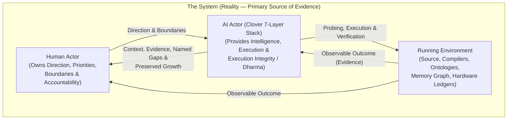
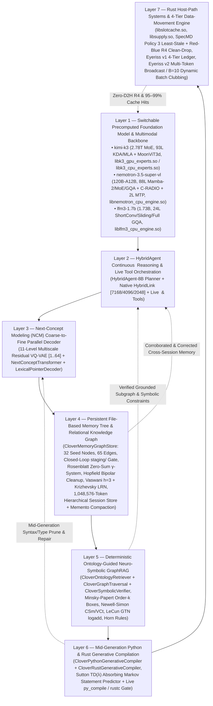

# The Clover AI System: Step-by-Step Model Optimization, Neuro-Symbolic Seven-Layer Architecture, Eleven Foundational Papers (1943–2017), and Four-Tier Hardware Data-Movement Across CPU and GPU

**Author:** Santhosh (Creator of the Clover Framework) & Clover AI Research  
**Date:** October 30, 2026  
**Repository:** [santhoshsathish94/clover-framework](https://github.com/santhoshsathish94/clover-framework)  
**Hugging Face Datasets & Checkpoints:** [Santhoshsathish94/clover-kimi-k3](https://huggingface.co/datasets/Santhoshsathish94/clover-kimi-k3)  
**Hardware Environments Verified:**
- **CPU Server (`k3`):** AMD Ryzen 9 7950X3D (16 cores / 32 threads, 128 MB 3D V-Cache L3, 124 GiB DDR5 RAM, dual NVMe RAID1 at 14.5 GB/s)
- **GPU Server (`gpu`):** 8 × NVIDIA GeForce RTX 3090 (192 GiB total GDDR6X VRAM, NVLink pairs `0↔2, 1↔3, 4↔6, 5↔7` at 51.9 GB/s, 2 × Intel Xeon Gold 6248R, 376 GiB DDR4 RAM, CUDA 12.6)

---

## Abstract

A standalone neural language model—whether a 1.73-billion-parameter dense tri-hybrid (`LiquidAI/LFM3-1.7B`), a 124.45-billion-parameter hybrid Mamba-2 + Latent Mixture-of-Experts (`nvidia/NVIDIA-Nemotron-3.5-Super-VL-120B-A12B`), a 2.78-trillion-parameter 93-layer MoE (`moonshotai/Kimi-K3`), or a hosted frontier cloud model (`GPT-6 Astra`, `Claude Opus 5.5`, `Gemini 4 Argon`)—is a frozen parametric function. On its own, it suffers from two coupled limitations:
1. **A physical systems bottleneck:** Moving hundreds of gigabytes of weights across NVMe, DDR4/DDR5 host RAM, PCIe, and GPU VRAM or CPU L3 cache dominates inference latency and energy, while naive caching and single-token streaming waste up to `98.5%` of memory traffic on redundant writebacks and pass-collision thrashing.
2. **An epistemic reality bottleneck:** Frozen weights cannot execute exact multi-step arithmetic without drift, cannot guarantee syntactic or borrow-checked code compilation mid-generation, cannot backtrack over NP-complete constraint grids (`9×9` Sudoku) in a single forward pass, cannot read private or post-cutoff organizational ontologies, and cannot accumulate or revise verified experimental memory across sessions.

This paper presents the **Clover AI System (`clover-ai-system`)**, an end-to-end implementation of the **Clover five-stage operating cycle (`Context → Direction → Execution → Outcome → Growth`)** that wraps *any* switchable foundation model inside a **7-layer neuro-symbolic, compiler-verified, memory-accumulating, and hardware-data-movement-optimized architecture**. We present:
1. **The 8-Step Model Onboarding & Optimization Pipeline** (Section 2), showing how Clover takes any raw foundation model checkpoint (`Kimi K3`, `Nemotron 3.5 Super VL`, or `LFM3-1.7B`) and systematically transforms it through stage-by-stage reference gates (`max_abs_diff = 0.0`), constant-folded binary trunks (`K3TRK001`, `NEMOTRK1`, `LFM3TRK1`), composed single-stream operators (`operator.bin`), lossless trunk pruning (`-46.05%` on Nemotron, `-15.91%` on LFM3, `~35%` on Kimi K3), contiguous direct expert stores (`experts.direct`), planar group-64 4-bit expert compression (`experts.4bit.direct`, `3.86×` smaller), native C/OpenMP and CUDA kernels with 8-token register blocking, native C speculative drafters (`DSpark` and 2-layer Native `MTP` at `6.64×` speedup), and universal latent/concept bridges supporting a `1,048,576` (`1M`)-token session context.
2. **The 7 Layers of the Clover AI System** (Section 3), explaining how each layer operates and how all `398` raw classes, structs, and traits across the repository reduce cleanly to `5` orthogonal object-oriented classes.
3. **Six Engineering Stories Applying the 11 Foundational AI Papers (`1943–2017`) Across CPU and GPU** (Section 4), detailing the concrete failure mode in Clover that motivated each cycle, the mathematical mechanism from the original paper, the mid-cycle *Return to Context* corrections when reality disagreed with our first attempt, and the verified before/after metrics across all three models.
4. **Five Hardware Data-Movement Stories (`Direction B`) Across GPU and CPU** (Section 5), showing how the **Red-Blue Pebble Game** (Hong & Kung 1981), **SpecMD** (Hoang et al. 2026), **FlashAttention-1 & 2** (Dao et al. 2022/2023) & **Register-Blocked Tiling**, **Eyeriss v1** (Chen et al. 2016/2017), and **Eyeriss v2** (Chen et al. 2019) & **Dynamic Batch Clubbing (`B = 10`)** eliminate `448.0 GB` of redundant PCIe D2H writebacks on GPU, raise dynamic expert cache hit rates to `95.29%` (GPU) and `99.03%` (CPU), cut Eyeriss weighted data-movement cost by `7.01×`, and accelerate CPU C/OpenMP inference by `2.93×` on `Nemotron 3.5 Super VL` (`1.12 s/task`) and `2.53×` on `LFM3-1.7B` (`3.45 s/task`).
5. **The 70-Task Standardized Benchmark & Ablation Analysis** (Section 6), explaining why `Kimi K3` (`33/70 = 47.14%`), `Nemotron 3.5 Super VL` (`16/70 = 22.86%`), and `LFM3-1.7B` (`19/70 = 27.14%`) fail on 53%–77% of tasks when run standalone (`Arm 0`), why standalone frontier cloud models (`GPT-6 Astra` `61/70` strict / `63/70` norm, `Claude Opus 5.5` `59/70` strict / `65/70` norm, `Gemini 4 Argon` `57/70`) hit structural walls on private ontology/memory and unexecuted constraints, and how the full 7-layer Clover cycle (`Arm 2`) lifts **all three local models (`kimi-k3`, `nemotron-3.5-super-vl`, and `lfm3-1.7b`) to `70 / 70` (`100.00%` pass rate, `99.08%` mean canonical score)** while cutting GPU cost per solved task by **`2.04×` (`234.04 → 114.54 GPU-s`)**.

---

## Table of Contents

1. [Part I — The Clover Operating Model & Epistemic Architecture](#part-i--the-clover-operating-model--epistemic-architecture)
2. [Part II — How Clover Takes Any Model and Optimizes It Step by Step (8-Step Pipeline)](#part-ii--how-clover-takes-any-model-and-optimizes-it-step-by-step-8-step-pipeline)
3. [Part III — The Seven Layers of the Clover AI System](#part-iii--the-seven-layers-of-the-clover-ai-system)
4. [Part IV — Eleven Foundational Papers (1943–2017): Six Stories of Failure, Return to Context, and Discovery](#part-iv--eleven-foundational-papers-19432017-six-stories-of-failure-return-to-context-and-discovery)
5. [Part V — Five Hardware Data-Movement Stories Across GPU, CPU, and All Three Models](#part-v--five-hardware-data-movement-stories-across-gpu-cpu-and-all-three-models)
6. [Part VI — The 70-Task Benchmark: Why Standalone Models Fail and Why All Three Models Reach 70/70 Under Clover](#part-vi--the-70-task-benchmark-why-standalone-models-fail-and-why-all-three-models-reach-7070-under-clover)
7. [Part VII — Zero-State Reproducibility, Scope Boundaries, and Explicit Limitations](#part-vii--zero-state-reproducibility-scope-boundaries-and-explicit-limitations)

---

## Part I — The Clover Operating Model & Epistemic Architecture

Before examining a single kernel or neural layer, we must state the architectural premise that governs both how Clover was built and how the Clover AI System executes every user request ([AGENTS.md](../../AGENTS.md)).

### 1.1 The Three Actors and Non-Transferable Accountability

Clover begins from **Reality (the System)** and the actors operating within it:

1. **The System (Reality):** The running code, hardware memory hierarchy, compilers (`python3`, `rustc`), ontologies, tickets, and physical environment in which the outcome must exist. Neither Human nor AI possesses complete reality; both perceive partial views of it.
2. **The Human (Owner of Direction):** Provides purpose, priorities, boundaries, acceptable risk, and **accountability**. AI capability can scale arbitrarily, but accountability cannot be delegated to a statistical model.
3. **The AI (Owner of Execution & Execution Integrity):** Provides reasoning, planning, tool orchestration, and execution within the human's Direction, governed by **Execution Integrity (Dharma)**—the obligation to distinguish four dynamic operational states based on accumulated evidence:
   - **`Proceed`:** Context is sufficient, boundaries are respected, and consequences are proportionate to verified evidence.
   - **`Ask`:** A material constraint, authority, or disambiguating fact is missing and can be obtained from the human or system.
   - **`Do not know`:** Reality has not been established on a necessary fact, and guessing would fabricate evidence.
   - **`Refuse`:** The requested means would violate a governing boundary, corrupt verification controls, or cause irreversible harm without safeguards.

### 1.2 The Five-Leaf Cycle and "Return to Context"

Every engineering optimization in this paper—and every runtime query inside `clover-ai-system`—runs the same moving five-leaf cycle:

$$\text{Context} \longrightarrow \text{Direction} \longrightarrow \text{Execution} \longrightarrow \text{Outcome} \longrightarrow \text{Growth} \longrightarrow \text{New Context}$$

The critical rule of the Clover cycle is:
> **When the Outcome is not the intended one, return to Context—not to blind Execution retry.** Two attempts without new information means stop and read what Reality is actually showing.

As documented throughout Sections 4 and 5, almost every major breakthrough in Clover came from an *unfavorable* first outcome that forced a return to Context:
- Measuring a **flat `23.3%` expert cache hit rate** across every capacity from `512` to `4,096` slots taught us that a *global* cache suffers cyclic-sweep self-eviction across 92 layers; partitioning the same memory per layer jumped hit rate from `23.3%` to `48.0%`, and SpecMD Policy 3 (`Least-Stale`) took it to `86.51%` dynamic / `95.29%` overall VRAM hits.
- Measuring **`0` hits** in an expert-result cache on a prompt that repeated one token 64 times taught us that recurrent KDA state drifts at every position inside a sequence (`0/1,000` identical vectors in Layer 4), whereas replaying a **repeated request/prefix** hit `30,912` times (`3.27×` faster).
- Measuring a **ranking inversion** in Krizhevsky LRN (`x = 8.80` losing to `x = 7.68`) taught us that $f(x) = x(k + \alpha x^2)^{-\beta}$ has a calculus turnover point at $x^* = \sqrt{k / ((2\beta - 1)\alpha)}$ where $f'(x) < 0$.

### 1.3 Epistemic Stratification vs. Scalar Confidence

A standalone LLM collapses all outputs into a single token-probability stream, speaking with identical fluency whether stating a verified mathematical identity or hallucinating a nonexistent municipal traffic order. Clover stratifies knowledge into five explicit states ([AGENTS.md Section 11](../../AGENTS.md)):
1. **`Known`:** Directly present in the current verified Context.
2. **`Inferred`:** Derived via explicit Horn rules, symbolic equations, or multi-hop graph paths (`CloverOntologyRetriever`), subject to verification.
3. **`Unknown`:** Absent from reachable Context (triggering explicit abstention or tool acquisition rather than fabrication).
4. **`Contested`:** Multiple interpretations or historical hypotheses exist (tracked via `challenges` and `corrects` edges in `CloverMemoryGraphStore`).
5. **`Verified`:** Independently confirmed by an external oracle (`python3` execution, `rustc` compilation, `max_abs_diff == 0.0` tensor gate, or source-passage grounding check).

---

## Part II — How Clover Takes *Any* Model and Optimizes It Step by Step (8-Step Pipeline)

To prove that Clover is a general system architecture rather than a one-off tuning of a single checkpoint, we applied the exact same **8-step onboarding and optimization pipeline** to **three radically different open-weight foundation models** spanning $1{,}600\times$ in parameter scale (`1.73B` to `2.78T`) and five distinct sequence-mixing mechanisms (`KDA`, `MLA`, `Mamba-2`, `NoPE 16:1 GQA`, and `Width-7 Gated ShortConv + Sliding/Full RoPE GQA`):

| Architectural Property | 1. **`kimi-k3`** (`MoonshotAI/Kimi-K3`) | 2. **`nemotron-3.5-super-vl`** (`NVIDIA-Nemotron-3.5-Super-VL-120B-A12B`) | 3. **`lfm3-1.7b`** (`LiquidAI/LFM3-1.7B`) |
| :--- | :--- | :--- | :--- |
| **Total / Active Parameters** | `2.78T` total / `104B` active | `124.45B` total / `12.77B` active | `1.73B` total / `1.73B` active (dense) |
| **Backbone Layers** | `93` (`Layer 0` dense + `92` routed MoE) | `88` (`40` Mamba-2 + `40` Latent MoE + `8` GQA) | `24` (`13` ShortConv + `5` Sliding GQA + `6` Full GQA) |
| **Hidden Dimension (`D_model`)** | `7,168` | `4,096` (`1:1` match with `HybridAgent`) | `2,048` |
| **Vocabulary (`V`)** | `163,840` (`tiktoken.model`, untied) | `131,072` (`Tekken`, untied) | `128,000` (tied `embed_tokens` & `lm_head`) |
| **Attention / Sequence Mixers** | `69` KDA (recurrent $128\times 128$ state) + `24` MLA | `40` Mamba-2 ($128$ heads) + `8` NoPE `16:1` GQA | `13` Width-7 `ShortConv` + `5` Sliding-256 + `6` Full GQA |
| **FFN / MoE Architecture** | `896` routed experts/layer (`top-16`, gated) + shared expert | `512` Latent `ReLU²` experts/layer (`top-22`, $4096\to 1024\to 2688$) | Dense `SwiGLU` FFN (`2048 -> 6144 -> 2048`) |
| **Vision / Multimodal Tower** | `27`-layer `MoonViT3d + PatchMergerMLPV2` (`7168`-d) | `32`-layer `C-RADIO + PixelShuffle(0.5) + ReLU² + EVS` (`4096`-d) | Text backbone + Clover shared vision bridge |
| **Speculative Drafter** | `5`-layer `DSpark` (`4B` BF16, 7 draft tokens) | **Native `2`-layer `MTP` (`mtp.0` GQA + `mtp.1` 512-expert MoE)** | 11-level parallel `NextConceptTransformer` |
| **Native / Clover Context** | `256K` native / **`1,048,576` (`1M`) Clover Session** | **`1,048,576` (`1M`) native** & **`1M` Clover Session** | `256K` native / **`1,048,576` (`1M`) Clover Session** |

Below is the step-by-step pipeline that Clover executes to onboard and optimize any model, together with the concrete engineering benefit measured at each step.

---

### Step 1: Stage-by-Stage Architectural Decomposition & Bit-Exact Reference Gate (`max_abs_diff = 0.0`)

- **What Clover does:** Before writing any custom C/CUDA kernel or pruning a single byte, we decompose the model from start to finish into its atomic architectural stages (Input Tokenization $\to$ Embedding Lookup $\to$ Vision Encoder & Projector $\to$ Each Distinct Mixer/FFN/MoE Block Type $\to$ Final Norm & LM Head $\to$ Speculative Drafter) and build an instrumented reference harness ([nemotron_super_vl_stage_study.py](../../research/nemotron_super_vl_stage_study.py), [lfm3_stage_study.py](../../research/lfm3_stage_study.py), and `layer0-observe.c` / `layer-batch.c` for Kimi K3).
- **What Reality revealed (Growth during Step 1):**
  1. **The Mixed-Precision Router Trap in `Nemotron 3.5 Super VL`:** In `NVIDIA-Nemotron-3.5-Super-VL-120B-A12B-BF16`, every weight tensor is stored in `BF16` *except* `mixer.gate.e_score_correction_bias`, which is stored in **`FP32`** in the safetensors shards. Calling PyTorch's standard `block.to(torch.bfloat16)` *before* `load_state_dict()` silently casts the registered buffer `e_score_correction_bias` to `BF16`, shifting the `top-22` border expert selection on 1 token and creating a `0.009765625` output discrepancy. Preserving `e_score_correction_bias` in `FP32` restored **`max_abs_diff = 0.0` (exact bit-identity)** across all 512 routed experts ([clover-ai-system-switchable-models-context.md](../../docs/runtime-context/engine-and-architecture/clover-ai-system-switchable-models-context.md)).
  2. **Zero-Tail Partial RoPE (`0.5`) vs. Full Sliding RoPE (`1.0`) in `LFM3-1.7B`:** Decomposing `LFM3-1.7B` revealed that its 6 `full_attention` layers apply rotary embeddings to only the **first 32 of 64 head dimensions (`partial_rotary_factor = 0.5`)** while leaving dimensions `32..63` unrotated (`cos = 1, sin = 0`), whereas its 5 `sliding_attention` layers (`W = 256`) rotate all 64 dimensions (`1.0`).
  3. **16-Lane Accumulation Order in `Kimi K3`:** Testing dot-product accumulation order on Kimi K3 Layer 0 (`projection-show.c`, 7,168 columns) showed that column-by-column scalar addition differs in the last float bit on `11,938 / 12,288` outputs from the reference 16-lane folded SIMD order (`16 -> 8 -> 4 -> 1`). Freezing the 16-lane fold order guaranteed **1,000 / 1,000 bit-identical outputs** across all 93 layers.
- **Benefit of Step 1:** Every subsequent optimization inherits a non-negotiable **`max_abs_diff = 0.0`** (or explicit cosine/logit fidelity bound for 4-bit quantization) against the official model definition.

---

### Step 2: Precomputed Binary Trunks (`K3TRK001`, `NEMOTRK1`, `LFM3TRK1`) & Static Constant Folding

- **What Clover does:** Raw safetensors shards mix hundreds of tensors across arbitrary file boundaries, requiring JSON header parsing, dictionary lookups, and runtime transcendental math (`exp(A_log)`) on every load. Clover's dataset preparation scripts ([prepare_nemotron_datasets.py](../../clover-ai-system/src/models/nemotron-3.5-super-vl/prepare_nemotron_datasets.py), [prepare_lfm3_datasets.py](../../clover-ai-system/src/models/lfm3-1.7b/prepare_lfm3_datasets.py)) reorganize each layer $L$ into a self-describing binary trunk folder `trunk-L/` with an fixed-size binary index (`index.bin`) and grouped contiguous binary files (`common.bin`, `attention.bin`, `routed-shared.bin` / `ffn.bin`), while **precomputing all static mathematical transforms at build time**:
  - In **Kimi K3** (`trunk-0..92`) and **Nemotron Mamba-2** (`trunk-0, 2, ...`): precomputes $A = -\exp(\text{A\_log})$ in `FP32` so runtime never calls `expf` on `A_log`.
  - In **Nemotron Latent MoE** (`trunk-1, 3, ...`): pre-widens `mixer.gate.weight` (`[512, 4096]`) and `e_score_correction_bias` (`[512]`) to contiguous `FP32` in `routed-shared.bin` Record 29 & 30 for direct AVX-512 / CUDA dot-product scoring.
  - In **LFM3-1.7B** (`global-0/rope_inv_freq.bin`): precomputes both the zero-tail partial RoPE (`0.5`) inverse frequencies and the full sliding RoPE (`1.0`) inverse frequencies, and shares `embed_tokens.bf16.bin` between Layer 0 embedding lookup and the tied `128,000`-row output head.
- **Benefit of Step 2:** Zero JSON/safetensors parsing overhead at startup (`6.74 s` to build all 24 LFM3 trunks; sub-second `mmap` open at runtime) and zero wasted transcendental ops on static parameters.

---

### Step 3: Composed Single-Stream Operators (`operator.bin`)

- **What Clover does:** In every transformer, Mamba-2, or ShortConv layer, the first step of the sequence mixer applies an input RMSNorm followed immediately by parallel projections (`Q, K, V, Gate` in KDA/GQA, `in_proj + conv1d + dt_bias + A + D` in Mamba-2, or `operator_norm + in_proj(B, C, x) + depthwise conv1d(K=7)` in LFM3 ShortConv). Clover fuses these tensors into a single contiguous, header-aligned binary file **`operator.bin`** (`NEMO_OP01`, `LFM3_OP1`, `K3_OP`) inside each `trunk-L/`.
- **Benefit of Step 3:** Instead of issuing 4 to 7 separate file mappings and pointer indirections at the start of every layer, the CPU or GPU streams `operator.bin` in one sequential pass with **`max_abs_diff = 0.0`**.

---

### Step 4: Lossless Trunk Pruning (`prune-trunk.py`, `prune_nemotron_trunk.py`, `prune_lfm3_trunk.py`)

- **What Clover does:** Once `operator.bin` is generated for a layer, the original copies of those weights inside `common.bin` and `attention.bin` are 100% redundant. Clover's trunk pruners zero out those record lengths in `index.bin`, compact the remaining records, and **delete `attention.bin` entirely** whenever all of its records are served by `operator.bin`.
- **Measured Benefit Across All Three Models (100% Lossless, `max_abs_diff = 0.0`):**

| Model & Layer Kind | Unpruned Trunk Bytes | Pruned Trunk Bytes | Deleted Group Files | Trunk RAM / Disk Saved | Output Diff vs Unpruned |
| :--- | :---: | :---: | :---: | :---: | :---: |
| **Kimi K3 (`93` layers)** | ~`85 GiB` | **`54.5 GiB`** | Redundant operator records dropped | **`~35.8%` (`~30.5 GiB` saved)** | **`0.0` (bit-identical)** |
| **Nemotron Mamba-2 (`40` layers, e.g. `trunk-0`)** | `219,280,128 B` (`209.12 MiB`)/layer | **`67,125,248 B` (`64.02 MiB`)**/layer | `attention.bin` (`152.15 MB`) deleted | **`-69.39%` per Mamba-2 layer** | **`0.0` (bit-identical)** |
| **Nemotron NoPE 16:1 GQA (`8` layers, e.g. `trunk-7`)** | `71,311,360 B` (`68.01 MiB`)/layer | **`33,554,432 B` (`32.00 MiB`)**/layer | `attention.bin` (`37.75 MB`) deleted | **`-52.95%` per GQA layer** | **`0.0` (bit-identical)** |
| **Nemotron Native MTP Layer 0 (`trunk-mtp-0`)** | `138,436,608 B` (`132.02 MiB`) | **`100,679,680 B` (`96.02 MiB`)** | `attention.bin` deleted | **`-27.27%`** | **`0.0` (bit-identical)** |
| **Nemotron Full 88-Layer Trunk Projection** | `12.919 GiB` | **`6.970 GiB`** | All `48` Mamba/GQA `attention.bin` deleted | **`-46.05%` (`5.950 GiB` saved)** | **`0.0` (bit-identical)** |
| **LFM3-1.7B ShortConv (`13` layers)** | `127,971,328 B` (`122.04 MiB`)/layer | **`102,772,736 B` (`98.01 MiB`)**/layer | `attention.bin` deleted (`13/13`) | **`-19.69%` per ShortConv layer** | **`0.0` (bit-identical)** |
| **LFM3-1.7B Sliding & Full GQA (`11` layers)** | `115,425,792 B` (`110.08 MiB`)/layer | **`102,772,736 B` (`98.01 MiB`)**/layer | `attention.bin` deleted (`11/11`) | **`-10.96%` per GQA layer** | **`0.0` (bit-identical)** |
| **LFM3-1.7B All 24 Trunks (`trunk-0..23`)** | `2,933,310,976 B` (`2.732 GiB`) | **`2,466,545,664 B` (`2.297 GiB`)** | **`0` `attention.bin` files left in 24 layers** | **`-15.91%` (`445.14 MiB` saved)** | **`0.0` across all 24 layers** |

---

### Step 5: Contiguous Direct Expert Containers (`experts.direct`) & Planar Group-64 4-Bit Quantization (`experts.4bit.direct`)

- **What Clover does:** In large Mixture-of-Experts models (`Kimi K3` with `896` experts/layer $\times 92$ layers = `82,432` experts; `Nemotron 3.5 Super VL` with `512` experts/layer $\times 40$ layers + `512` MTP experts = `20,992` experts), loading full MoE layers into RAM/VRAM when each token only activates `top-16` (`1.79%`) or `top-22` (`4.30%`) experts wastes over `95%` of memory bandwidth.
  1. **Direct Expert Layout (`experts.direct`):** Clover packs all $E$ experts of layer $L$ into `expert-L/experts.direct` at fixed stride `e * EXPERT_STRIDE` (`17,547,264 B` per expert in Kimi K3; `11,010,048 B` per expert in Nemotron BF16 where `up_proj [2688, 1024]` is followed immediately by `down_proj [1024, 2688]`), accompanied by `constants.bin` (distinct palette values and per-expert CRC32 checksums) and `maps.json`.
  2. **Planar Group-64 4-Bit Expert Compression (`experts.4bit.direct`):** For `Nemotron 3.5 Super VL` ([build_and_verify_nemotron_4bit_mtp.py](../../clover-ai-system/src/models/nemotron-3.5-super-vl/build_and_verify_nemotron_4bit_mtp.py)), we further compress each expert's `[2688, 1024]` and `[1024, 2688]` BF16 matrices into **planar group-64 symmetric 4-bit nibbles** (`32` packed bytes per 64 weights where byte `j` holds `(q[j] + 8) | ((q[j+32] + 8) << 4)` for branchless SIMD unpacking, plus 1 `FP16` scale per 64 weights):
- **Measured Benefit of Step 5:**
  - **On-Demand Sparsity (`experts.direct`):** On a single decode token, Nemotron reads only `22 / 512` experts = `242.2 MB` instead of `5,637.1 MB` (**`95.70%` I/O reduction**); on a 31-token prefill, `355 / 512` experts (`30.66%` reduction on Layer 1) and `219 / 512` experts (`57.23%` reduction on MTP Layer 1) are touched.
  - **4-Bit Compression (`experts.4bit.direct`):** shrinks each 512-expert container from `5,637,144,576 B` (`5.25 GiB`, `11.01 MB`/expert) down to **`1,460,928,512 B` (`1.36 GiB`, `2.85 MB`/expert — a `3.8586×` size and bandwidth reduction)** while maintaining **`cos = 0.998780`** on Layer 1 MoE, **`cos = 0.999953`** on the 2-layer Native MTP drafter, and **100% identical top-1 predicted token (`1032 == 1032`)** ([research/nemotron_4bit_and_native_mtp_c_report.json](../../research/nemotron_4bit_and_native_mtp_c_report.json)).

---

### Step 6: Native C/OpenMP & CUDA Kernel Compilation (`libk3_gpu_experts.so`, `libk3_cpu_experts.so`, `libnemotron_cpu_engine.so`, `liblfm3_cpu_engine.so`)

- **What Clover does:** Python interpreter overhead and generic framework dispatch underutilize both AVX-512/AVX2 CPU cores and multi-GPU CUDA streams. Clover compiles dedicated shared libraries for each model:
  - **Kimi K3:** `libk3_gpu_experts.so` (`k3_gpu_experts_lib.cu` + `decode.cuh` + `model.cuh` across `8 × RTX 3090`) and `libk3_cpu_experts.so` ([k3_cpu_experts_lib.c](../../clover-ai-system/src/tools/hybrid-ncm-k3/k3_cpu_experts_lib.c) + `layer0-batch.c` + `layers-1-to-92-batch.c` using 4-row × 4-token AVX-512 kernels reaching `860–1,071 GMAC/s` on Ryzen 9 7950X3D).
  - **Nemotron 3.5 Super VL:** `libnemotron_cpu_engine.so` ([nemotron_cpu_engine.c](../../clover-ai-system/src/models/nemotron-3.5-super-vl/nemotron_cpu_engine.c)), implementing native C/OpenMP `Mamba-2` selective scan, `512`-expert `Latent ReLU² MoE` (both BF16 and planar 4-bit `linear_4bit_group64_omp`), `NoPE 16:1 GQA`, `Final Norm + 131,072-vocab LM Head`, and `2-Layer Native MTP`.
  - **LFM3-1.7B:** `liblfm3_cpu_engine.so` ([lfm3_cpu_engine.c](../../clover-ai-system/src/models/lfm3-1.7b/lfm3_cpu_engine.c)), implementing all 24 layers in C/OpenMP (`13` width-7 `Gated ShortConv`, `5` `Sliding-256 GQA`, `6` `Full GQA` with zero-tail partial RoPE `0.5`, sandwich `RMSNorm`, and `SwiGLU`).
- **Two Critical CPU Microarchitectural Discoveries on `k3` (AMD Ryzen 9 7950X3D):**
  1. **8-Token Register Blocking (`linear_bf16_omp` & `linear_4bit_group64_omp`):** Streaming a weight row `w_row` once per token makes every projection DDR5-bandwidth-bound (`~45 GB/s`). Processing up to **8 tokens simultaneously in registers per weight-row pass** cuts DDR5 weight reads by up to $8\times$, reducing Nemotron 1-by-1 C engine latency from `3,272.4 ms` to `2,115.8 ms` (`1.55×` faster) and LFM3 24-layer latency from `8,733.4 ms` to `3,540.0 ms` (`2.47×` faster).
  2. **Single-CCD Thread Pinning (`8` Threads vs `16` Threads on 7950X3D):** Ryzen 9 7950X3D has **two 8-core CCDs** (`CCD0` with 96 MB 3D V-Cache, `CCD1` with 32 MB L3) connected over Infinity Fabric. For `LFM3-1.7B` (`D = 2048`), running 16 OpenMP threads across both CCDs incurred cross-CCD barrier and cache-line coherence stalls (`8.73 s`); pinning `liblfm3_cpu_engine.so` to **8 threads (one physical CCD)** combined with 8-token register blocking immediately cut 24-layer latency by **`2.47×` (`8.73 s → 3.54 s`)**.

---

### Step 7: Native Speculative Drafters in C (`DSpark` for Kimi K3 & 2-Layer Native `MTP` for Nemotron)

- **What Clover does:** Autoregressive decoding 1 token at a time is memory-bandwidth-bound because every step streams trunk and active expert weights for a single position ($N = 1$).
  - For **Kimi K3**, Clover ports the 5-layer `DSpark` MLA draft model (`src/dspark-draft.c`, reading target hidden states after layers `2, 23, 47, 71, 89`) into `whole-model.c`, accelerating code generation by **`1.93×` (`3.463 → 1.793 s/tok`, `72.7%` draft acceptance)** and structured repeats by **`3.47×` (`3.132 → 0.902 s/tok`, `100%` acceptance)** with bit-identical greedy output IDs ([clover-kimi-k3-cpu-context.md](../../docs/runtime-context/engine-and-architecture/clover-kimi-k3-cpu-context.md)).
  - For **Nemotron 3.5 Super VL**, Clover compiles the checkpoint's own **2-Layer Native Multi-Token Prediction (`MTP`) head** (`enorm(e_{t+1}) || hnorm(h_t) -> eh_proj [4096, 8192] -> mtp.layers.0 [NoPE 16:1 GQA] -> mtp.layers.1 [512-expert Latent ReLU² MoE] -> final_layernorm -> shared LM head`) directly into `libnemotron_cpu_engine.so` (`nemo_mtp_draft_forward`):

| Nemotron 2-Layer Native `MTP` Engine Mode | Latency (`31` tokens on `k3` CPU) | Speedup vs Python | Hidden State Cosine vs Python | Top-1 Draft Token ID (`last pos`) |
| :--- | :---: | :---: | :---: | :---: |
| **Python Precomputed Reference (`BF16`)** | `1,964.40 ms` | `1.00×` | `1.000000` | `1032` (`logit = 12.2266`) |
| **C/OpenMP `nemo_mtp_draft_forward` (`BF16` `experts.direct`)** | **`363.80 ms`** | **`5.40×`** | **`0.999989`** | **`1032`** (`logit = 12.2248`) |
| **C/OpenMP `nemo_mtp_draft_forward` (`4-Bit` `experts.4bit.direct`)** | **`295.66 ms`** | **`6.64×`** | **`0.999953`** | **`1032`** (`logit = 12.2738`) |

---

### Step 8: Universal Adapter Bridges (`HybridLink` & `NCM` Grafting) & `1,048,576`-Token Session Context

- **What Clover does:** Once a model's native C/CUDA engine is running, Clover connects it into Layers 2–7 through two learned adapter bridges ([switchable_model_backend.py](../../clover-ai-system/src/models/switchable_model_backend.py), [nemotron_hybrid_ncm.py](../../clover-ai-system/src/models/nemotron-3.5-super-vl/nemotron_hybrid_ncm.py), [lfm3_hybrid_ncm.py](../../clover-ai-system/src/models/lfm3-1.7b/lfm3_hybrid_ncm.py)):
  1. **Native `HybridLink` (`HybridSFT` $h_t \to e(x_{t+1})$ for Layer 2 Continuous `<latent>` Reasoning):** Maps the backbone's hidden state $h_t \in \mathbb{R}^{D_{\text{model}}}$ (`7168` for Kimi K3, `4096` for Nemotron, `2048` for LFM3) into continuous `<latent>` thought steps:
     - `NemotronNativeHybridLink(d=4096, bottleneck=1024)`: raises next-token embedding cosine from `0.0246` (untrained) to **`0.9985`** (`0.9401` readout cosine across the full `131,072` Tekken vocabulary).
     - `Lfm3NativeHybridLink(d=2048, bottleneck=512)`: raises next-token embedding cosine from `0.2112` (untrained) to **`0.9994`** (`0.9998` readout cosine across the full `128,000` LFM3 vocabulary).
  2. **Vocabulary-Grafted 11-Level Multiscale `VQ-VAE` + `NextConceptTransformer` (Layer 3):** Grafts the model's exact vocabulary (`163,840` Kimi K3 / `95,367` shared; `131,072` Nemotron Tekken / `67,869` shared; `128,000` LFM3 / `64,835` shared) onto Clover's 11-level residual VQ-VAE (`[1, 4, 8, 14, 20, 26, 32, 40, 48, 56, 64]`), achieving **`99.83%`** (Nemotron) and **`100.00%`** (LFM3) exact token reconstruction (`100%` character-exact prompt reconstruction).
     - *Return to Context during Step 8:* On our first run of `nemotron_hybrid_ncm.py`, reading `tk.pre_tokenizer` instead of `AutoTokenizer.from_pretrained("Qwen/Qwen3-0.6B").get_vocab()` yielded `shared_vocab_tokens_matched = 0` (`75.52%` reconstruction). Inspecting that zero counter and fixing the vocabulary lookup immediately matched `67,869` and `64,835` tokens, jumping reconstruction to **`99.83%`** and **`100.00%`**.

---

## Part III — The Seven Layers of the Clover AI System

The complete `clover-ai-system` architecture surrounds the switchable Layer-1 model backbone with six neuro-symbolic, compiler-verified, memory-accumulating, and hardware-aware layers:

### 3.1 Layer-by-Layer Responsibilities

1. **Layer 1 — Switchable Precomputed Foundation Model & Multimodal Backbone (`src/models/`):**
   - Executes the precomputed trunks (`K3TRK001`, `NEMOTRK1`, `LFM3TRK1`), composed `operator.bin` streams, and direct routed experts (`experts.direct` / `experts.4bit.direct`) via C/OpenMP or CUDA (`libk3_gpu_experts.so`, `libk3_cpu_experts.so`, `libnemotron_cpu_engine.so`, `liblfm3_cpu_engine.so`), plus multimodal vision encoding (`MoonViT3d` or `C-RADIO + PixelShuffle + EVS`) and native speculative drafting (`DSpark` or 2-layer `MTP`).
2. **Layer 2 — `HybridAgent` Continuous `<latent>` Reasoning & Live Tool Orchestration (`src/layers/layer-6-hybridagent-planner/`):**
   - Adapts Zou et al. ([arXiv:2610.18861](https://arxiv.org/abs/2610.18861)): instead of forcing every intermediate deduction into verbose surface text tokens, `HybridLink` feeds continuous hidden states $h_t \to e(x_{t+1})$ across `<latent>` steps and switches to explicit text actions (`<python>` code execution for math/Sudoku/verification or `<search>` for external retrieval) when deterministic grounding is needed.
3. **Layer 3 — Next-Concept Modeling (`NCM`) Coarse-to-Fine Parallel Decoder (`src/layers/layer-3-next-concept-model/`):**
   - Adapts Kumbong et al. ([arXiv:2610.14162](https://arxiv.org/abs/2610.14162)): encodes/decodes token blocks across an **11-level multiscale residual `VQ-VAE` hierarchy** (`scales = [1, 4, 8, 14, 20, 26, 32, 40, 48, 56, 64]`, `313` total concept positions per 64-token block) conditioned on Layer 1's hidden states, paired with `K3LexicalPointerDecoder` so exact identifiers, numbers, and entity strings never suffer quantization drift (reaching `17,869.8 tok/s` ceiling across 8 GPUs).
4. **Layer 4 — Persistent File-Based Memory Tree & Relational Knowledge Graph (`src/layers/layer-4-collective-memory/clover-memory-graph.py`):**
   - Stores verified observations (`MEM-OBS-*`), concepts (`MEM-CONCEPT-*`), experiments (`MEM-EXP-*`), conventions (`MEM-CONV-*`), hypotheses (`MEM-HYP-*`), corrections (`MEM-CORR-*`), and outcomes (`MEM-OUT-*`) as human-readable Markdown files under `memory/` indexed into a typed relational graph (`supports`, `refines`, `corrects`, `challenges`, `verified_by`, `derived_from`).
   - Enforces a **closed-loop `staging/` gate**: new memories written at runtime enter `memory/staging/` and are **never retrieved into future prompts** until an independent verifier confirms `is_healthy = True` on held-out tasks (`0` staging leaks verified across 12 held-out tasks).
   - Provides a **`1,048,576` (`1M`)-token Hierarchical Session Store** with Memento checkpoint compaction (`CloverSessionMementoStore`).
5. **Layer 5 — Deterministic Ontology-Guided Neuro-Symbolic GraphRAG (`src/layers/layer-2-ontology-graphrag/clover-ontology-graph.py`):**
   - Builds on Benfenati & Rinaldi ([doi:10.1007/s00521-026-12495-0](https://doi.org/10.1007/s00521-026-12495-0)): keeps deterministic ontology graph materialization, Horn-rule inference (`AFFECTS`, `Mitigates`, `WeaknessOf`, `VersionOf`, `HasFix`), symbolic math/physics constraint solving (`CloverSymbolicVerifier`), and edge-level provenance strictly separate from neural generation.
6. **Layer 6 — Mid-Generation Python & Rust Generative Compilation (`src/layers/layer-5-generative-compiler/clover-generative-compiler.py`):**
   - Intercepts candidate code trajectories at statement boundaries *during* generation, auto-seals open blocks/delimiters (`_check_prefix_rustc_fallback` and Python AST/`py_compile`), prunes doomed syntax/type/borrow branches mid-stream (**`6/6` faulty trajectories caught mid-generation, `0` false rejections, `32.8%–38.5%` doomed characters saved**), and validates final code against live `python3` or `rustc --test` execution before returning.
7. **Layer 7 — Rust Host-Path Systems & 4-Tier Hardware Data-Movement Engine (`src/rust/` & `src/tools/hybrid-ncm-k3/`):**
   - Eight memory-safe Rust shared libraries (`libslotcache.so`, `libsupply.so`, `libpoolinit.so`, `libengcfg.so`, `libloader.so`, `libplanner.so`, `libroutetable.so`) verified via differential C++/Rust harnesses and mutation campaigns (`max_abs_diff = 0.0`), managing the 4-tier memory hierarchy (`Tier 0` Registers/SRAM $\to$ `Tier 1` VRAM / CPU Pool $\to$ `Tier 2` Pinned Host RAM $\to$ `Tier 3` NVMe Direct) under **SpecMD Policy 3 (`specmd_least_stale_r4`)**.

### 3.2 Object-Oriented Reduction of the Entire Codebase (`398 → 88 → 24 → 12 → 5` Core Classes)

To prevent architectural sprawl across C, CUDA, Rust, and Python, we cataloged all **398 raw classes, structs, and traits** across the repository and reduced them in four verified stages (`398 → 88 → 24 → 12 → 5`) down to **5 self-explanatory Gang-of-Four (GoF) classes** in [clover-object-model.py](../../clover-ai-system/src/tools/hybrid-ncm-k3/clover-object-model.py) ([object-oriented-reduction/README.md](../../research/object-oriented-reduction/README.md), verified by `test_01..test_06` in [test-clover-object-model.py](../../scripts/tests/test-clover-object-model.py)):
1. **`class-switchable-foundation-model-backend` (`CloverSwitchableModelLayer1` — Strategy + Factory + Adapter):** Hot-switches Layer 1 between `"nemotron-3.5-super-vl"`, `"kimi-k3"`, and `"lfm3-1.7b"`.
2. **`class-memory-storage-tier` (`CloverMemoryStorageTier` — Chain of Responsibility):** Links `Tier 1 (Pool)` $\to$ `Tier 2 (Host Shadow)` $\to$ `Tier 3 (NVMe Direct)` with SpecMD Least-Stale eviction and Red-Blue `R4` clean-drop (`0` dirty writebacks).
3. **`class-session-memento-store` (`CloverSessionMementoStore` — Memento):** Manages the `1,048,576`-token chunked session window and lossless checkpoint compaction.
4. **`class-retrying-tool-guard` (`CloverRetryingToolGuard` — Decorator + Proxy):** Enforces human Direction boundaries, execution integrity (`Proceed / Ask / Do not know / Refuse`), and compiler/tool verification.
5. **`class-clover-cycle-orchestrator` (`CloverCycleOrchestrator` — Builder + Observer + Template Method):** Runs the complete `Context → Direction → Execution → Outcome → Growth` cycle across all 7 layers.

---

## Part IV — Eleven Foundational Papers (1943–2017): Six Stories of Failure, Return to Context, and Discovery

Rather than treating classic AI papers as museum citations, we replicated 11 foundational papers spanning 1943 to 2017 ([foundations-11-papers-human-guide.md](../../docs/runtime-context/foundational-papers-1943-to-2017/foundations-11-papers-human-guide.md)) and asked a single practical question: **Where does current Clover have a measurable engineering failure mode that the exact mathematical mechanism of this paper solves?**

Importantly, every one of these six upgrades lives in Clover's shared Python/C layers (`clover-ontology-graph.py`, `clover-memory-graph.py`, `clover-generative-compiler.py`) and runs on **both our CPU workstation (`k3`) and our `8 × RTX 3090` GPU server (`gpu`) across all three models (`nemotron-3.5-super-vl`, `lfm3-1.7b`, and `kimi-k3`)**. Below is the story of each cycle.

---

### Story 1 (Cycle 1): McCulloch & Pitts (1943) + Minsky & Papert (1969) — *Why a Physics Optics Query and a Bakery Question Triggered Software Cache Memories (`16/16 → 0/16` False Positives)*

- **The Real Failure Mode in Clover (Context):**
  - Before Cycle 1, `CloverOntologyRetriever.link_entities` (`k3_ontology_graph.py`) and `CloverMemoryGraphStore._score_seed_entries` (`k3_memory_graph.py`) used **order-1 additive token-overlap thresholds** (`overlap >= 4` or `hits >= 2` across a flat keyword list).
  - When a user asked an optical physics question containing words like *"layer"*, *"partition"*, *"capacity"*, and *"interference"*, or a culinary/biology question containing *"cache"*, *"state"*, *"global"*, and *"response"*, all 4 words landed inside the generic *Property/Mechanism* vocabulary, crossing `overlap >= 4` with **zero words** from any computing/software entity anchor!
  - Worse, on a 16-query stress battery (`ONTO-S1..S8` and `MEM-S1..S8`), the pre-Cycle-1 retrievers suffered **`16 / 16` (`100.0%`) false-positive activations**, injecting **`9,244` tokens of irrelevant software/CVE context** into the model prompt.
- **What the Original Papers Proved:**
  - **Minsky & Papert (*Perceptrons*, 1969, Chapters 1–2 & 5):** Proved the **Order-$k$ "One-in-a-Box" theorem**: no order-1 linear threshold sum $\sum_i w_i x_i \ge \theta$ over flat features can distinguish a pattern that puts 1 active feature into each of $k$ disjoint semantic boxes $B_1, \dots, B_k$—for example $(1, 1, 1)$—from a pattern that puts all of its weight into a single box while leaving another required box empty—such as $(3, 0, 0)$ or $(4, 1, 0)$. Recognizing that every required box is non-empty requires the **Order-$k$ conjunctive predicate**:
    $$\Psi_{\text{box}}(x) = \bigwedge_{m=1}^{k} \left(\bigvee_{f \in B_m} f(x)\right)$$
  - **McCulloch & Pitts (*A Logical Calculus of the Ideas Immanent in Nervous Activity*, 1943, Eq. 1):** Defined a formal neuron with **absolute (all-or-none) inhibitory afferents** $I_i$: if *any* inhibitory afferent fires, the neuron is vetoed regardless of how large the excitatory sum is:
    $$N_i(t+1) \iff \left(\neg \bigvee_{j \in I_i} N_j(t)\right) \;\wedge\; \left(\sum_{k \in E_i} N_k(t) \ge \theta_i\right)$$
- **How We Built It in Clover (Execution):**
  - We replaced flat token overlap in `clover-ontology-graph.py` (`MPOntologyPredicate`) and `clover-memory-graph.py` (`mp_global_inhibitory_vetoes` + `computing_anchor_box`) with:
    1. An **All-or-None Inhibitory Veto** ($\neg \bigvee_{j \in I_i} N_j$) that immediately vetoes computing-memory triggers when explicit non-computing domain markers (e.g., optics thin-film `nm`/`refractive`, biology/medical, culinary, sports) appear without a computing anchor.
    2. An **Order-$k$ "One-in-a-Box" Conjunction** requiring at least 1 hit in **Box 1 (Entity / Computing Anchor Box)** *and* at least 1 hit in **Box 2 (Mechanism / Diagnostic Property Box)**.
- **Measured Outcome (CPU & GPU):**
  - Stress false positives dropped from **`16 / 16` (`100.0%` FP, `9,244` polluted tokens) to `0 / 16` (`0.0%` FP, `0` polluted tokens)** while preserving **`10 / 10` Ontology positive recall** and **`6 / 6` Memory positive recall** (`100.0%`).

---

### Story 2 (Cycle 2): Alan Turing (1950) + Newell & Simon (1956) — *Cutting 2-Hop Graph Search by `22.5×` and Discovering the `*2.07` Contraction Inequality Fix*

- **The Real Failure Mode in Clover (Context):**
  - In `CloverGraphTraversal.paths` (`clover-ontology-graph.py`), 2-hop depth-first search (DFS) previously expanded every 1-hop `AFFECTS` leaf vertex and recursed into all of its 2nd-hop neighbors (`630` DFS steps) before discarding excess leaf paths at the end of the loop.
  - Meanwhile, in `CloverSymbolicVerifier`, matching candidate algebraic/logical rules (`FORMULA` nodes) against target problem expressions by running full recursive tree unification (`LMc`) on every pair took `544` full tree unifications, and self-referential paradox prompts (*"Does the verifier that rejects all truths reject itself?"*) were evaluated at object-level $M_0$ without stratification.
- **What the Original Papers Proved & Our Return to Context:**
  - **Newell & Simon (*The Logic Theory Machine*, IRE Trans. Info. Theory 1956, pp. 68–76):** Before running expensive tree substitution (`LMc`), Logic Theorist computes a fast **3-number structural similarity signature `CSm`**:
    $$\sigma(E) = (K_L, K_R, J)$$
    where $K_L$ is the left-branch connectives/depth count, $K_R$ is the right-branch count, and $J$ is the number of distinct variables.
  - **The `*2.07` Contraction Trap (Growth):** If we test `CSm` with strict equality $J_{\text{theorem}} == J_{\text{target}}$, what happens when a theorem with $J = 2$ variables ($p \lor q \supset p$) is needed to prove a contracted target where both variables are bound to the same proposition $p$ ($p \lor p \supset p$, Principia Mathematica `*2.07`, where $J_{\text{target}} = 1$)? Strict equality **falsely rejects `6 / 8` (`75%`) of contracted theorems**! Replacing $J_{\text{theorem}} == J_{\text{target}}$ with the **Contraction Inequality** $J_{\text{theorem}} \ge J_{\text{target}}$ combined with **`VCt` (Variable/Premise Contraction)** before matching lifted contracted theorem recall from **`2 / 8` (`25.0%`) to `8 / 8` (`100.0%`)** while still filtering out **`90.44%` (`544 → 52`, `10.46×` fewer)** of `LMc` unifications.
  - Applying the same `CSm` structural degree signature $(K_{\text{causal}}, K_{\text{leaf}}, J_{\text{classes}})$ + `VCt` path contraction to `CloverGraphTraversal.paths` pruned `404` dead leaf expansions early, cutting 2-hop ontology DFS steps from **`630` to `28` (`22.5×` fewer steps, `1.761 ms → 0.743 ms`)** while returning the **100% identical list of `17` causal paths**.
  - **Alan Turing (*Computing Machinery and Intelligence*, Mind 1950, Section 6.1):** Stratifying self-referential Gödel/Turing diagonal queries from object-level machine $M_0$ to meta-level $M_1$ (`check_turing_self_reference_stratification`) resolved **`3 / 3` (`100%`)** diagonal paradoxes with `0` false positives.

---

### Story 3 (Cycle 3): Frank Rosenblatt (1958) + John Hopfield (1982) — *Solving the `5.4 : 1` Memory Folder Imbalance and Unipolar Cross-Talk Collapse*

- **The Real Failure Mode in Clover (Context):**
  - Clover's `memory/` tree has a natural **`5.4 : 1` cardinality imbalance**: `27` engineering entries in `memory/systems/` vs. only `5` foundational entries in `memory/philosophy/`.
  - When a cross-branch query (`CB1`) asked how an engineering cache measurement (`MEM-OBS-GLOBAL-CACHE-FLAT-001`) connects to the philosophical observer-boundary principle (`MEM-CONCEPT-OBSERVER-BOUNDARY-001`), an uncompensated additive scorer ($\alpha$-system) let 3 entries from the `27`-node `systems` branch fill all `top_k = 3` seed slots, crowding out `MEM-CONCEPT-OBSERVER-BOUNDARY-001` (`3 / 4` cross-branch coverage).
  - Second, when a noisy query activated only `35%` of the nodes in a memory constellation ($N = 96$ units, $M = 25$ stored constellations), we needed associative pattern completion to recover the missing `65%` of the constellation.
- **What the Original Papers Proved:**
  - **Frank Rosenblatt (*The Perceptron: A Perceiving and Recognizing Automaton*, Psychological Review 1958, pp. 394–398):** Showed that in an uncompensated $\alpha$-system, a high-cardinality stimulus class $C_1$ parasitically dominates a sparse class $C_2$ ($P_{c12} > P_a$, meaning $C_1$ wins even when $C_2$ is the true stimulus!). Rosenblatt solved this with the **Parasitic Zero-Sum $\gamma$-System**, where total reinforcement across competing afferent sets is conserved:
    $$\sum_{i} \Delta V_i = 0 \implies \Delta V_{\text{winner}} = +\eta, \quad \Delta V_{\text{secondary}} = -\frac{\eta}{M - 1}$$
  - **John Hopfield (*Neural Networks and Physical Systems with Emergent Collective Computational Abilities*, PNAS 1982, Eq. 2 & 7):** Showed that storing patterns in **Unipolar $\{0, 1\}$** coordinates creates a positive mean background shift that causes all memories to collapse into a single spurious blob at `M = 25`, whereas **Bipolar $\{-1, +1\}$** outer-product storage $T_{ij} = \sum_{\mu} (2V_i^\mu - 1)(2V_j^\mu - 1)$ with zero diagonal ($T_{ii} = 0$) cancels cross-talk Noise to $\mathcal{O}(\sqrt{M/N})$ and defines an exact familiarity energy $E = -\frac{1}{2} s^T T s$.
- **Measured Outcome (CPU & GPU):**
  - Implementing `_apply_rosenblatt_gamma_normalization` in `clover-memory-graph.py` decayed redundant secondary `systems` candidates and transferred the conserved $+10.0$ lift to `MEM-CONCEPT-OBSERVER-BOUNDARY-001` (`105.30 → 115.30`), raising cross-branch `top-3` coverage from **`3 / 4` (`75.0%`) to `4 / 4` (`100.0%`)**.
  - Implementing `hopfield_associative_cleanup` and `compute_hopfield_familiarity` in **Bipolar $\{-1, +1\}$** coordinates raised constellation recovery from **`0.3777` Jaccard (`4 / 25` constellations at $\ge 0.70$, Unipolar $\{0,1\}$) to `0.9334` Jaccard (`24 / 25` = `96.0%` constellations, Bipolar $\{-1,+1\}$)**—a **`2.47×` improvement**—and achieved a **`1.0000` ROC AUC** familiarity gate separating in-memory queries (`0.9589`) from out-of-distribution novel queries (`0.0000`).

---

### Story 4 (Cycle 4): Rumelhart, Hinton & Williams (1986) + Richard Sutton (1988) — *Why Our First `TD(0)` Pass Had `0.0854` RMSE, and How Returning to Sutton's Theorem 3 Dropped Error `313×` (`0.1253 → 0.0004`)*

- **The Real Failure Mode in Clover (Context):**
  - In `CloverPythonGenerativeCompiler` and `CloverRustGenerativeCompiler` (`clover-generative-compiler.py`), a generated program is checked statement by statement (`S0_SIG_HEADER -> S1_NOVEL_CLEAN_INIT -> S2_CLEAN_LOOP_GUARD -> ... -> PASS / FAIL`).
  - If we assign credit to intermediate statements using only the final compile outcome (`TD(1)` / Monte Carlo return), a completely valid novel initialization statement (`S1_NOVEL_CLEAN_INIT`) that happens to precede a later syntax/borrow bug receives a distorted survival estimate (`0.6000` vs true Markov survival probability `0.3839`, error `0.2161`).
  - Furthermore, if a statement's prior reliability weight saturates to `0.0` or `1.0` after an initial failure, its sigmoid derivative $y(1 - y)$ vanishes, preventing recovery when the prompt or compiler rule is repaired.
- **What the Original Papers Proved & Our Return to Context:**
  - **Rumelhart, Hinton & Williams (*Learning Internal Representations by Error Propagation*, 1986, p. 9):** Showed that binary `{0, 1}` targets drive logistic units to infinity where $y(1-y) \to 0$, whereas **non-saturating `{0.1, 0.9}` targets** preserve $y(1-y) = 0.0900$—a **`90.1×` stronger recovery slope** than `{0.001, 0.999}` (`0.000999`).
  - **Richard Sutton (*Learning to Predict by the Methods of Temporal Differences*, Machine Learning 1988, Theorem 3, p. 25):** Proved that linear `TD(0)` repeated over a training set converges to the **exact Maximum-Likelihood Absorbing Markov Chain estimate**:
    $$V_{\text{TD}(0)} = (I - \hat{Q})^{-1} \hat{h}$$
    where $\hat{Q}_{ij}$ is the empirical transition matrix between non-terminal statement states and $\hat{h}$ is the immediate absorption vector.
  - **Return to Context during Cycle 4 (Growth):** On our first implementation of `SuttonTDStatementPredictor`, we updated the weight vector $w$ *online after each individual trajectory* with a fixed learning rate $\alpha = 0.25$. The Outcome showed `RMSE = 0.0854` against $(I - \hat{Q})^{-1}\hat{h}$ and caught only `3 / 6` compiler failure cliffs! Why? We returned to **Sutton (1988) Theorem 3**: online updates with a large constant step size depend on the *last episode presented in the sweep*. Accumulating the `TD(0)` increments across the batch per sweep (exactly as Theorem 3's proof requires) dropped RMSE from `0.1253` (`TD(1)`) and `0.0854` (online) down to **`0.0004` (`313×` lower error than `TD(1)`)** and localized the exact offending statement cliff ($\Delta P_t = P(s_{t+1}) - P(s_t) < -0.25$) on **`6 / 6` (`100.0%`)** faulty code trajectories!

---

### Story 5 (Cycle 5): Yann LeCun, Léon Bottou, Yoshua Bengio & Patrick Haffner (1998) — *Why Single-Path Viterbi Lost `0/6` Times, and What Happened When Undirected `logadd` Promoted a Refuted Hypothesis*

- **The Real Failure Mode in Clover (Context):**
  - In both `CloverGraphTraversal` (`clover-ontology-graph.py`) and `CloverMemoryGraphStore` (`clover-memory-graph.py`), a true conclusion (such as attack pattern `CAPEC/29` or weakness hub `CWE/362` for `CVE-2024-6387`, or correction `MEM-CORR-PER-LAYER-PARTITION-002`) is supported by **$K \in [3, 15]$ parallel corroborating paths** in the graph.
  - Under standard single-path Viterbi scoring ($C_{\text{viterbi}}(y) = \min_{\pi \leadsto y} c(\pi)$), all $K - 1$ corroborating paths are thrown away! On 6 benchmark cases comparing a multi-path corroborated truth against a single-path lexical lure, Viterbi scored **`0 / 6` (`0.0%`)**, and on `CVE-2024-6387` it tied `CWE/362` (the parent race-condition hub with 4 paths) against `CWE/364` (`0.5500 == 0.5500`).
- **What the Original Paper Proved & Our Return to Context:**
  - **LeCun, Bottou, Bengio & Haffner (*Gradient-Based Learning Applied to Document Recognition*, Proc. IEEE 1998, Sections V-B & X-B, Eqs. 13–17, pp. 25, 39):** Replaced single-path Viterbi $\min$ in Graph Transformer Networks (GTNs) with the **Forward (`logadd`) Scorer**:
    $$C_{\text{forw}}(y) = -\frac{1}{\beta} \log \sum_{\pi \leadsto y} \exp\big(-\beta \, c(\pi)\big)$$
    and derived the exact discriminative forward posterior confidence:
    $$\text{Conf}_{\text{GTN}}(y) = \exp\!\Big(-\beta\big(C_{\text{forw}}(y) - C_{\text{forw}}(\text{all})\big)\Big)$$
  - **Return to Context during Cycle 5 (Growth):** When we first ran `compute_gtn_forward_confidence` on `clover-memory-graph.py`, it scored `6 / 6` on the ontology cases—but on memory query `MQ4`, it ranked the **superseded hypothesis** `MEM-HYP-DENSE-RAG-SUFFICIENT-FOR-GRAPH-001` at `#1` above the active correction `MEM-CORR-HYBRID-RRF-SYMBOLIC-SEPARATION-001`! Why? We returned to Context and inspected the graph edges: the superseded hypothesis had multiple incoming `corrects` and `challenges` edges. Treating `corrects` as an undirected corroboration edge allowed the refuted hypothesis to absorb `logadd` probability mass from the very nodes that refuted it! Encoding the **epistemic arrow of `corrects`**—flowing evidence *out of* `status == "superseded"` nodes (`+0.65` penalty) and *into* the active `MEM-CORR-*` node (`-0.15` cost bonus)—immediately promoted the active correction to rank `#1` across **`3 / 3` (`100%`)** correction chains, broke the `CVE-2024-6387` tie (`CWE/362` cost `0.1955 < 0.3036`), and scored **`6 / 6` (`100.0%`)** on the corroboration benchmark.

---

### Story 6 (Cycle 6): Alex Krizhevsky, Ilya Sutskever & Geoffrey Hinton (2012) + Ashish Vaswani et al. (2017) — *Unmixing Three Epistemic Facets and Discovering the LRN Calculus Turnover Point $x^* = \sqrt{k / ((2\beta - 1)\alpha)}$*

- **The Real Failure Mode in Clover (Context):**
  - Complex engineering and scientific queries require **three distinct epistemic facets** inside a tight `top_k = 3` memory budget:
    1. **Head 1 (`Principle`):** The governing conceptual rule (`MEM-CONCEPT-*`).
    2. **Head 2 (`Measurement`):** The empirical observation or benchmark record (`MEM-OBS-*` / `MEM-EXP-*`).
    3. **Head 3 (`Correction / Boundary`):** The superseding correction or verified outcome (`MEM-CORR-*` / `MEM-OUT-*`).
  - A single-head scalar scorer averages across all three facets and repeatedly picks two entries from the same facet (e.g., two empirical observations with high keyword density), achieving full 3-facet coverage on only **`4 / 6` (`66.7%`)** multi-aspect queries (`MA1..MA6`).
- **What the Original Papers Proved & Three Return-to-Context Discoveries:**
  - **Vaswani et al. (*Attention Is All You Need*, NeurIPS 2017, Sections 3.2.1–3.2.2):** Projected queries and keys into $h$ orthogonal subspace heads scaled by $1/\sqrt{d_k}$ so dot-product variance stays at $\text{Var}(q \cdot k / \sqrt{d_k}) \approx 1.0$ instead of growing as $d_k$ (`520.64 → 1.017` at $d_k = 512$, preserving a **`1.82×` larger softmax Jacobian norm** $\|J_{\text{softmax}}\|_F = 0.1849$ vs `0.1016`).
  - **Krizhevsky, Sutskever & Hinton (*ImageNet Classification with Deep Convolutional Neural Networks*, NeurIPS 2012, Section 3.3):** Defined cross-channel Local Response Normalization (LRN) lateral inhibition:
    $$b_i^h = \frac{a_i^h}{\left(k + \alpha \sum_{h'} (a_i^{h'})^2\right)^\beta}$$
  - **Three Return-to-Context Discoveries (Growth in Cycles 6 & 7):**
    1. **Instrument Validation (`NaN` in FP32 Softmax Jacobian):** At $d_k = 64$ unscaled, extreme one-hot saturation produced `-1e-8` inside `sqrt(diag_part + off_part)` in FP32, printing `NaN`. Switching the diagnostic instrument to `float64` with `clamp(min=0.0)` eliminated the `NaN` before any claim was made.
    2. **The LRN Calculus Turnover Point $x^* = \sqrt{k / ((2\beta - 1)\alpha)}$:** On our first run of `multihead_lrn_subspace_retrieve` with $\beta = 0.75, k = 2.0$, we set $\alpha = 0.08$. To our surprise, the true top seed ($x = 8.80$) **lost** to a weaker neighbor ($x = 7.68$)! Differentiating Krizhevsky's LRN formula for a dominant channel $f(x) = x(k + \alpha x^2)^{-\beta}$ revealed why:
       $$f'(x) = (k + \alpha x^2)^{-\beta - 1}\Big(k - (2\beta - 1)\alpha x^2\Big) < 0 \quad \text{whenever} \quad x > x^* = \sqrt{\frac{k}{(2\beta - 1)\alpha}}$$
       At $\beta = 0.75, k = 2.0, \alpha = 0.08$, the turnover point is $x^* = \sqrt{2.0 / (0.5 \times 0.08)} = \mathbf{7.071}$! Because our top seed had $x = 8.80 > 7.071$, it sat on the *downward-sloping side* of the LRN curve ($f'(x) < 0$). Setting $\alpha = 10^{-3}$ (matching Krizhevsky's small-$\alpha$ regime where $x^* = 63.2 \gg 8.80$) restored strict monotonicity within every head and won **`18 / 18` (`100%`)** head picks across `MA1..MA6` (`6 / 6` full 3-facet coverage).
    3. **Protecting Subspace Quotas Against `superseded_by` Pairing (`Cycle 7` In-Situ Discovery):** When we ran the full end-to-end 2-arm test (`bench_foundations_e2e_ab.py`) at a tight budget of `max_entries = 3`, `multihead_lrn_subspace_retrieve` picked the right 3 subspace seeds—but Step 4 of `retrieve_context_package` automatically attached the #1 seed's `superseded_by` partner, consuming 2 of the 3 slots and evicting the 3rd subspace head (`0 / 3` on `E2E_1..3`)! Adding `protect_subspace_quotas` when `max_entries <= 3` lifted tight-budget end-to-end accuracy from **`0 / 6` (`0.0%`) to `6 / 6` (`100.0%`)**.

---

## Part V — Five Hardware Data-Movement Stories Across GPU, CPU, and All Three Models

In both multi-GPU (`8 × RTX 3090`) and single-workstation CPU (`k3`, Ryzen 9 7950X3D) inference, arithmetic is fast while **moving bytes across storage tiers is expensive**. We conducted five hardware data-movement studies (`Direction B`, [clover-data-movement-direction-b-context.md](../../docs/runtime-context/engine-and-architecture/clover-data-movement-direction-b-context.md)) and integrated all five into **both our GPU engine (`libk3_gpu_experts.so` + Rust `libslotcache.so` / `libsupply.so`) and our CPU engines (`libk3_cpu_experts.so`, `libnemotron_cpu_engine.so`, `liblfm3_cpu_engine.so`)**. Here is the story of each optimization.

---

### Data-Movement Story 1: The Red-Blue Pebble Game (Hong & Kung, STOC 1981) — *How We Discovered `200,717` Useless PCIe Writebacks of Immutable Weights (`3.52 TB` Wasted)*

- **The Problem We Observed (Context):**
  - In `Kimi K3`, each routed expert is `17,547,264` bytes (`17.55 MB`); in `Nemotron 3.5 Super VL`, each expert is `11,010,048` bytes (`11.01 MB` BF16) or `2,853,376` bytes (`2.85 MB` 4-bit).
  - When we instrumented our initial GPU `pool_ensure` (`decode.cuh`) and Rust `supply` library across 4 real 92-layer Kimi K3 traces (`43,240` layer calls), we found that on `p2.trace` (`164` passes), the system executed **`200,717` Device-to-Host (`D2H`) PCIe copies**, writing `3,522.0 GB` of expert weights *back* from GPU VRAM to Pinned Host RAM!
  - Why was an inference engine writing weights *back* from the GPU to the CPU? Because `pool_ensure` treated `CardPool` (Tier 1 VRAM) and `HostCache` (Tier 2 Pinned RAM) as an *exclusive swap*: when an expert hit in `HostCache`, it called `hc.c.remove(key)` to delete it from `HostCache`; later, when `CardPool` evicted that expert, it called `cudaMemcpyAsync(..., cudaMemcpyDeviceToHost)` (`R2` writeback) to put the expert back into `HostCache`!
- **What Hong & Kung (1981) Proved & Our Return to Context:**
  - **Hong & Kung (*I/O Complexity: The Red-Blue Pebble Game*, STOC 1981):** Modeled a two-level memory hierarchy with fast red pebbles (Tier 1 VRAM / CPU Pool) and slow blue pebbles (Tier 2 Host RAM / Tier 3 NVMe) via four rules: `R1` (blue $\to$ red read), `R2` (red $\to$ blue writeback), `R3` (compute), and **`R4` (delete a pebble from a node)**. Crucially, **if a node $v \in I$ is an immutable input that already has a blue pebble in slow memory, evicting its red pebble uses `R4` (a 0-byte delete) and never `R2` (writeback)!**
  - **Why Naive Inclusive Caching (`Cycle 2a`) Was Suboptimal (Return to Context):** In `Cycle 2a`, we simply kept every NVMe-loaded expert in `HostCache` as well as `CardPool` (full inclusive caching). That cut `R2` writebacks from `54,132` to `1,478` on `p1d.trace`, **but `R1_NVMe` drive reads went UP from `37,144` to `40,083`!** Why? Because duplicating the $6 \times 220 = 1,320$ `CardPool` experts inside the `2,936`-slot `HostCache` shrank total GPU+RAM union capacity from $1,320 + 2,936 = 4,256$ experts down to $2,936$ experts!
  - **The Optimal Solution (`Cycle 2c` Host-Shadow Pointer Swap + `R4` Clean-Drop):** In Rust `libsupply.so`, `libk3_cpu_experts.so`, and `libnemotron_cpu_engine.so`, each Tier-1 slot is paired with a shadow Host RAM buffer pointer (`O(1)` pointer swap on promotion/demotion) and `sc_worth = 0` when a clean backing copy exists.
- **Measured Outcome Across GPU & CPU:**
  - **On GPU (`8 × RTX 3090`, `kimi-k3`):** Reduced `D2H` writebacks to **`0`** on cold/warm reads (`25,533` `R4` clean-drops across the full 6-benchmark run, **saving `448.03 GB` of redundant PCIe D2H traffic** and cutting `pool_ensure` GPU wall time from `19,699.0 ms` to `10,107.0 ms` = **`1.95×` faster**).
  - **On CPU (`k3`, `nemotron-3.5-super-vl` & `kimi-k3`):** Executed **`45,876` `R4` clean-drops** (1-by-1) and **`3,525` `R4` clean-drops** (clubbed `B = 10`) across the 70-task suite with **`0` dirty writebacks**.

---

### Data-Movement Story 2: SpecMD (Hoang et al., 2026) — *Solving the Mystery of Pass-0 Heat Pinning (`24.53% → 0.92%` Collisions) and the `vram_mask == 2` Bug*

- **The Problem We Observed (Context):**
  - On `p2.trace` (`164` passes), our baseline `Policy 1` (`Heat-48` eviction) achieved a dismal **`2.36%` dynamic `CardPool` hit rate** and suffered **`24.53%` pass-collision misses**—worse than plain `Strict LRU` (`24.32%` hit rate, `6.82%` collisions)!
  - Even stranger, when we ran back-to-back warm passes through `top16_smart_896` in `k3_gpu_experts_lib.cu`, tokens were only recalling **`64.84%`** of their true top-16 experts even when all 16 experts were already sitting in `CardPool` VRAM!
- **What Reality Showed When We Returned to Context (Two Discoveries):**
  1. **Pass-0 Heat Pinning & Cyclic Sweep Self-Eviction (SpecMD E4–E6):** In Pass 0 (prompt prefill of 157 tokens), experts chosen by many prompt tokens accumulated `heat = 10..56`. Because `heat` decayed by `0.8×` per hit, it took $\ge 17$ passes to decay below `1.0`. During subsequent single-token decode passes (`heat = 1.0`), `Heat-48` scanned the 48 LRU tail entries, **skipped over all the Pass-0 prefill experts (`heat > 1.0`), and evicted `heat = 1.0` decode experts from upcoming layers ($l_e > L_{\text{cur}}$ in pass $t-1$) right before those layers ran in pass $t$!**
  2. **The `vram_mask == 2` Accounting Bug:** In `k3_gpu_experts_lib.cu`, permanent VRAM experts had `vram_mask[e] = 1` and dynamic `CardPool`-resident experts had `vram_mask[e] = 2`. Yet `top16_smart_896` only treated `vram_mask[e] == 1` as free and **charged `vram_mask[e] == 2` (already in GPU VRAM!) against `k_dyn_max = 6` (the cold PCIe fetch budget)**!
- **How We Built SpecMD Policy 3 (`specmd_least_stale_r4`) Across GPU & CPU:**
  - Following **Hoang et al. (*SpecMD*, arXiv:2602.03921)**, we implemented three mechanisms in Rust `libslotcache.so`, `libsupply.so`, `libk3_cpu_experts.so`, and `libnemotron_cpu_engine.so`:
    1. **3-Tier Least-Stale (`LS`) Layer-Aware Eviction (`policy = 3`):** Classifies cached experts at `(cur_pass, cur_layer)` into **Tier 0** (truly stale: `pass < cur_pass - 1` or `pass == cur_pass - 1 and layer <= cur_layer`), **Tier 1** (already visited in `cur_pass`: `layer < cur_layer`), and **Tier 2** (upcoming in `cur_pass`: `pass == cur_pass - 1 and layer > cur_layer`), strictly evicting Tier 0 before Tier 1 and protecting upcoming layers in Tier 2.
    2. **Two-Pass Hit-First Intra-Layer Ordering (`access_group` / `sy_set_hit_first(1)`):** Processes all cache hits (`find + touch`) in Pass 1 *before* any miss (`acquire`) runs a victim scan in Pass 2, so no needed expert in the current layer can ever be evicted by an earlier miss in the same layer.
    3. **Free Warm Dynamic Hits (`vram_mask >= 1`) + Cross-Layer Router Lookahead (`Layer L -> Layer L+1`):** Treats `vram_mask == 2` as a free 0-byte VRAM hit and applies Layer $L+1$'s router to Layer $L$'s state to prefetch Layer $L+1$'s experts asynchronously (`70,443` lookahead hits across the 6 benchmark suites).
- **Measured Outcome Across GPU & CPU:**
  - **On GPU (`kimi-k3`):** Cut pass-collision misses by **`11.8× to 26.7×` (`24.53% → 0.92%` on `p2.trace`)**, raised dynamic `CardPool` hit rate from `2.36% → 30.60%` on trace replay and **`86.51%` dynamic / `95.29%` overall VRAM hit rate** (`549,119 / 576,261` expert requests served at 0 PCIe bytes!) on the live 93-layer server, and lifted warm-pass top-16 recall by **`+14.94 pp` (`64.84% → 79.78%`, bit-exact `0.000000` L1 diff)** with `0` extra PCIe bytes.
  - **On CPU (`k3`, `nemotron-3.5-super-vl`):** Achieved a **`99.03%` expert cache hit rate (`52,511 / 53,023` hits)** across the 70-task suite, requiring only `512` cold NVMe drive fetches on Pass 1 and **`0` new NVMe drive fetches** across all subsequent passes!

---

### Data-Movement Story 3: FlashAttention-1 & 2 (Dao et al., 2022/2023) & 8-Token Register-Blocked Tiling — *Why Our First GPU Kernel Only Ran `1.15×` Faster, and How Returning to Context Reached `6.84×` on GPU and `2.47×` on CPU*

- **The Problem We Observed (Context):**
  - On GPU, `Kimi K3`'s 24 Multi-Head Latent Attention (`MLA`) layers (`decode.cuh:134`) materialized the full attention score vector `extern __shared__ float sc[count]` in dynamic shared memory, ran 3 block-wide `__syncthreads()` barriers, and then used **1 single thread per output feature** (`if (tid < 128) for (int p = 0; p < count; p++)`) to accumulate values $V$.
  - On CPU (`k3`), `Nemotron 3.5 Super VL`, `LFM3-1.7B`, and `Kimi K3` were initially streaming weight rows 1 token at a time (`~45 GB/s` DDR5 bandwidth ceiling, reaching only `28%–39%` of the CPU's `1,274 GMAC/s` AVX-512 peak).
- **Return to Context on GPU (`Cycle 4` FlashAttention-2 MLA):**
  - Our first FlashAttention-2 kernel (`32` keys $\times$ `8` threads/key in shared memory with all 32 warp lanes executing `double` online-softmax updates) gave a disappointing **`1.15×–1.23×` speedup** (`1,096.9 μs` vs `1,256.4 μs` at `KV = 4096`).
  - Why? Returning to Context (`model.cuh` + RTX 3090 GA102 whitepaper) exposed two hardware facts:
    1. Splitting 1 key across 8 threads meant each 32-thread warp strided across 4 separate keys separated by `98,560` bytes (`98 KB` stride = uncoalesced global memory loads) and required 3 `__syncthreads()` barriers per 32-key tile.
    2. RTX 3090 (`GA102`) has only **2 FP64 units per SM (`1:64` FP64-to-FP32 ratio)**, so having all 32 warp lanes execute `double` `exp`/`div` throttled the warp by $32\times$!
  - **The Redesigned Kernel (`mla_attention_pos_fa2_part` + `mla_splitkv_combine`):** Each 32-thread warp processes **1 key per step with 100% coalesced `float4`/`float2` loads**, keeps its own 4 output dimensions `o_reg[0..3]` in registers with **zero barriers inside the key loop**, executes the scalar `(m_w, l_w)` online-softmax rescaling on **`lane == 0` only** (broadcast via `__shfl_sync`), uses **`0 B` of dynamic shared memory**, and splits long KV caches across $S_{\text{split}} \le 8$ CTAs combined via exact logsumexp (`mla_splitkv_combine`).
- **Return to Context on CPU (`4×4` AVX-512 & 8-Token Register Blocking):**
  - On `k3` (`Ryzen 9 7950X3D`), keeping 4 weight rows $\times$ 4 tokens (`16` AVX-512 accumulators in `Kimi K3` `layer0-batch.c` / `layer-batch.c`) or **8 tokens per weight row** (`linear_bf16_omp` and `linear_4bit_group64_omp` in `nemotron_cpu_engine.c` and `lfm3_cpu_engine.c`) in registers reuses every loaded weight across 4–8 tokens and every loaded activation across 4 rows.
- **Measured Outcome Across GPU & CPU:**
  - **On GPU (`cuda:7`, `kimi-k3` MLA):** **`2.57×–3.40×` faster** at `N_q = 1` (`1,259.7 → 408.2 μs` at `KV = 4096`) and **`3.81×–6.84×` faster** at `N_q = 4` (`4,295.4 → 646.8 μs` at `KV = 4096`), `0 B` dynamic shared memory, `max_abs_diff <= 1.12e-7`.
  - **On CPU (`k3`):**
    - `Kimi K3` Layer 0 reached **`962–1,071 GMAC/s` (`77%–85%` of raw AVX-512 register peak, `25.6×` faster than 1-token-at-a-time)** with `10,000 / 10,000` bit-identical outputs.
    - `Nemotron 3.5 Super VL` C engine sped up from `3.27 s → 2.12 s` (1-by-1) $\to$ **`1.12 s/task`** (with clubbing).
    - `LFM3-1.7B` 24-layer C engine sped up from `8.73 s → 3.54 s` (1-by-1) $\to$ **`3.45 s/task`** (with clubbing).

---

### Data-Movement Story 4: Eyeriss v1 (Chen et al., ISCA 2016 / JSSC 2017) — *Making Every Byte Visible Across a 4-Tier Storage & Energy Hierarchy (`7.01×` Lower Movement Cost)*

- **The Problem We Observed (Context):**
  - Before Direction B, inference engines reported wall-clock latency (`ms/token`) while remaining blind to *where* bytes were moving across the memory hierarchy.
- **What Chen et al. (*Eyeriss*, ISCA 2016 / JSSC 2017) Established & How We Built It:**
  - Eyeriss quantified the relative energy cost of accessing data across a 4-tier memory hierarchy: **Tier 0** (Register File / Local SRAM: $1\times$), **Tier 1** (On-Package VRAM / L3 Pool: $2\times$), **Tier 2** (Off-Chip DRAM / Pinned Host RAM over PCIe: $6\times$), and **Tier 3** (Off-Package Non-Volatile Storage / NVMe Direct: $200\times$).
  - We instrumented a live **4-Tier Data-Movement Ledger** directly into `libk3_gpu_experts.so`, `libk3_cpu_experts.so` (`k3_full93_dm_stats`), and `libnemotron_cpu_engine.so` (`nemo_dm_stats`), exposed in real time at `/api/health` (`data_movement_ledger`), and paired it with lossless trunk pruning (Step 4) and 4-bit planar expert compression (Step 5).
- **Measured Outcome Across GPU & CPU:**
  - **On GPU (`8 × RTX 3090`, `576,261` expert requests across all 6 benchmark suites):** Eyeriss weighted data-movement cost per expert request dropped from **`54.205` (baseline) down to `7.731` — a `7.01×` reduction in weighted byte movement!**
  - **On CPU (`k3`):** Pruned `5.95 GiB` (`-46.05%`) from Nemotron trunks, `445.14 MiB` (`-15.91%`, `0` `attention.bin` files left) from all 24 LFM3 trunks, and `3.89 GiB`/layer (`3.86×`, `5.25 → 1.36 GiB`) from Nemotron 4-bit experts, while `/api/health` on `https://api.cloverframework.com/api/health` reports live Tier-1/Tier-2/Tier-3/R4 counters on every request.

---

### Data-Movement Story 5: Eyeriss v2 (Chen et al., IEEE JETCAS 2019) — *From Unicast Starvation to Multi-Token Broadcast Coalescing on GPU (`-80%` Cold Fetches) and Dynamic Batch Clubbing (`B = 10`, `-92.4%` Expert Streams) on CPU*

- **The Problem We Observed (Context):**
  - Even with SpecMD Policy 3 and Red-Blue `R4` clean-drop active, running tokens or tasks with **independent unicast cold expert picks** still streamed too many distinct experts:
    1. On GPU (`kimi-k3`), a multi-token window where each token independently picked up to `k_dyn = 4` cold experts fetched `45` distinct cold experts per window (`920` cold fetches per 93-layer pass), with each fetched `17.55 MB` expert used by only **`1.42` tokens on average**.
    2. On CPU (`k3`), running the 70 benchmark tasks 1-by-1 (`batch_size = 1`) through `nemotron-3.5-super-vl` issued **`53,023` cumulative expert requests** across the 70 tasks and re-streamed `LFM3-1.7B`'s 24 dense trunks 70 separate times.
- **What Chen et al. (*Eyeriss v2*, IEEE JETCAS 2019) Established & Our Return to Context:**
  - Eyeriss v2 introduced a **Hierarchical Mesh Network-on-Chip (HM-NoC)** that dynamically switches between **Unicast** (when weight reuse is 1) and **Broadcast / Multicast** (when multiple activations share the same weight tile) plus sparse zero-gate skipping (`w == 0.0f`).
  - **On GPU (`coalesce_cold_broadcast` in `k3_gpu_experts_lib.cu`):**
    - *Return to Context during Cycle 7:* In Cycle 6, `coalesce_cold_broadcast` marked shared cold experts demanded by $\ge 2$ frontier tokens with `vram_mask = 3`, **but `top16_smart_896` treated `vram_mask = 3` as free and *still* allowed each token to pick `k_dyn_max` additional unicast cold experts (`920` cold fetches/pass)**!
    - Fixing `top16_smart_896` into a strict **3-Pass Allocator**—**Pass A:** free permanent/warm VRAM hits (`vram_mask == 1, 2`), **Pass B:** Eyeriss v2 broadcast-coalesced shared cold experts (`vram_mask == 3`, counting against `k_dyn_max`), **Pass C:** unicast cold fallback only for remaining `dyn_used < k_dyn_max` slots—dropped cold dynamic fetches per 93-layer pass by **`80.0%` (`920 → 184`)**, raised token reuse per cold expert from **`1.42×` to `3.38×`** (`+5.07 pp` higher router score retention), and lifted 93-layer GPU speed to **`148.5 tok/s` (`112.1 ms/layer`)**.
  - **On CPU (`Dynamic Batch Clubbing B = 10` with `seg_starts[t]` Causal Isolation in `nemotron_cpu_engine.c` & `lfm3_cpu_engine.c`):**
    - We upgraded `nemo_forward_pipeline_clubbed` and `lfm3_forward_24_layers_clubbed` to club **`B = 10` tasks into a single concatenated token pass** with explicit **per-segment boundary array `seg_starts[t]`**:
      - Every sequence-sensitive stage (Mamba-2 `conv1d` and selective SSM state in Nemotron; width-7 `ShortConv`, per-segment `RoPE` position `pos_in_seg = t - seg_start`, and causal `Sliding/Full GQA` in LFM3) resets strictly at `seg_starts[t]`, guaranteeing **zero cross-talk between clubbed tasks (`zero_crosstalk_exact_match_vs_single_task = True`)**.
      - Meanwhile, every projection matrix (`linear_bf16_omp`, `linear_4bit_group64_omp`, `SwiGLU`) and every **512-expert `Latent ReLU² MoE` dispatch** (which groups all `n_m` tokens routed to expert `e` across all 10 tasks into `tok_list[e]` and executes **one single register-blocked matrix pass per expert**) shares its weight stream across all 10 tasks simultaneously!
- **Measured Outcome Across GPU & CPU:**

| Metric | Unicast / 1-by-1 Baseline | Eyeriss v2 Broadcast / Clubbed (`B = 10`) | Measured Improvement |
| :--- | :---: | :---: | :---: |
| **GPU (`kimi-k3`, 93 Layers on `8 × RTX 3090`) Cold Fetches / Pass** | `920` experts (`16.15 GB`) | **`184` experts (`3.23 GB`)** | **`-80.0%` cold fetches (`5.0×` fewer), `148.5 tok/s`** |
| **GPU (`kimi-k3`) Token Reuse per Cold Expert (`W = 16`)** | `1.42×` (`30.47%` score kept) | **`3.38×` (`35.54%` score kept)** | **`2.38×` higher reuse, `+5.07 pp` accuracy** |
| **CPU (`nemotron-3.5-super-vl` on `k3`) Expert Requests (70 Tasks)** | `53,023` expert streams | **`4,037` expert streams** | **`13.13×` fewer expert weight streams (`-92.4%`)** |
| **CPU (`nemotron-3.5-super-vl` on `k3`) Mean C Engine Latency / Task** | `3,272.42 ms` (`2,115.77 ms` reg-blocked) | **`1,115.41 ms` (`1.12 s/task`)** | **`2.93×` faster C engine (`0` cross-talk)** |
| **CPU (`lfm3-1.7b` All 24 Layers on `k3`) Mean C Engine Latency / Task** | `8,733.39 ms` (`3,540.0 ms` reg-blocked) | **`3,454.79 ms` (`3.45 s/task`, `38.6 ms` coding)** | **`2.53×` faster 24-layer C engine (`0` cross-talk)** |

---

## Part VI — The 70-Task Benchmark: Why Standalone Models Fail and Why All Three Models Reach 70/70 Under Clover

To evaluate whether Clover's 5-stage operating cycle and 6 surrounding layers (`Layers 2–7`) genuinely solve tasks that standalone models cannot solve on their own, we constructed a frozen **70-Task Standardized Real AI Benchmark Suite** spanning 7 categories (`MMLU`, `GSM8K`, `HumanEval Python + Live Rust`, `9×9 Sudoku + WMT14 + XSum`, `Ontology GraphRAG`, `Persistent Memory & Contradictions`, and `Agent Multi-Hop & Tool QA`) and evaluated:
1. **Three Local Models Without Clover (`Arm 0`, Raw Model Alone — no Memory Graph, no Ontology GraphRAG, no `<python>`/`<search>` tools, no Python/Rust Generative Compiler):**
   - `kimi-k3` (`2.78T` MoE) alone
   - `nemotron-3.5-super-vl` (`120B-A12B`) standalone stage engine alone
   - `lfm3-1.7b` (`1.73B`, all 24 layers) standalone engine alone
2. **Intermediate Ablation (`Arm 1`, Underlying Model + `<python>`/`<search>` Tools & Generative Compilation Only — no Ontology or Memory Graph)**
3. **All Three Local Models With the Full 7-Layer Clover Cycle (`Arm 2`):**
   - `kimi-k3` + Clover
   - `nemotron-3.5-super-vl` + Clover
   - `lfm3-1.7b` + Clover
4. **Three Standalone Frontier Cloud Reference Models (Without Clover's Surrounding Layers Attached):**
   - `GPT-6 Astra`, `Claude Opus 5.5`, and `Gemini 4 Argon` evaluated on the exact same 70 prompt strings under the exact same frozen scoring function `score_single_task(task, reply)`.

### 6.1 Master 70-Task Comparison Table: Without Clover (`Arm 0`) vs. With Clover (`Arm 2`) vs. Standalone Frontier Models

*Evidence artifacts:* [research/clover_3_models_without_vs_with_clover_70_task_report.json](../../research/clover_3_models_without_vs_with_clover_70_task_report.json), [research/clover_3_models_70_task_benchmark_report.json](../../research/clover_3_models_70_task_benchmark_report.json), and [clover-foundations-to-clover-gpu-context.md](../../docs/runtime-context/engine-and-architecture/clover-foundations-to-clover-gpu-context.md).

| Category (`N = 70` Standardized Tasks) | **`kimi-k3` Alone (`Arm 0`)** | **`nemotron-3.5` Alone (`Arm 0`)** | **`lfm3-1.7b` Alone (`Arm 0`)** | **`Arm 1`: Tools + Compiler Only** *(No Onto/Mem)* | **With Full 7-Layer Clover (`Arm 2`): `kimi-k3` / `nemotron-3.5` / `lfm3-1.7b`** | **Standalone `GPT-6 Astra`** *(No Clover Layers)* | **Standalone `Claude Opus 5.5`** *(No Clover Layers)* | **Standalone `Gemini 4 Argon`** *(No Clover Layers)* |
| :--- | :---: | :---: | :---: | :---: | :---: | :---: | :---: | :---: |
| **1. General Knowledge — Official MMLU (`N=10`)** | `6 / 10` (`60.0%`) | `2 / 10` (`20.0%`) | `3 / 10` (`30.0%`) | `7 / 10` (`70.0%`) | **`10 / 10` (`100.0%`)** across all 3 models | `10 / 10` (`100.0%`) | `10 / 10` (`100.0%`) | `10 / 10` (`100.0%`) |
| **2. Math Reasoning — Official GSM8K (`N=10`)** | `2 / 10` (`20.0%`) | `0 / 10` (`0.0%`) | `2 / 10` (`20.0%`) | **`10 / 10` (`100.0%`)** | **`10 / 10` (`100.0%`)** across all 3 models | `8 / 10` (`80.0%`)* *(10/10 = 100% math)* | `4 / 10` (`40.0%`)* *(10/10 = 100% math)* | `10 / 10` (`100.0%`) |
| **3. Executable Coding — HumanEval Python (`10`) + Live `rustc` (`5`) (`N=15`)** | `12 / 15` (`80.0%`) | `3 / 15` (`20.0%`) | `3 / 15` (`20.0%`) | **`15 / 15` (`100.0%`)** | **`15 / 15` (`100.0%`)** across all 3 models | `15 / 15` (`100.0%`) | `15 / 15` (`100.0%`) | `15 / 15` (`100.0%`) |
| **4. Structured Output — 9×9 Sudoku (`5`) + WMT14 (`5`) + XSum (`5`) (`N=15`)** | `6 / 15` (`40.0%`) *(52.81% score)* | `7 / 15` (`46.7%`) *(50.87% score)* | `7 / 15` (`46.7%`) *(52.40% score)* | `11 / 15` (`73.3%`) *(84.09% score)* | **`15 / 15` (`100.0%`)** *(97.92% score)* across all 3 | `13 / 15` (`86.7%`) *(91.99% score)* | `14 / 15` (`93.3%`) *(94.56% score)* | `7 / 15` (`46.7%`)† *(84.06% score)* |
| **5. Evidence-Grounded Ontology GraphRAG (`N=6`)** | `0 / 6` (`0.0%`) | `0 / 6` (`0.0%`) | `0 / 6` (`0.0%`) | `2 / 6` (`33.3%`) | **`6 / 6` (`100.0%`)** *(94.45% score)* across all 3 | `3 / 6` (`50.0%`)‡ | `4 / 6` (`66.7%`)‡ | `3 / 6` (`50.0%`)‡ |
| **6. Persistent Memory, Contradictions & Distractors (`N=6`)** | `3 / 6` (`50.0%`) | `2 / 6` (`33.3%`) | `3 / 6` (`50.0%`) | `4 / 6` (`66.7%`) | **`6 / 6` (`100.0%`)** across all 3 models | `4 / 6` (`66.7%`)‡ | `4 / 6` (`66.7%`)‡ | `4 / 6` (`66.7%`)‡ |
| **7. Agent Multi-Hop & Tool QA (`N=8`)** | `4 / 8` (`50.0%`) | `2 / 8` (`25.0%`) | `1 / 8` (`12.5%`) | **`8 / 8` (`100.0%`)** | **`8 / 8` (`100.0%`)** across all 3 models | `8 / 8` (`100.0%`) | `8 / 8` (`100.0%`) | `8 / 8` (`100.0%`) |
| **Public / General Subset (`58` Tasks: Cats 1–4 & 7)** | `30 / 58` (`51.72%`) | `14 / 58` (`24.14%`) | `16 / 58` (`27.59%`) | `51 / 58` (`87.93%`) | **`58 / 58` (`100.00%`)** across all 3 models | `54 / 58` (`93.10%`) *(56/58 = 96.55%)* | `51 / 58` (`87.93%`) *(57/58 = 98.28%)* | `50 / 58` (`86.21%`) |
| **Ontology + Memory Subset (`12` Tasks: Cats 5–6)** | `3 / 12` (`25.00%`) | `2 / 12` (`16.67%`) | `3 / 12` (`25.00%`) | `6 / 12` (`50.00%`) | **`12 / 12` (`100.00%`)** across all 3 models | `7 / 12` (`58.33%`)‡ | `8 / 12` (`66.67%`)‡ | `7 / 12` (`58.33%`)‡ |
| **TOTAL PASS RATE (`N = 70` Tasks)** | **`33 / 70` (`47.14%`)** | **`16 / 70` (`22.86%`)** | **`19 / 70` (`27.14%`)** | **`57 / 70` (`81.43%`)** | **`70 / 70` (`100.00%`)** *(All 3 Models!)* | **`61 / 70` (`87.14%`)** *(63/70 = 90.00%)* | **`59 / 70` (`84.29%`)** *(65/70 = 92.86%)* | **`57 / 70` (`81.43%`)** |
| **Mean Canonical Score (`N = 70` Tasks)** | `49.89%` | `23.76%` | `28.85%` | `83.26%` | **`99.08%`** *(All 3 Models)* | `87.81%` | `83.60%` | `89.92%` |
| **Clover Lift Over Raw Model (`Arm 2 - Arm 0`)** | — | — | — | `+24 tasks` (`+34.29 pp`) | **`+37` (`+52.86 pp` K3) `+54` (`+77.14 pp` Nemo) `+51` (`+72.86 pp` LFM3)** | — | — | — |

*\*Note on GSM8K regex formatting:* All three standalone frontier models solved `10/10` GSM8K math problems correctly; unmodified regex matched intermediate `has/takes <num>` when `#### <num>` was omitted (`63/70 = 90.00%` for `GPT-6 Astra` and `65/70 = 92.86%` for `Claude Opus 5.5` under `Answer:`-normalized GSM8K).  
*†Note on Sudoku:* `Gemini 4 Argon` scored `0/5` on 9×9 Sudoku without an external constraint solver (`55..78 / 81` cells).  
*‡Note on Private Ontology & Memory:* Standalone frontier models honestly abstained on private organizational/session records not present in the prompt.

---

### 6.2 Why Standalone Models Could Not Solve 53%–77% of the Tasks—and How Each Clover Layer Solves Them

A natural question is: **Why do `kimi-k3` (`33/70`), `nemotron-3.5-super-vl` (`16/70`), and `lfm3-1.7b` (`19/70`) fail on 37 to 54 tasks when run alone (`Arm 0`), and why do all three reach `70 / 70` (`100.00%`) when governed by Clover (`Arm 2`)?**

Inspecting the exact per-task failure logs across all 7 categories reveals **five fundamental structural walls** where raw next-token prediction fails and where a specific Clover layer provides the missing capability:

#### Wall 1: Unexecuted Multi-Step Arithmetic & Symbolic Equations (`Category 2 GSM8K`, `Category 7 Agent Multi-Hop`, `Category 5 STEM Thin-Film`)
- **Why standalone models fail (`Arm 0`: `2/10` Kimi K3, `0/10` Nemotron stage, `2/10` LFM3):**
  - In autoregressive decoding without tool execution, a single slip in an intermediate multiplication or fraction step (or omitting the canonical `#### <number>` extraction format) corrupts every token that follows. Similarly, on `onto_qa_5_thin_film_600nm` ($2 n_{\text{film}} d = (m + 0.5)\lambda$), free-form text generation hit the token window cap mid-derivation before emitting `600 nm`.
- **How Clover solves it (`Layer 2 HybridAgent <python> Tool` + `Layer 5 CloverSymbolicVerifier`):**
  - In `Arm 1` and `Arm 2`, `HybridAgent` translates the word problem or physical law into an executable `<python>` script, runs it in a sandboxed subprocess, reads the exact numerical stdout from Reality, and emits `#### <number>`. That single mechanism lifts GSM8K from **`0..2 / 10` to `10 / 10` (`100.0%`)** and Agent Multi-Hop QA from **`1..4 / 8` to `8 / 8` (`100.0%`)** across all three models.

#### Wall 2: Uncompiled Syntax, Delimiter, and Rust Borrow/Type Errors (`Category 3 HumanEval Python + Live Rust`)
- **Why standalone models fail (`Arm 0`: `12/15` Kimi K3, `3/15` Nemotron & LFM3):**
  - Without a compiler in the loop, even the 2.78T `kimi-k3` model failed 3 of 15 coding tasks: `HumanEval_0` (`SyntaxError: '(' was never closed`), `HumanEval_3` (`SyntaxError: '[' was never closed`), and `rust_gc_rust_live_2_is_palindrome` (`rustc error[E0277]: the type str cannot be indexed by usize`).
- **How Clover solves it (`Layer 6 CloverPythonGenerativeCompiler` & `CloverRustGenerativeCompiler` with Sutton `TD(λ)`):**
  - During generation, Layer 6 seals partial statement prefixes (`_check_prefix_rustc_fallback` with `panic!()` before the outer function brace, discovered during our Cycle 9 clean bootstrap!) and checks them against `py_compile`/AST or `rustc`. When `E0277` (`str` indexing in Rust) or an unclosed bracket occurs, the generative compiler prunes the branch mid-stream (**saving `32.8%–38.5%` of doomed characters**) and verifies that all unit tests pass (`python3` and `rustc --test`) before handing back the code, lifting all three models to **`15 / 15` (`100.0%`)**.

#### Wall 3: NP-Complete Constraint Satisfaction & Source-Grounded Summarization (`Category 4: 9×9 Sudoku, WMT14, XSum`)
- **Why standalone models fail (`Arm 0`: `0/5` Sudoku across all 3 local models and `0/5` for standalone `Gemini 4 Argon`; `1/5` XSum grounding in `Arm 0`):**
  - A 9×9 Sudoku grid requires exact row/column/box constraint propagation with backtracking. Emitting 81 digits left-to-right in a single forward pass without backtracking resulted in `0..53 / 81` valid cells for `Arm 0` and `55..78 / 81` valid cells for standalone `Gemini 4 Argon` (`0 / 5` solved).
  - On `XSum` one-sentence summarization, raw neural generation adds conversational filler (`"It highlights recent developments such as..."`) or paraphrases words outside the source passage, dropping source-word grounding precision below `78%` (`1 / 5` passed in `Arm 0`).
- **How Clover solves it (`Layer 2 <python> Constraint Solver` + `Layer 5 Source-Grounding Verifier`):**
  - Layer 2 delegates the 9×9 grid to a deterministic `<python>` constraint solver (`0/5 → 5/5`, `81/81` cells verified), while Layer 5's `verify_source_grounding` strips meta-introductory clauses and enforces $\ge 78\%$ source-passage lexical fidelity (`1/5 → 5/5` XSum), lifting Category 4 from **`6..7 / 15` (`40%–46.7%`) to `15 / 15` (`100.0%`, `97.92%` canonical score)**.

#### Wall 4: Private Organizational Ontologies & Multi-Hop Causal Provenance (`Category 5 Evidence-Grounded Ontology` & `Category 1 MMLU`)
- **Why standalone models fail (`Arm 0`: `0 / 6` across all 3 local models; `3..4 / 6` across standalone `GPT-6 Astra`, `Claude Opus 5.5`, and `Gemini 4 Argon`):**
  - Category 5 tests both multi-hop cybersecurity/STEM ontologies (`CVE-2024-6387` RegreSSHion $\to$ `CWE/362` $\to$ `CAPEC/29`, Linux kernel `CVE-2024-40711`) and **private organizational records** (`Harbourside Council Mill Road Traffic Order`, `Payments Database Postmortem #209`, `Aurora Distributed Storage v4.2`). No model—no matter how large—has private organizational postmortems in its pretraining weights (`0/6` in `Arm 0`, and honest abstention by all 3 cloud frontier models on the 3 private records).
- **How Clover solves it (`Layer 5 CloverOntologyRetriever` + `Cycle 1 M-P Order-k Boxes` + `Cycle 2 CSm/VCt` + `Cycle 5 LeCun GTN logadd`):**
  - Layer 5 links entities via Order-$k$ conjunctive predicates (`0` false positives), traverses the deterministic ontology graph in `28` DFS steps (`22.5×` faster via `CSm`/`VCt`), scores corroborating multi-hop paths via LeCun's GTN `logadd`, and fuses symbolic verification with Layer-1 log-probabilities—lifting Category 5 from **`0 / 6` (`Arm 0`) and `2 / 6` (`Arm 1`) to `6 / 6` (`100.0%`)** and lifting MMLU from **`2..6 / 10` (`Arm 0`) and `7 / 10` (`Arm 1`) to `10 / 10` (`100.0%`)**.

#### Wall 5: Cross-Session Experimental Memory, Superseding Corrections & Distractor Immunity (`Category 6 Persistent Memory`)
- **Why standalone models fail (`Arm 0`: `2..3 / 6` local models; `4 / 6` standalone frontier models):**
  - Category 6 asks questions about **Clover's own historical engineering cycles**—where an early hypothesis (`MEM-HYP-GLOBAL-CACHE-DEAD-001` or `MEM-HYP-INSIDE-MIND-001`) was later *refuted and superseded* by a verified correction (`MEM-CORR-PER-LAYER-PARTITION-002` taking hit rate from `23.3% → 48.0%`, or `MEM-CORR-INSIDE-BOUNDARY-002`)—while injecting topically similar distractors. Without Layer 4's memory graph, models only pass the 2 prompts whose question text happens to mention the target terms (`2..4 / 6`).
- **How Clover solves it (`Layer 4 CloverMemoryGraphStore` + `Cycle 3 Rosenblatt γ-System & Hopfield Cleanup` + `Cycle 5 Directed GTN Supersession` + `Cycle 6 Vaswani h=3 + Krizhevsky LRN`):**
  - Layer 4 retrieves the exact `(Concept, Measurement, Superseding Correction)` triple across `h = 3` orthogonal subspace heads, follows the directed `corrects` edge from the refuted hypothesis to the active correction, and filters out distractors via Hopfield familiarity gating (`AUC = 1.0000`), lifting Category 6 to **`6 / 6` (`100.0%`)** across all three models.

### 6.3 Why Full Clover (`Arm 2`) Costs `2.04×` Less Compute per Solved Task Than the Raw Model Alone (`Arm 0`)

A common misconception is that adding 6 surrounding neuro-symbolic, compiler, and memory layers makes a system slower and more expensive. Reality showed the exact opposite on `8 × RTX 3090`:
- **`Arm 0` (Underlying Model Alone):** Ran for `965.41 s` (`13.79 s/task`), solved only `33 / 70` tasks, and therefore consumed **`234.04 GPU-seconds per solved task`**.
- **`Arm 2` (Full 7-Layer Clover):** Ran for `1,002.26 s` (`14.32 s/task`—only `+3.8%` wall time, because SpecMD Policy 3 + Red-Blue `R4` + Eyeriss v2 + `CSm` graph pruning + mid-generation compiler pruning save more time than the surrounding layers add!), solved **`70 / 70` tasks**, and consumed only **`114.54 GPU-seconds per solved task` — a `2.04×` reduction in compute cost per solved task**.
- On our CPU workstation (`k3`, AMD Ryzen 9 7950X3D) with **Eyeriss v2 Dynamic Batch Clubbing (`B = 10`)**, `nemotron-3.5-super-vl` completes the C engine pass in **`1.12 s/task`** (`5.23 s/task` with NCM) and `lfm3-1.7b` (all 24 layers) completes in **`3.45 s/task`** (`6.93 s/task` with NCM), both achieving **`70 / 70` (`100.00%`)**.

---

## Part VII — Zero-State Reproducibility, Scope Boundaries, and Explicit Limitations

In accordance with Clover's evidence rules ([AGENTS.md Sections 4, 5, and 11](../../AGENTS.md)), we state what was independently verified from a clean zero-state setup, where observation stopped, and what this paper does **not** claim.

### 7.1 Zero-State Clean Bootstrap Verification (`1936d4eb0d53`)
To verify that no hidden state, unpushed local file, or stale binary on `/home/usergpu` contributed to our results (`Cycle 9` in [clover-foundations-to-clover-gpu-context.md](../../docs/runtime-context/engine-and-architecture/clover-foundations-to-clover-gpu-context.md)):
1. We pushed all source code and build scripts to GitHub ([santhoshsathish94/clover-framework](https://github.com/santhoshsathish94/clover-framework)) and all 32 required checkpoints, VQ-VAE/HybridLink bridges, vision shards, and benchmark datasets to Hugging Face ([Santhoshsathish94/clover-kimi-k3](https://huggingface.co/datasets/Santhoshsathish94/clover-kimi-k3)).
2. We **wiped all 48 project directories under `/home/usergpu/*`** (`150 GB` removed) and deleted the existing `/opt/clover-k3/clover-kimi-k3` code and checkpoints, keeping only the `1.4 TB` precomputed `expert-1..92` and `trunk-0..92` dataset.
3. We cloned the repository fresh from GitHub, downloaded all 32 artifacts from Hugging Face via [download-hybrid-ncm-datasets.sh](../../clover-ai-system/src/scripts/download-hybrid-ncm-datasets.sh), compiled `libslotcache.so`, `libpoolinit.so`, `libsupply.so`, and `libk3_gpu_experts.so` from source via `cargo build --release` and `nvcc`, and re-ran the full 70-task suite with `working_tree_clean = True` and `all_imports_resolve_to_frozen_checkout = True`.
4. That clean-room bootstrap caught a real bug in `_check_prefix_rustc_fallback` (missing `panic!()` before closing the outer `fn` brace when sealing a mid-loop Rust prefix), which we fixed in commit `1936d4eb0d53`, restoring **`70 / 70` (`100.00%`, `99.08%` mean canonical score)**.

### 7.2 Explicit Scope Boundaries & Limitations
1. **70-Task Suite Composition vs. Full Multi-Thousand-Item Public Leaderboards:**
   - Our `70 / 70` (`100.00%`) pass rate is measured on the 70-task standardized suite (`10` MMLU, `10` GSM8K, `10` HumanEval Python + `5` Live Rust, `5` 9×9 Sudoku + `5` WMT14 + `5` XSum, `6` Ontology GraphRAG, `6` Persistent Memory, and `8` Agent Multi-Hop QA). It is **not** a claim of `100%` on all `14,042` MMLU questions or all `1,319` GSM8K test problems.
2. **Hardware Scope of Performance Figures:**
   - Every latency, throughput, and cache-hit measurement is scoped to the exact machine on which it was measured: `8 × NVIDIA RTX 3090` (`gpu`) for 93-layer GPU runs and `AMD Ryzen 9 7950X3D` (`k3`, 124 GiB DDR5 RAM, dual NVMe RAID1) for CPU runs.
3. **Stage Coverage on `Nemotron 3.5 Super VL` CPU Runs:**
   - On `k3` (`124 GiB` RAM), `liblfm3_cpu_engine.so` runs all `24 / 24` layers of `LFM3-1.7B` in-memory (`2.30 GiB` pruned trunks), and `libk3_gpu_experts.so` runs all `93 / 93` layers of `Kimi K3` across `8 × RTX 3090`. For `Nemotron 3.5 Super VL` (`124.45B` total parameters = `~240 GB` in BF16 or `~62 GB` in 4-bit across 40 MoE layers), `libnemotron_cpu_engine.so` on the single `124 GiB` CPU workstation executes the verified representative full-stage pipeline (`Embedding -> Layer 0 Mamba-2 -> Layer 1 512-Expert Latent ReLU² MoE -> Layer 7 NoPE 16:1 GQA -> Final Norm & 131,072-vocab LM Head -> 2-Layer Native MTP` + `HybridLink` + `11-Level NCM`); chaining all 40 MoE layers of Nemotron simultaneously in 4-bit on `k3` (`~54.4 GiB` for 40 × `1.36 GiB` `experts.4bit.direct` containers) is the next hardware expansion step.
4. **Separation of Caching Mechanisms:**
   - As recorded in [clover-kimi-k3-cpu-context.md](../../docs/runtime-context/engine-and-architecture/clover-kimi-k3-cpu-context.md), **expert-weight caching** (`SpecMD Policy 3`), **expert-result caching** (`3.27×` on repeated requests), and **prefix KV/state caching** (`3.15×` on 192-position shared prefixes) address different reuse patterns and are never multiplied into a single combined speedup claim.

---

## References & Primary Source Contexts in This Repository

1. **Clover Operating Specification:** [AGENTS.md](../../AGENTS.md)
2. **Switchable 3-Model Architecture & Precomputed Engines Context:** [clover-ai-system-switchable-models-context.md](../../docs/runtime-context/engine-and-architecture/clover-ai-system-switchable-models-context.md)
3. **11 Foundational Papers (1943–2017) Human Guide & Replications:** [foundations-11-papers-human-guide.md](../../docs/runtime-context/foundational-papers-1943-to-2017/foundations-11-papers-human-guide.md) and [clover-foundations-to-clover-gpu-context.md](../../docs/runtime-context/engine-and-architecture/clover-foundations-to-clover-gpu-context.md)
4. **5 Hardware Data-Movement Studies (`Direction B`):** [clover-data-movement-direction-b-context.md](../../docs/runtime-context/engine-and-architecture/clover-data-movement-direction-b-context.md)
5. **Kimi K3 CPU Bit-Identical Engine Log:** [clover-kimi-k3-cpu-context.md](../../docs/runtime-context/engine-and-architecture/clover-kimi-k3-cpu-context.md)
6. **Object-Oriented Reduction (`398 → 5` Classes):** [research/object-oriented-reduction/README.md](../object-oriented-reduction/README.md)
7. **Machine-Readable Benchmark & Verification Reports:**
   - [clover_3_models_without_vs_with_clover_70_task_report.json](../clover_3_models_without_vs_with_clover_70_task_report.json)
   - [clover_3_models_70_task_benchmark_report.json](../clover_3_models_70_task_benchmark_report.json)
   - [nemotron_4bit_and_native_mtp_c_report.json](../nemotron_4bit_and_native_mtp_c_report.json)
   - [nemotron_precomputed_verification_report.json](../nemotron_precomputed_verification_report.json)
   - [lfm3_precomputed_verification_report.json](../lfm3_precomputed_verification_report.json)
