# Step 0 — All Current Classes, Structs, Traits, and Their Relationships in the Clover Repository

## Clover Cycle 0 — Establishing Context

- **Context:** We surveyed every source file across `c:\personal\oss\clover-framework` (`.c`, `.h`, `.cu`, `.cuh`, `.cpp`, `.rs`, `.py`, `.js`, `.mjs`). Across the repository, there were **398 named `class`, `struct`, `trait`, and `enum` definitions** (`330` runtime/domain types + `68` verification-driver helper structs) spread across 7 implementation domains.
- **Direction:** Before reducing any classes, establish a complete, honest inventory of all existing classes/structs and their current relationships (`is-a` inheritance, `has-a` composition, `mirrors-across-FFI`, and `clones-by-copy-paste`).
- **Execution:** Group every class/struct by its subsystem in the repository, record its exact file location, its current relationships, and expose where the codebase multiplied abbreviated names (`Mat`, `Buf`, `Ent`, `Rel`, `PfJob`, `sc_cache`, `sy_stats`) instead of reusing complete-English objects.
- **Outcome:** A complete baseline map of all **398 raw types** (`49 + 42 + 112 + 64 + 24 + 54 + 53 = 398`) showing that the types were fragmented by file, language boundary (C vs. C++/CUDA vs. Rust vs. Python), layer index (`Server` vs. `Transformer` vs. `Transformer93`), and abbreviated local nouns.
- **Growth:** Seeing all 398 types side-by-side reveals the first law of reduction for Step 1: **a type named after the file or language it lives in (`ServerRecord` vs. `TransformerRecord` vs. `Record`, or `SlotCache` vs. `sc_cache` vs. `SlotCacheSim`) is not a distinct class — it is an alias of the same object.**

---

## 1. High-Level Map of Current Subsystems (398 Raw Types: 330 Runtime + 68 Driver Helpers)

| Subsystem | Path | Languages | Named Classes / Structs / Traits |
|---|---|---|---:|
| **1. Common & CPU K3 Engine** | `clover-kimi-k3/src/code/{common,cpu,third-party}` | C | 49 |
| **2. GPU K3 Engine & Probes** | `clover-kimi-k3/src/code/gpu` | CUDA / C++ | 42 |
| **3. Rust Host-Path Crates & Drivers** | `clover-kimi-k3/src/rust/*` | Rust / C / C++ | 112 (`44` crate types + `68` driver helpers) |
| **4. Python Hybrid-NCM-K3 Runtime & Agent** | `clover-kimi-k3/src/tools/hybrid-ncm-k3` | Python / C / CUDA | 64 |
| **5. Memory Graph & Ontology Graph** | `clover-kimi-k3/src/tools/hybrid-ncm-k3/k3_{memory,ontology}_graph.py` | Python | 24 |
| **6. Vision, NCM, VQ-VAE & Training** | `clover-kimi-k3/src/tools/hybrid-ncm-k3/{k3_vision,models,tokenization,train_*}` | Python | 54 |
| **7. Foundational Papers, Research & Verification Guards** | `clover-kimi-k3/research/*`, `research/*`, `reference/*`, `scripts/*`, `vscode-extension/*` | Python / C / JS | 53 |
| **Total Across All 7 Subsystems** | | | **398** |

*(Note: several C/C++ driver helper structs such as `Rng`, `Api`, `Job`, `Ev` are redefined identically across multiple verification drivers; Section 3 below catalogs both the unique crate types and their repeated driver clones.)*

---

## 2. Subsystem-by-Subsystem Class & Relationship Inventory

### 2.1 Common & CPU K3 Engine (`clover-kimi-k3/src/code/common/` & `cpu/`)

#### Current Classes / Structs

| Type Name | File | Role in Code | Current Relationships |
|---|---|---|---|
| `Text` | `common/whole-model.c` | `{ bytes, length }` slice of UTF-8 text | Cloned identically in `pipeline-gpu.cu`, `tail-check.cpp`, and as `TokenText` in `token-ends.h` |
| `Model` | `common/whole-model.c` | Top-level 93-layer orchestrator (`layer[93]`, `tail_model`, `tail_sequence`, `hidden`, `snapshot[8]`) | **Has-a** `void *layer[93]`, `Transformer93*`, `Transformer93Sequence*` |
| `SpeculativeStats` | `common/whole-model.c` | Counters for speculative decoding (`passes`, `with_draft`, `rollbacks`, `drafted`, `accepted`) | Passed to `speculative_decode()` |
| `ChatTurn` | `common/whole-model.c` | `{ assistant, text }` single turn in file-driven chat session | Contained in `session` singleton (`has-many ChatTurn`) |
| `chat` *(anon struct)* | `common/whole-model.c` | XTML chat state machine (`think`, `open`, `close`, `response`) | Global singleton in `whole-model.c` |
| `session` *(anon struct)* | `common/whole-model.c` | Multi-turn session state (`fed`, `pos`, `summary`, `turn[]`) | **Has-many** `ChatTurn`; uses `Model` |
| `GenerationConfig` | `common/generation-request.h` | Generation limits (`max_new_tokens`, `temperature`) | Paired with `GenerationRequest` |
| `GenerationRequest` | `common/generation-request.h` | `{ tokens[], count, max_new_tokens }` | Input payload to engine |
| `NumericTable` | `common/embedding-and-head-tables.h` | Memory-mapped or block-compressed `[163840, 7168]` BF16 table | Wrapped by `ServerInput` and `ServerOutput` |
| `ServerInput` | `common/embedding-and-head-tables.h` | `{ NumericTable *table; }` wrapper for token embedding lookup | **Has-a** `NumericTable` (1-field wrapper) |
| `ServerOutput` | `common/embedding-and-head-tables.h` | `{ NumericTable *table; }` wrapper for LM head projection | **Has-a** `NumericTable` (1-field wrapper, identical to `ServerInput`) |
| `Normalization` | `common/final-normalization.c` | Final 9-snapshot aggregation & RMSNorm weights | Contained in `Transformer93` |
| `Transformer93` | `common/final-stage.c` | Layer 93 tail weights (`Normalization*`, `Tokenizer*`, `head_path`) | **Has-a** `Normalization`, **has-a** `Tokenizer` |
| `Transformer93Sequence` | `common/final-stage.c` | Per-request execution state for Layer 93 (`owner`, `ServerOutput *head`, `sources[9]`, `result`, `token`, `word`) | **Belongs-to** `Transformer93`; **has-a** `ServerOutput`, `TokenText` |
| `TokenizerStatus` | `common/token-ends.h` | Enum of status codes (`TOKENIZER_OK`, etc.) | Returned by `Tokenizer` functions |
| `TokenText` | `common/token-ends.h` | `{ const unsigned char *bytes; size_t length; }` | Structurally identical to `Text` |
| `Tokenizer` | `common/token-ends.h` | Vocabulary table (`TokenText *tokens`, `lookup`, `vocabulary`, `count`) | **Has-many** `TokenText` |
| `DecodeBits` | `common/inflate-fast.h`, `inflate-simple.h` | Bitstream reader for Deflate decompression | Duplicated across `inflate-fast.h` and `inflate-simple.h` |
| `DecodeTree` | `common/inflate-fast.h`, `inflate-simple.h` | Huffman decode table for Deflate | Duplicated across `inflate-fast.h` and `inflate-simple.h` |
| `JsonReader` | `common/json-reader.h` | `{ cursor, end, depth }` minimal JSON scanner | Used by `safetensors.h` and `token-ends.h` |
| `SafetensorsTensor` | `common/safetensors.h` | Parsed tensor descriptor (`bf16`, `dimensions`, `shape[4]`, `offset`, `bytes`) | Used by `NumericTable` |
| `ClientHash` | `common/sha256.h` | Streaming SHA-256 state (`state[8]`, `bytes`, `block[64]`) | Used for integrity verification |
| `ServerRecord` | `cpu/layer0.c` | `{ id, group, kind, rows, columns, count, offset, length, data }` | Contained in `Server` (`records[40]`). Identical to `TransformerRecord`! |
| `Server` | `cpu/layer0.c` | Layer 0 static weights (`qkv`, `records[40]`, `palette[256]`, `group_map[3]`) | **Has-many** `ServerRecord` |
| `ServerSequence` | `cpu/layer0.c` | Layer 0 per-sequence state (`history`, `recurrent`, `qkv`, `residual`, `dense_*`) | **Belongs-to** `Server` (`const Server *owner`) |
| `ServerLayout` | `cpu/layer0.c` | `{ id, group, kind, rows, columns }` static schema entry | Identical to `TransformerLayout` |
| `TransformerRecord` | `cpu/layer-kda.c`, `cpu/layer-mla.c` | `{ id, group, kind, rows, columns, count, offset, length, data }` | Duplicated in `layer-kda.c` and `layer-mla.c`; identical to `ServerRecord` |
| `Transformer` | `cpu/layer-kda.c`, `cpu/layer-mla.c` | Layer 1..92 static weights (`qkv`, `records[40]`, `operator_records[40]`, `ExpertStore *store`) | **Has-many** `TransformerRecord`, **has-a** `ExpertStore` |
| `TransformerSequence` | `cpu/layer-kda.c`, `cpu/layer-mla.c` | Layer 1..92 per-sequence state (`recurrent`, `snapshots[8]`, `mla_cache`, `selected[16]`, `ExpertStoreScratch*`) | **Belongs-to** `Transformer`, **has-a** `ExpertStoreScratch` |
| `TransformerLayout` | `cpu/layer-kda.c`, `cpu/layer-mla.c` | `{ id, group, kind, rows, columns }` | Identical to `ServerLayout` |
| `ExpertStore` | `cpu/expert-reader.h` | Compressed/direct reader for 896 experts (`constants`, `index`, `offsets`, `values`, `pairs`, `direct`) | Owned by `Transformer` and `LbLayer` |
| `ExpertStoreScratch` | `cpu/expert-reader.h` | Per-thread decompression buffers (`compressed`, `raw`) | Owned by `TransformerSequence` |
| `Mat` | `cpu/layer0-batch.c`, `cpu/layers-1-to-92-batch.c` | Quantized matrix descriptor (`ids`, `scale`, `rows`, `cols`, `packed_nibbles`, `packed_steps`) | Duplicated in `layer0-batch.c` and `layers-1-to-92-batch.c` |
| `MatStat` | `cpu/layer0-batch.c`, `cpu/layers-1-to-92-batch.c` | Timing counter per matrix (`name`, `rows`, `cols`, `sec`) | Duplicated in `layer0-batch.c` and `layers-1-to-92-batch.c` |
| `Buf` | `cpu/layer0-batch.c`, `cpu/layers-1-to-92-batch.c` | Batch scratch buffers for token windows | Duplicated in `layer0-batch.c` and `layers-1-to-92-batch.c` |
| `ExpertCache` | `cpu/layers-1-to-92-batch.c` | CPU RAM cache for decoded expert matrices | Used inside `layers-1-to-92-batch.c` |
| `A8Tables` | `cpu/layers-1-to-92-batch.c` | `{ const ExpertStore *store; int8_t (*q)[16]; float *scale; }` | **Has-a** `ExpertStore` |
| `Group` | `cpu/layers-1-to-92-batch.c` | `{ expert, count, start }` token-to-expert grouping | Used in MoE batch dispatch |
| `MlaCache` | `cpu/layers-1-to-92-batch.c` | `{ key, value, rope, cap, scratch }` CPU MLA KV cache | Contained in `LbLayer`; distinct from GPU `MlaCache` in `decode.cuh` |
| `PodStages` | `cpu/layers-1-to-92-batch.c` | Stage trace buffers per layer | Optional instrumentation |
| `LbLayer` | `cpu/layers-1-to-92-batch.c` | Unified CPU batch layer state (`layer`, `is_mla`, `Mat` tables, `ExpertStore*`, `MlaCache`, `recurrent`) | **Has-many** `Mat`, **has-a** `ExpertStore`, `MlaCache`, `PackedTrunk` |
| `PackedTrunk` | `cpu/trunk-4bit.h` | `{ nibbles[slots], steps[slots] }` 4-bit trunk tables | Embedded in `LbLayer` |
| `Bf16Matrix` | `cpu/dspark-draft.c` | `{ const uint16_t *data; unsigned rows, cols; }` | Contained in `DraftLayer` and `D` |
| `DraftLayer` | `cpu/dspark-draft.c` | Single layer of DSpark drafter (`Bf16Matrix` weights) | Contained in `D` (`layers[4]`) |
| `D` *(anon struct)* | `cpu/dspark-draft.c` | Full DSpark draft model state | **Has-many** `DraftLayer`, `Bf16Matrix` |
| `jtype`, `jval`, `jparser` | `third-party/kimi-k3-in-c/third_party/json.h` | DOM-style JSON parser | Used by `tok.h` |
| `ment`, `hmap`, `Special`, `Tok` | `third-party/kimi-k3-in-c/third_party/tok.h` | BPE + Tiktoken tokenizer in C (`Tok` **has-a** `hmap`, `Special[]`) | Wrapped by `k3_tokenizer.py` (`libk3tok.so`) |

---

### 2.2 GPU K3 Engine (`clover-kimi-k3/src/code/gpu/`)

#### Current Classes / Structs

| Type Name | File | Role in Code | Current Relationships |
|---|---|---|---|
| `Record` | `gpu/kernels.cuh` | `{ id, group, kind, rows, cols, offset, length }` | Contained in `Trunk` and `Layer` (GPU equivalent of `TransformerRecord`) |
| `Trunk` | `gpu/kernels.cuh` | `{ Record rec[64]; unsigned char *group[3], *op; float *pal[3]; }` | Contained in `Layer` |
| `Planes` | `gpu/kernels.cuh` | `{ cublasHandle_t h; int8_t *x8; int *c32; double *ts; ... }` | Bit-plane int8 IMMA GEMM workspace |
| `Srcs` | `gpu/model.cuh` | `{ const float *p[9]; }` pointer pack of 9 residual snapshots | Passed to CUDA aggregation kernel |
| `Layer` | `gpu/model.cuh` | GPU trunk + expert palette tables for one layer (`L`, `mla`, `Trunk T`, `Record mr[26]`, `d_mapvals`, `d_refs`, `d_ref_base`) | **Has-a** `Trunk`, **has-many** `Record`; owned by `Handle` |
| `Work` | `gpu/model.cuh` | Per-GPU-card activation & MoE scratch arena (`arena`, `snap[8]`, `cur`, `nxt`, `state`, `mq`, `G`, `U`, `D`, `d_experts`) | Owned by `Card` (`Card` **has-a** `Work`) |
| `KdaState` | `gpu/decode.cuh` | Per-KDA-layer recurrent state & conv history on GPU (`conv[3]`, `S`, `conv_keep`, `S_keep`) | Owned by `Handle` |
| `MlaCache` | `gpu/decode.cuh` | Per-MLA-layer KV cache on GPU (`kv`, `lat`, `cap`) | Owned by `Handle` |
| `SlotCache` | `gpu/decode.cuh` | LRU / Heat-48 / Belady / Policy-3 Least-Stale slot manager (`lru`, `map`, `by_next`, `spare`) | Nested `struct Ent`; wrapped by `SlotCacheSel` |
| `SlotCache::Ent` | `gpu/decode.cuh` | `{ it, p, heat, nu, pass_id, layer_id }` cache entry metadata | Owned by `SlotCache` |
| `SlotCacheSel` | `gpu/decode.cuh` | Selector facade switching between `SlotCache cpp` and Rust `sc_cache *rs` | **Has-a** `SlotCache` (C++) and `sc_cache*` (Rust) |
| `HostCache` | `gpu/decode.cuh` | Pinned host RAM expert pool (`SlotCacheSel c`, `cap_slots`, `ready`) | **Has-a** `SlotCacheSel` |
| `ExpertStats` | `gpu/decode.cuh` | Hit/miss/writeback and timing counters (`needed`, `hit_card`, `hit_host`, `from_drive`, `written_back`) | Contained in `CardPool`; mirrored by `pi_expert_stats` and `sy_stats` |
| `CardPool` | `gpu/decode.cuh` | Per-GPU-card VRAM expert slot pool (`SlotCacheSel c`, `base`, `copy`, `rstream[32]`, `bounce[32]`, `ExpertStats st`) | **Has-a** `SlotCacheSel`, **has-a** `ExpertStats` |
| `Pending` | `gpu/decode.cuh` | `{ std::atomic<int> state; unsigned char *slot; }` drive-to-RAM completion flag | Pointed to by `PfJob` |
| `Arrival` | `gpu/decode.cuh` | `{ std::atomic<int> state; }` H2D arrival completion flag | Pointed to by `PfJob` and `CqHold` |
| `Rel` | `gpu/backend-gpu.cu` | `{ std::atomic<int> state; unsigned char *slot; }` RAM-slot release flag | Structurally identical to `Pending`! |
| `Need` | `gpu/decode.cuh` | `{ int e; unsigned char *dst, *host; }` local struct in `pool_ensure` | Cloned in `supply/src/ensure.rs` and `pl_driver.cpp` |
| `Victim` | `gpu/decode.cuh` | `{ int key; float heat; unsigned char *src; }` local struct in `pool_ensure` | Cloned in `supply/src/ensure.rs` and `pl_driver.cpp` |
| `Timed` | `gpu/decode.cuh` | RAII stopwatch accumulating elapsed wall time into `double &acc` | Scoped timer inside `pool_ensure` |
| `Handle` | `gpu/backend-gpu.cu` | Per-layer GPU runtime handle (`L`, `card`, `mla`, `Layer y`, `KdaState kda`, `MlaCache mc`, `fd`) | **Has-a** `Layer`, `KdaState`, `MlaCache` |
| `Card` | `gpu/backend-gpu.cu` | `{ Work w; bool ready; unsigned alloc_n; }` per-GPU device context | **Has-a** `Work` |
| `CallSet` | `gpu/backend-gpu.cu` | `{ int layer; vector<int> experts; vector<int> counts; }` route-cache entry | Mirrored by `Call` in `routetable` |
| `PfJob` | `gpu/backend-gpu.cu` | Asynchronous I/O & PCIe transfer job (`fd`, `off`, `slot`, `kind`, `dev`, `dst`, `host_src`, `victim_host`, `arr`, `rel`, `wb`) | Enqueued in `PfQueue`; mirrored by `cq_job` |
| `PfQueue` | `gpu/backend-gpu.cu` | `{ mutex mu; condition_variable cv; deque<PfJob> q; bool started; }` per-card worker queue | **Has-many** `PfJob`; mirrored by `Queue` in `copyq` |
| `CqHold` | `gpu/backend-gpu.cu` | `{ shared_ptr<Arrival> arr; shared_ptr<Rel> rel; }` lifetime holder for Rust `copyq` | Bridges C++ `shared_ptr` to raw pointers in `cq_job` |
| `Loader` | `gpu/backend-gpu.cu` | Per-card background trunk/table loader thread queue | Mirrored by `Loader` in `src/rust/loader` |
| `ScApi`, `PiApi`, `SpApi`, `SyApi`, `EcApi`, `RtApi`, `LdApi` | `gpu/decode.cuh`, `gpu/backend-gpu.cu` | 7 separate `dlopen` vtable structs holding function pointers for the 7 Rust crates | All 7 follow the exact same pattern (`bool on` + C ABI function pointers) |
| `K3Full93Chain` | `tools/hybrid-ncm-k3/k3_gpu_experts_lib.cu` | Single-card or 6-card 93-layer persistent GPU chain with permanent + dynamic `SlotCache` | Uses `Layer`, `Work`, `SlotCache`, `HostCache`, `CardPool` |
| `K3MultiCardChain` | `tools/hybrid-ncm-k3/k3_gpu_experts_lib.cu` | Multi-GPU pipeline wrapper across cards `0..5` | Coordinates `K3Full93Chain` instances |

---

### 2.3 Rust Host-Path Crates (`clover-kimi-k3/src/rust/`)

Every one of the 8 Rust crates (`slotcache`, `routetable`, `copyq`, `poolinit`, `supply`, `planner`, `loader`, `engcfg`) was built as a drop-in replacement for a specific C++ struct/module in `decode.cuh` / `backend-gpu.cu`. Look at the 1-to-1 mirror relationships:

| Rust Crate | C ABI Structs (`include/*.h`) | Rust Domain Structs & Traits (`src/*.rs`) | Mirrors C++ Struct in `decode.cuh` / `backend-gpu.cu` |
|---|---|---|---|
| **`slotcache`** | `sc_cache`, `sc_entry` | `sc_cache`, `sc_entry`, `Node`, `Acquired` | Mirrors `SlotCache` and `SlotCache::Ent` |
| **`routetable`** | `rt_table` | `rt_table`, `Call` | Mirrors `CallSet` + `g_rc` + `g_uses` |
| **`copyq`** | `cq_job`, `cq_config` | `trait Backend`, `CudaBackend`, `CudaWs`, `Engine<B>`, `Queue`, `QState`, `Job`, `Cfg` | Mirrors `PfJob` + `PfQueue` |
| **`poolinit`** | `pi_ops`, `pi_expert_stats`, `pi_host_cfg`, `pi_host_out`, `pi_pool_cfg`, `pi_pool_out` | `Timespec`, `pi_*` ABI structs | Mirrors `HostCache::init`, `CardPool::init`, `ExpertStats` |
| **`supply`** | `sy_ops`, `sy_config`, `sy_stats`, `sy_pool`, `sy_host` | `Supply`, `Need`, `Victim`, `Job`, `Ctx`, `Global`, `Busy` | Mirrors `pool_ensure` (`Need`, `Victim`, `CardPool`, `HostCache`) |
| **`planner`** | `sp_ops`, `sp_config`, `sp_stats` | `Planner`, `Wiring`, `Pool`, `Host`, `Handle`, `LayerTable`, `LayerSlot`, `Pending`, `Arrival`, `Rel`, `DenseMap<V>`, `IntHasher` | Mirrors `plan_prefetch`, `plan_vqueue`, `Pending`, `Arrival`, `Rel` |
| **`loader`** | `ld_callbacks`, `ld_config`, `ld_layer` | `trait Sys`, `RealSys`, `Loader`, `CardQ`, `CardState`, `LayerJob`, `Cb`, `Config`, `State` | Mirrors `Loader` and `open_layer` in `backend-gpu.cu` |
| **`engcfg`** | `ec_settings`, `ec_call`, `ec_card_stats`, `ec_summary` | `trait EnvSource`, `ProcessEnv`, `EcSettings`, `EcCall`, `EcCardStats`, `EcSummary`, `SelInfo`, `SelOutcome`, `Line` | Mirrors `configure()`, `card_of()`, `force_routes()`, `print_summary()` |

---

### 2.4 Python Hybrid-NCM-K3 Runtime, Agent, and Compilers (`clover-kimi-k3/src/tools/hybrid-ncm-k3/`)

| Class Name | File | Inheritance (`is-a`) | Composition (`has-a`) & Relationships |
|---|---|---|---|
| `CloverK3AgentEngine` | `k3_agent_engine.py` | `object` | **Has-a** `K3GPUExpertsRunner`, `HybridAgentModel`, `NextConceptTransformer`, `VQVAE`, `K3ExpertBridge`, `K3KnowledgeSearchTool`, `LiveWebSearchTool`, `CloverMemoryGraphStore`, `CloverPythonGenerativeCompiler`, `CloverRustGenerativeCompiler` |
| `K3GPUExpertsRunner` | `k3_agent_engine.py` | `object` | Loads `libk3_gpu_experts.so` or `libk3_cpu_experts.so`; wraps 93-layer K3 C/CUDA execution |
| `K3ExpertBridge` | `k3_agent_engine.py` | `nn.Module` | Projects between Qwen3/HybridAgent hidden states (`4096`), K3 expert space (`7168`), and NCM (`1024`) |
| `K3KnowledgeSearchTool` | `k3_agent_engine.py` | `object` | Searches local curated `KNOWLEDGE_DOCS` + `CloverOntologyRetriever` |
| `LiveWebSearchTool` | `live_web_search.py` | `object` | Fetches live Wikipedia REST summaries, arXiv papers, DuckDuckGo results, and GitHub/web URLs |
| `K3FastChatEngine` | `k3_fast_chat.py` | `object` | Lightweight conversational engine wrapping `HybridAgentModel` + `NextConceptTransformer` + `VQVAE` |
| `K3MultimodalChatEngine` | `k3_multimodal_chat.py` | `object` | **Has-a** `K3OptionAMoonViT`, `Qwen3-VL`, `HybridLink`, `NextConceptTransformer` |
| `K3OptionAMoonViT` | `k3_multimodal_chat.py` | `nn.Module` | **Has-a** `MoonViT3dPretrainedModel` + `PatchMergerMLP` |
| `PendingTextRequest` | `k3_chat_server.py` | `object` | Queued request item in the adaptive batch clubbing scheduler |
| `MultiGPUCloverCoordinator` | `k3_chat_server.py` | `object` | **Has-a** `CloverK3AgentEngine`, `K3MultimodalChatEngine`, batch queue of `PendingTextRequest`, session store |
| `ChatRequestHandler` | `k3_chat_server.py` | `BaseHTTPRequestHandler` | HTTP/SSE handler delegating `/api/chat` and `/v1/chat/completions` to `MultiGPUCloverCoordinator` |
| `HybridGenerationEngine` | `hybrid_agent/engine.py` | `object` | **Has-a** `HybridAgentModel`, `ToolExecutor`, and per-row `RowState` |
| `RowState` | `hybrid_agent/engine.py` | `object` | Tracks token sequence, latent spans, and tool calls for one generation row |
| `HybridAgentModel` | `hybrid_agent/model.py` | `nn.Module` | **Has-a** backbone LLM + `HybridLink` + `LatentSpanReadout` |
| `HybridLink` | `hybrid_agent/hybridlink.py` | `nn.Module` | Cross-model latent projection module |
| `LatentSpanReadout` | `hybrid_agent/readout.py` | `object` | Extracts latent thought spans from hidden states |
| `BaseTool` | `hybrid_agent/tools/base.py` | `ABC` | Abstract base class for agent tools |
| `PythonTool` | `hybrid_agent/tools/python_tool.py` | `BaseTool` | Sandboxed Python execution tool |
| `TavilySearchTool` | `hybrid_agent/tools/search_tool.py` | `BaseTool` | Web search tool |
| `RetryingSearchTool` | `hybrid_agent/tools/executor.py` | `object` | **Has-a** `BaseTool` (decorator pattern adding retries) |
| `ToolExecutor` | `hybrid_agent/tools/executor.py` | `object` | **Has-many** `BaseTool` |
| `GCDiagnostic` | `k3_generative_compiler.py` | `@dataclass` | Single AST/compiler diagnostic (`stage`, `severity`, `line`, `message`) |
| `GCVerdict` | `k3_generative_compiler.py` | `@dataclass` | Verification result (`passed`, `diagnostics: List[GCDiagnostic]`, `stdout`, `repaired_code`) |
| `_PythonStatementBoundaryAnalyzer` | `k3_generative_compiler.py` | `ast.NodeVisitor` | AST walker identifying statement boundaries |
| `CloverPythonGenerativeCompiler` | `k3_generative_compiler.py` | `object` | Incremental Python syntax/AST/runtime verifier returning `GCVerdict` |
| `CloverRustGenerativeCompiler` | `k3_generative_compiler.py` | `object` | Incremental `rustc`/executable verifier for Rust code returning `GCVerdict` |
| `SuttonTDStatementPredictor` | `k3_generative_compiler.py` | `object` | Sutton (1988) $\text{TD}(\lambda)$ value predictor over compiler statement states |
| `SlotCacheSim` | `k3_data_movement_ledger.py` | `object` | Python simulation mirror of `SlotCache` (`decode.cuh`) |
| `K3Tokenizer` | `k3_tokenizer.py` | `object` | ctypes wrapper around `libk3tok.so` (`Tok` in `tok.h`) |

---

### 2.5 Memory Graph & Ontology Graph (`k3_memory_graph.py` & `k3_ontology_graph.py`)

Look closely at these two files side by side — they implement the exact same graph concepts twice with different class names:

| `k3_memory_graph.py` Class | `k3_ontology_graph.py` Class | Shared Real Concept |
|---|---|---|
| `MemoryProvenance` | `Provenance` + `Evidence` | **Where a fact came from** (`source_type`, `source_uri`, `timestamp`, `verified`) |
| `MemoryEntry` | `Vertex` + `EntityRef` + `EntityClass` | **A node in the knowledge graph** (`id`, `kind`, `content`/`properties`, `provenance`) |
| `MemoryRelationship` | `Edge` + `Relation` | **A directed typed link between two nodes** (`source_id`, `target_id`, `relation_type`, `provenance`) |
| `MemoryRevision` + `EvolutionChainNode` | *(implicit in derived edges)* | **Version history of a node over time** |
| `TraversalStep` + `TraversalResultNode` | `GraphPath` | **A multi-hop walk through the graph** |
| `RetrievedMemoryItem` + `MemoryContextPackage` | *(dict return in `CloverOntologyRetriever`)* | **A retrieved subgraph packaged for prompt grounding** |
| `GraphValidationReport` | `MPOntologyPredicate` + `CloverSymbolicVerifier` | **Integrity & logical consistency check over the graph** |
| `CloverMemoryGraphStore` | `CloverOntologyGraph` + `CloverGraphTraversal` + `CloverOntologyRetriever` | **The Graph Store + Retriever** |

---

### 2.6 Vision, NCM, VQ-VAE, Tokenizers & Training Modules

| Category | Current Classes | Relationships |
|---|---|---|
| **Tokenizers** (`tokenization/`) | `Tokenizer` (base), `BPETokenizer(Tokenizer)`, `HFTokenizer(Tokenizer)`, `SudokuTokenizer(Tokenizer)`, `VQVAETokenizer(Tokenizer)` | Clean `is-a` hierarchy in `tokenization/`, but separate from `K3Tokenizer` (`k3_tokenizer.py`), `Tokenizer` (`token-ends.h`), and `Tok` (`tok.h`) |
| **Blocks & Layers** (`models/common.py`, `models/vae.py`, `k3_vision/`, `train_*.py`) | `LayerNorm`, `RMSNorm`, `SelfAttention`, `MLP`, `Block`, `Transformer` (in `models/common.py`) **duplicated again** in `models/vae.py` (`LayerNorm`, `RMSNorm`, `SelfAttention`, `MLP`, `Block`, `Encoder`, `Decoder`), plus `CausalBlock`, `CrossBlock`, `MoonViTEncoderLayer`, `EncoderLayer2017`, `DecoderLayer2017`, `MLP2`, `PositionwiseFFN2017` | 7 separate definitions of Transformer `Block`/`Layer` and 5 separate definitions of `MLP`! |
| **Concept & VQ Models** (`models/`) | `VQVAE`, `VectorQuantizerBaseClass`, `MultiscaleResidualVectorQuantizer(VectorQuantizerBaseClass)`, `Phi(nn.Conv1d)`, `PhiConvStack`, `PhiShared`, `PhiPartiallyShared`, `PhiNonShared`, `NextConceptTransformer(Transformer)`, `_TiedCodebookHead`, `_SharedHeadView`, `_SharedHeads` | `VQVAE` **has-a** `Encoder`, `Decoder`, `MultiscaleResidualVectorQuantizer`; `NextConceptTransformer` **is-a** `Transformer` |
| **Vision Tower** (`k3_vision/`) | `KimiLinearConfig(PretrainedConfig)`, `KimiK3VisionConfig(PretrainedConfig)`, `KimiK3Config(PretrainedConfig)`, `VisionTowerConfig(PretrainedConfig)`, `ProjectorConfig`, `Learnable2DInterpPosEmbDivided_fixed`, `MoonVision3dPatchEmbed`, `Rope2DPosEmbRepeated`, `MoonViTEncoderLayer`, `MoonViT3dEncoder`, `MoonViT3dPretrainedModel(PreTrainedModel)`, `IdentityMap`, `PatchMergerMLP`, `PatchMergerMLPV2`, `KimiK3PreTrainedModel(PreTrainedModel)`, `KimiK3ForConditionalGeneration(KimiK3PreTrainedModel)` | **Duplicated word-for-word** in both `k3_vision/modeling_kimi_k3.py` and `k3_vision/k3_vis_standalone.py`! |
| **Training Bridges & Step Wrappers** (`train_*.py`) | `LatentBridge`, `ComboBridge`, `K3ComboBridge`, `QwenToK3HybridBridge`, `K3NativeHybridLink`, `CausalVQDecoder`, `CausalConceptDecoder`, `K3LexicalPointerDecoder`, `K3PlanCopyDecoder`, `VQLossStep`, `JointNCMAndPointerStep`, `AgentK3StepModule`, `CloverK3NativeStepModule`, `TrueCloverK3StepModule` | 5 bridge classes and 5 training-step wrapper classes across training scripts |

---

### 2.7 Foundational Paper Studies, Research Trees & Runtime Guards

| Area | Current Classes | File |
|---|---|---|
| **11 Foundational Paper Studies & Data-Movement** | `MPNeuron1943`, `MPNet1943`, `Turing1950DigitalComputer`, `ClickingWheelMachine`, `Expr`, `LogicTheorist1956`, `MLP1986`, `ScaledTanh1998`, `Subsampling1998`, `AsymmetricC3_1998`, `AuthenticLeNet5_1998`, `InterpretationGraph`, `KrizhevskyLRN2012`, `AuthenticAlexNet2012`, `FourLayerCNN_Fig1`, `FourLayerCNN_Compare`, `MultiHeadAttention2017`, `PositionwiseFFN2017`, `EncoderLayer2017`, `DecoderLayer2017`, `AuthenticTransformer2017`, `DAGSpec`, `PaperMove`, `PaperPebbleEngine`, `HBMCounter`, `FlopAndByteCounter`, `DetailedIOAndOpCounter`, `Group`, `SinglePoolCache` | `clover-kimi-k3/research/**` |
| **K3 Weight Tree & Compression Research** | `ExpertTree`, `BinaryExpertTree`, `RootTableReader`, `SeedReader`, `SeedInput`, `Slot`, `MRec`, `ERec` | `research/k3/experiments/**` |
| **Observe Reciprocal Experiment** | `ParticipantStateSnapshot`, `ObservationRecord`, `StatefulParticipant` | `research/observe/run_observe_experiment_a.py` |
| **Runtime & Repo Verification Guards** | `VerificationPolicy` (`reference/runtime-enforcement/write_guard.py`), `Checker(HTMLParser)` (`scripts/check-site.py`), `DocumentIndexes`, `SiteChecks`, `MarkdownAnchors` (`scripts/tests/*.py`), `CloverLanguageModelChatProvider` (`vscode-extension/extension.js`) | `reference/`, `scripts/`, `vscode-extension/` |

---

## 3. Current Relationship Diagram (Showing the Fragmentation)

```mermaid
classDiagram
    direction TB

    namespace C_CPU_Engine {
        class Model_C["Model (whole-model.c)"]
        class Server["Server (layer0.c)"]
        class ServerSequence["ServerSequence (layer0.c)"]
        class ServerRecord["ServerRecord (layer0.c)"]
        class Transformer_C["Transformer (layer-kda.c / layer-mla.c)"]
        class TransformerSequence["TransformerSequence (layer-kda/mla.c)"]
        class TransformerRecord["TransformerRecord (layer-kda/mla.c)"]
        class LbLayer["LbLayer (layers-1-to-92-batch.c)"]
        class Mat_C["Mat (layer0-batch.c / layers-1-to-92-batch.c)"]
        class Transformer93["Transformer93 (final-stage.c)"]
        class Transformer93Sequence["Transformer93Sequence (final-stage.c)"]
        class ExpertStore["ExpertStore (expert-reader.h)"]
        class ExpertCache_C["ExpertCache (layers-1-to-92-batch.c)"]
    }

    namespace CUDA_GPU_Engine {
        class Handle_GPU["Handle (backend-gpu.cu)"]
        class Layer_GPU["Layer (model.cuh)"]
        class Trunk_GPU["Trunk (kernels.cuh)"]
        class Record_GPU["Record (kernels.cuh)"]
        class Card_GPU["Card (backend-gpu.cu)"]
        class Work_GPU["Work (model.cuh)"]
        class KdaState_GPU["KdaState (decode.cuh)"]
        class MlaCache_GPU["MlaCache (decode.cuh)"]
        class HostCache_GPU["HostCache (decode.cuh)"]
        class CardPool_GPU["CardPool (decode.cuh)"]
        class SlotCacheSel["SlotCacheSel (decode.cuh)"]
        class SlotCache_CPP["SlotCache (decode.cuh)"]
        class PfQueue_CPP["PfQueue (backend-gpu.cu)"]
        class PfJob_CPP["PfJob (backend-gpu.cu)"]
    }

    namespace Rust_Crates {
        class sc_cache_RS["sc_cache (slotcache)"]
        class rt_table_RS["rt_table (routetable)"]
        class Engine_CopyQ["Engine<B> (copyq)"]
        class Supply_RS["Supply (supply)"]
        class Planner_RS["Planner (planner)"]
        class Loader_RS["Loader (loader)"]
    }

    namespace Python_Agent_Runtime {
        class MultiGPUCloverCoordinator["MultiGPUCloverCoordinator (k3_chat_server.py)"]
        class CloverK3AgentEngine["CloverK3AgentEngine (k3_agent_engine.py)"]
        class K3FastChatEngine["K3FastChatEngine (k3_fast_chat.py)"]
        class K3MultimodalChatEngine["K3MultimodalChatEngine (k3_multimodal_chat.py)"]
        class K3GPUExpertsRunner["K3GPUExpertsRunner (k3_agent_engine.py)"]
        class HybridAgentModel["HybridAgentModel (hybrid_agent/model.py)"]
        class NextConceptTransformer["NextConceptTransformer (models/next_concept.py)"]
        class VQVAE["VQVAE (models/vqvae.py)"]
        class CloverMemoryGraphStore["CloverMemoryGraphStore (k3_memory_graph.py)"]
        class CloverOntologyGraph["CloverOntologyGraph (k3_ontology_graph.py)"]
    }

    Model_C *-- Server
    Model_C *-- Transformer_C
    Model_C *-- LbLayer
    Model_C *-- Transformer93
    Server *-- ServerRecord
    Server <-- ServerSequence : owner
    Transformer_C *-- TransformerRecord
    Transformer_C *-- ExpertStore
    Transformer_C <-- TransformerSequence : owner
    LbLayer *-- Mat_C
    LbLayer *-- ExpertStore
    LbLayer *-- ExpertCache_C
    Transformer93 <-- Transformer93Sequence : owner

    Handle_GPU *-- Layer_GPU
    Handle_GPU *-- KdaState_GPU
    Handle_GPU *-- MlaCache_GPU
    Layer_GPU *-- Trunk_GPU
    Trunk_GPU *-- Record_GPU
    Card_GPU *-- Work_GPU
    HostCache_GPU *-- SlotCacheSel
    CardPool_GPU *-- SlotCacheSel
    SlotCacheSel *-- SlotCache_CPP
    SlotCacheSel o-- sc_cache_RS : FFI mirror
    PfQueue_CPP *-- PfJob_CPP
    PfQueue_CPP .. Engine_CopyQ : FFI mirror

    MultiGPUCloverCoordinator *-- CloverK3AgentEngine
    MultiGPUCloverCoordinator *-- K3MultimodalChatEngine
    CloverK3AgentEngine *-- K3GPUExpertsRunner
    CloverK3AgentEngine *-- HybridAgentModel
    CloverK3AgentEngine *-- NextConceptTransformer
    CloverK3AgentEngine *-- VQVAE
    CloverK3AgentEngine *-- CloverMemoryGraphStore
    CloverK3AgentEngine *-- CloverOntologyGraph
```

---

## 4. Five Structural Symptoms Identified in Step 0 (Why We Need Reduction)

1. **Copy-Paste File Cloning:**
   - `k3_vision/modeling_kimi_k3.py` and `k3_vision/k3_vis_standalone.py` define the exact same 16 classes twice.
   - `models/common.py` and `models/vae.py` both define `LayerNorm`, `RMSNorm`, `SelfAttention`, `MLP`, and `Block`.
   - `cpu/layer-kda.c` and `cpu/layer-mla.c` both define `TransformerRecord`, `Transformer`, `TransformerSequence`, and `TransformerLayout`, which are also structurally identical to `ServerRecord`, `Server`, `ServerSequence`, and `ServerLayout` in `cpu/layer0.c`.
2. **Three Names for the Same Flag Object:**
   - In `decode.cuh` and `backend-gpu.cu`, `Pending`, `Rel`, and `Arrival` are three separate structs for an atomic completion flag (`std::atomic<int> state` + optional `unsigned char *slot`).
3. **Eight Names for the Same Slot Cache:**
   - `SlotCache` (`decode.cuh`), `SlotCacheSel` (`decode.cuh`), `sc_cache` (`slotcache`), `CpuSlotCache` (`k3_cpu_experts_lib.c`), `ExpertCache` (`layers-1-to-92-batch.c`), `LiveSlotCache` (`bench_dm_cycles_gpu.cu`), `SlotCacheSim` (`k3_data_movement_ledger.py`), and `SinglePoolCache` (`sim_cache.py`).
4. **Two Parallel Graph Systems in Python:**
   - `k3_memory_graph.py` (`MemoryEntry`, `MemoryRelationship`, `MemoryProvenance`, `CloverMemoryGraphStore`) and `k3_ontology_graph.py` (`Vertex`, `Edge`, `Provenance`, `CloverOntologyGraph`) model the exact same property-graph with provenance under two completely separate sets of classes.
5. **Ten Separate Latent Bridge Classes:**
   - `HybridLink`, `K3ExpertBridge`, `LatentBridge`, `ComboBridge`, `K3ComboBridge`, `QwenToK3HybridBridge`, `K3NativeHybridLink`, `PatchMergerMLP`, `PatchMergerMLPV2`, and `LatentSpanReadout`.

---

## Next Cycle Pointer

Proceed to **[Step 1 — Reduction 1: Eliminating Identical Clones, FFI Mirrors, and File-Scoped Aliases](01-reduction-1-eliminate-clones-and-mirrors.md)** to collapse the 338 raw types down to **88 distinct technical classes**.
