# Step 1 — Reduction 1: Eliminating Identical Clones, FFI Mirrors, and File-Scoped Aliases (398 → 88 Classes)

## Clover Cycle 1 — Removing False Multiplicity & Abbreviated Names

- **Context:** In [Step 0](00-current-classes-and-relationships.md), we cataloged **398 named types** (`330` runtime/domain types + `68` verification-driver helper structs) across the Clover repository. Inspecting their fields and methods revealed that **310 of those 398 definitions are exact structural clones, C/Rust/Python FFI mirrors, or file-scoped aliases** where a struct was given an abbreviated local name (`Mat`, `Buf`, `Ent`, `Rel`, `PfJob`, `sc_cache`, `sy_stats`) merely because it sat in a different file.
- **Direction:** Perform the first OOP reduction:
  1. **Never give the same structural object a different class name just because it lives in another file, layer, or language binding.**
  2. **Replace cryptic abbreviations (`Mat`, `Buf`, `Ent`, `Rel`, `PfJob`, `Prov`) with complete English noun phrases (`QuantizedTensorRecord`, `ForwardPassWorkspace`, `ExpertSlotCacheEntry`, `TransferCompletionSignal`, `AsynchronousTransferJob`, `SourceProvenance`).**
- **Execution:** Group every set of clones/mirrors across the 398 types, collapse each equivalence class into one canonical complete-English technical class, and deduplicate the live Python clones (`k3_vision/k3_vis_standalone.py` $\to$ re-exports `modeling_kimi_k3.py`; `models/vae.py` $\to$ imports `LayerNorm`, `RMSNorm`, `MLP` from `models/common.py`; `k3_memory_graph.py` & `k3_ontology_graph.py` $\to$ share `SourceProvenance` from `clover_object_model.py`).
- **Outcome:** The 398 named types reduce cleanly to **88 distinct technical classes** (`-310` redundant types, a **77.9% reduction**) with zero loss of fields, behavior, or hardware specificity.
- **Growth:** Once file-level clones and FFI mirrors are removed, we can see the next deeper problem for Step 2: the remaining 88 classes are still split by *algorithmic variant* (`KdaState` vs. `MlaCache`, `HostCache` vs. `CardPool`, `CloverPythonGenerativeCompiler` vs. `CloverRustGenerativeCompiler`) instead of using polymorphism and composition.

---

## 1. The 11 Major Equivalence Merges (310 Redundant Types Removed)

### Merge 1.1: Byte / Text Slice (`6 types → 1 class: ByteSlice`)
In the current C/CUDA code, an immutable slice of bytes `{ const unsigned char *bytes; size_t length; }` is defined 6 times under different names:
- `Text` (`common/whole-model.c`)
- `Text` (`gpu/pipeline-gpu.cu`)
- `Text` (`gpu/probes/tail-check.cpp`)
- `TokenText` (`common/token-ends.h`)
- `Line(Vec<u8>)` (`rust/engcfg/src/lib.rs`)
- `Special` (`third-party/tok.h`, `{ str, len, id }`)

**Reduced Class:** `ByteSlice` (`data: *const u8, len: usize`).

---

### Merge 1.2: Tensor / Weight Record Descriptor (`16 types → 1 class: TensorRecord`)
Every stage of the engine defines its own struct for a stored tensor/matrix record `(id, group, kind/dtype, rows, cols, offset, length, data/scale)`:
- `ServerRecord` (`cpu/layer0.c`)
- `TransformerRecord` (`cpu/layer-kda.c`)
- `TransformerRecord` (`cpu/layer-mla.c`)
- `ServerLayout` (`cpu/layer0.c`)
- `TransformerLayout` (`cpu/layer-kda.c`, `cpu/layer-mla.c`)
- `Record` (`gpu/kernels.cuh`)
- `SafetensorsTensor` (`common/safetensors.h`)
- `Mat` (`cpu/layer0-batch.c` and `cpu/layers-1-to-92-batch.c`)
- `Bf16Matrix` (`cpu/dspark-draft.c`)
- `Shape` (`gpu/probes/bench-common.cuh`)
- `Slot`, `MRec`, `ERec` (`research/k3/experiments/.../baseline.c`, repeated across 18 experiment step folders)
- `ServerInput` and `ServerOutput` (`common/embedding-and-head-tables.h`, 1-field `{ NumericTable *table; }` wrappers)

**Reduced Class:** `TensorRecord` (holds shape `[rows, cols]`, `dtype/kind`, storage `[offset, length]`, and optional quantization pointers `palette / scale / nibbles`).

---

### Merge 1.3: Async Completion Signal (`9 types → 1 class: TransferSignal`)
In `gpu/decode.cuh`, `gpu/backend-gpu.cu`, `rust/planner`, and `rust/copyq`, three separate struct names are used for the exact same atomic state flag + optional slot pointer:
- `Pending` (`decode.cuh`: `{ std::atomic<int> state; unsigned char *slot; }`)
- `Rel` (`backend-gpu.cu`: `{ std::atomic<int> state; unsigned char *slot; }`)
- `Arrival` (`decode.cuh`: `{ std::atomic<int> state; }`)
- `CqHold` (`backend-gpu.cu`: `{ shared_ptr<Arrival> arr; shared_ptr<Rel> rel; }`)
- `Pending`, `Arrival`, `Rel` (`rust/planner/src/planner.rs`)
- `Pending`, `Arrival`, `Rel` (`rust/copyq/ref/copyq_ref.cu`)

**Reduced Class:** `TransferSignal` (`state: AtomicI32, slot: Option<*mut u8>`). Whether a transfer is "drive read complete" (`Pending`), "H2D copy arrived" (`Arrival`), or "RAM slot released" (`Rel`) is the **role** of the signal instance (`job.on_read`, `job.on_arrival`, `job.on_release`), not three separate classes!

---

### Merge 1.4: Slot Cache (`12 types → 1 class: SlotCache` + `1 class: SlotEntry`)
Across C++, Rust, C, and Python, the exact same slot cache and its entry struct are defined 12 times:
- `SlotCache` and `SlotCache::Ent` (`gpu/decode.cuh`)
- `SlotCacheSel` (`gpu/decode.cuh` — C++/Rust switch wrapper)
- `sc_cache`, `sc_entry`, `Node`, `Acquired` (`rust/slotcache/src/lib.rs` & `include/slotcache.h`)
- `CpuSlotCache` (`tools/hybrid-ncm-k3/k3_cpu_experts_lib.c`)
- `ExpertCache` (`cpu/layers-1-to-92-batch.c`)
- `LiveSlotCache` and `LiveSlotCache::Ent` (`tools/hybrid-ncm-k3/bench_dm_cycles_gpu.cu`)
- `SlotCacheSim` (`tools/hybrid-ncm-k3/k3_data_movement_ledger.py`)
- `SinglePoolCache` (`research/specmd/work/sim_cache.py`)

**Reduced Classes:** `SlotCache` **has-many** `SlotEntry` (`slot_ptr, heat, next_use, pass_id, layer_id`).

---

### Merge 1.5: Memory Pool & I/O Statistics (`14 types → 2 classes: MemoryPool, TransferStats`)
The C++ structs `HostCache`, `CardPool`, and `ExpertStats` in `decode.cuh` are mirrored across `poolinit`, `supply`, and `planner`:
- `HostCache` (`decode.cuh`), `pi_host_cfg`, `pi_host_out` (`poolinit`), `sy_host` (`supply`), `Host` (`planner`), `HostSel`/`HostView` (`ref`)
- `CardPool` (`decode.cuh`), `pi_pool_cfg`, `pi_pool_out` (`poolinit`), `sy_pool` (`supply`), `Pool` (`planner`), `PoolSel`/`PoolView` (`ref`)
- `ExpertStats` (`decode.cuh`), `pi_expert_stats` (`poolinit`), `sy_stats` (`supply`), `sp_stats` (`planner`), `ec_card_stats` / `ec_summary` (`engcfg`)

**Reduced Classes:**
- `MemoryPool` (manages a contiguous region of pinned RAM or device VRAM divided into `EXPERT_RAW` slots, backed by a `SlotCache`).
- `TransferStats` (tracks `needed, hit_card, hit_host, from_drive, written_back, r4_clean_drops, t_read, t_copy, t_ensure`).

---

### Merge 1.6: Asynchronous Copy / I/O Job & Queue (`15 types → 2 classes: TransferJob, TransferQueue`)
- `PfJob` (`gpu/backend-gpu.cu`), `cq_job` (`copyq/include/copyq.h`), `Job` (`copyq/src/engine.rs`), `Job` (`supply/src/ensure.rs`), `LayerJob` (`loader/src/job.rs`), `Need` & `Victim` (`decode.cuh`, `supply/src/ensure.rs`, `pl_driver.cpp`), `Job` (`gemm-imma-bench.cu`, `gemm-simt-bench.cu`, `nvme-read-rate.c`, `ram-copy.c`), `PaperMove` (`red-blue-pebbling/work/paper_engine.py`).
- `PfQueue` (`gpu/backend-gpu.cu`), `Queue` & `QState` (`copyq/src/engine.rs`), `Loader` & `CardQ` & `CardState` (`loader/src/queue.rs` and `backend-gpu.cu`).

**Reduced Classes:**
- `TransferJob` (describes a data movement from `source` to `destination` with `TransferSignal`s).
- `TransferQueue` (thread-safe work queue with worker threads executing `TransferJob`s).

---

### Merge 1.7: Dynamic Library VTable Wrappers (`9 types → 1 class: LibraryBinding<T>`)
In `decode.cuh` and `backend-gpu.cu`, 7 separate structs wrap `dlopen`/`dlsym` function pointers:
- `ScApi`, `PiApi`, `SpApi`, `SyApi`, `EcApi`, `RtApi`, `LdApi` (plus `Api` and `Lib` in the verification drivers).

**Reduced Class:** `LibraryBinding<Ops>` (`enabled: bool, handle: *mut c_void, ops: Ops`).

---

### Merge 1.8: Route Table & Call Trace (`9 types → 2 classes: RouteCall, RouteTable`)
- `CallSet` (`backend-gpu.cu`), `Call` (`routetable/src/lib.rs`), `ec_call` (`engcfg.h`), `TraceCall` (`bench_dm_cycles_gpu.cu`), `FCall` (`engcfg/verify/diff_driver.cpp`).
- `rt_table` (`routetable`), `g_rc` + `g_uses` (`backend-gpu.cu`), `RcView` (`engcfg_ref.cpp`).

**Reduced Classes:** `RouteTable` **has-many** `RouteCall` (`layer, experts[], counts[]`) and answers `next_use(expert_key)`.

---

### Merge 1.9: Duplicate Vision & VAE Modules (`26 types → 10 classes`)
1. `k3_vision/modeling_kimi_k3.py` and `k3_vision/k3_vis_standalone.py` contain **16 identical classes** word-for-word (`Learnable2DInterpPosEmbDivided_fixed`, `MoonVision3dPatchEmbed`, `Rope2DPosEmbRepeated`, `MLP2`, `MoonViTEncoderLayer`, `MoonViT3dEncoder`, `MoonViT3dPretrainedModel`, `IdentityMap`, `MLP`, `PatchMergerMLP`, `PatchMergerMLPV2`, `KimiK3PreTrainedModel`, `VisionTowerConfig`, `ProjectorConfig`, `KimiK3ForConditionalGeneration`). Deduplicating the standalone copy removes 16 duplicate classes immediately.
2. `models/common.py` and `models/vae.py` both define `LayerNorm`, `RMSNorm`, `SelfAttention`, `MLP`, and `Block` (5 duplicate classes).
3. `MLP` in `models/common.py`, `MLP` in `models/vae.py`, `MLP` and `MLP2` in `k3_vision/modeling_kimi_k3.py`, `PositionwiseFFN2017` in `vaswani2017_experiments.py`, and `MLP1986` in `rhw1986_experiments.py` are all feed-forward 2-layer perceptrons (`FeedForwardMLP`).

---

### Merge 1.10: Duplicate Memory Graph & Ontology Graph Classes (`24 types → 9 classes`)
Merging the parallel graph types in `k3_memory_graph.py` and `k3_ontology_graph.py`:
1. `MemoryProvenance` + `Provenance` + `Evidence` $\to$ **`Provenance`**
2. `MemoryEntry` + `Vertex` + `EntityRef` + `EntityClass` $\to$ **`GraphNode`**
3. `MemoryRelationship` + `Edge` + `Relation` $\to$ **`GraphEdge`**
4. `MemoryRevision` + `EvolutionChainNode` $\to$ **`NodeRevision`**
5. `TraversalStep` + `TraversalResultNode` + `GraphPath` $\to$ **`GraphWalk`**
6. `RetrievedMemoryItem` + `MemoryContextPackage` $\to$ **`RetrievedSubgraph`**
7. `GraphValidationReport` + `MPOntologyPredicate` + `CloverSymbolicVerifier` $\to$ **`GraphValidator`**
8. `CloverMemoryGraphStore` + `CloverOntologyGraph` $\to$ **`KnowledgeGraphStore`**
9. `CloverGraphTraversal` + `CloverOntologyRetriever` $\to$ **`GraphRetriever`**

---

### Merge 1.11: Verification Driver Test Harness Clones (`68 driver-local structs → 4 classes`)
Across `src/rust/{copyq,engcfg,hostpath,loader,planner,poolinit,routetable,slotcache,supply}/verify/*.cpp`, each differential test driver re-declares its own `Rng`, `Api`, `UCfg`/`Opts`, `Child`/`ChildRes`/`ChildResult`, `Mismatch`, and `Ev`/`OpRec`:
- 9 copies of `struct Rng` $\to$ **`DeterministicRng`**
- 8 copies of `struct Api` / `struct Lib` $\to$ **`LibraryBinding<T>`**
- 6 copies of `struct Child` / `ChildRes` / `ChildResult` $\to$ **`SubprocessRun`**
- 45 driver event/record structs $\to$ **`DifferentialHarness`**

---

## 2. The Resulting 88 Technical Classes (Grouped by Domain)

After eliminating clones, FFI mirrors, and file-scoped aliases, here are the **88 distinct technical classes** and their relationships:

```mermaid
classDiagram
    direction TB

    namespace Tier1_Core_Data_And_Tensors {
        class ByteSlice
        class TensorRecord
        class NumericTable
        class PackedTrunk4Bit
        class ExpertStore
        class ExpertStoreScratch
        class A8QuantTables
    }

    namespace Tier2_Model_Stages_And_State {
        class K3WholeModel
        class Layer0Server
        class Layer0Sequence
        class KdaOrMlaTransformer
        class TransformerSequence
        class BatchLayerLb
        class BatchScratchBuf
        class Layer93Tail
        class Layer93Sequence
        class FinalNormalization
        class DSparkDrafter
        class DraftLayer
        class GpuLayerHandle
        class GpuLayerTrunk
        class GpuCardWorkspace
        class GpuKdaState
        class GpuMlaCache
        class ImmaBitPlanes
    }

    namespace Tier3_Memory_Hierarchy_And_Data_Movement {
        class SlotCache
        class SlotEntry
        class MemoryPool
        class TransferStats
        class TransferSignal
        class TransferJob
        class TransferQueue
        class RouteCall
        class RouteTable
        class PrefetchPlanner
        class SlotSupply
        class EngineConfig
        class LibraryBinding
    }

    namespace Tier4_Tokenization_And_Concept_Models {
        class BaseTokenizer
        class BPETokenizer
        class HFTokenizer
        class SudokuTokenizer
        class VQVAETokenizer
        class K3FastCtypesTokenizer
        class LayerNorm
        class RMSNorm
        class SelfAttention
        class FeedForwardMLP
        class TransformerBlock
        class SequenceTransformer
        class VQEncoder
        class VQDecoder
        class VectorQuantizer
        class MultiscaleResidualVQ
        class PhiConvResidual
        class VQVAEModel
        class NextConceptTransformer
        class TiedCodebookHead
        class CausalPointerDecoder
    }

    namespace Tier5_Vision_And_Multimodal {
        class KimiK3ModelConfig
        class VisionPatchEmbed3D
        class PosEmb2D
        class MoonViTEncoderLayer
        class MoonViT3dEncoder
        class PatchMergerProjector
        class K3OptionAMoonViT
        class K3MultimodalChatEngine
    }

    namespace Tier6_Agent_Tools_And_Graphs {
        class MultiGPUCloverCoordinator
        class PendingTextRequest
        class ChatRequestHandler
        class CloverK3AgentEngine
        class K3FastChatEngine
        class K3GPUExpertsRunner
        class HybridGenerationEngine
        class HybridAgentModel
        class RowState
        class LatentSpanReadout
        class LatentBridgeModule
        class BaseTool
        class PythonTool
        class WebSearchTool
        class KnowledgeSearchTool
        class ToolExecutor
        class KnowledgeGraphStore
        class GraphRetriever
        class GraphValidator
        class GraphNode
        class GraphEdge
        class Provenance
        class NodeRevision
        class GraphWalk
        class RetrievedSubgraph
    }

    namespace Tier7_Verification_And_Diagnostics {
        class PythonGenerativeCompiler
        class RustGenerativeCompiler
        class SuttonTDPredictor
        class GCVerdict
        class GCDiagnostic
        class VerificationPolicyGuard
        class DifferentialHarness
    }

    K3WholeModel *-- Layer0Server
    K3WholeModel *-- KdaOrMlaTransformer
    K3WholeModel *-- BatchLayerLb
    K3WholeModel *-- Layer93Tail
    K3WholeModel *-- DSparkDrafter
    GpuLayerHandle *-- GpuLayerTrunk
    GpuLayerHandle *-- GpuKdaState
    GpuLayerHandle *-- GpuMlaCache
    MemoryPool *-- SlotCache
    MemoryPool *-- TransferStats
    SlotCache *-- SlotEntry
    TransferQueue *-- TransferJob
    TransferJob *-- TransferSignal
    RouteTable *-- RouteCall
    PrefetchPlanner --> RouteTable
    PrefetchPlanner --> MemoryPool
    PrefetchPlanner --> TransferQueue
    SlotSupply --> MemoryPool
    MultiGPUCloverCoordinator *-- CloverK3AgentEngine
    MultiGPUCloverCoordinator *-- K3MultimodalChatEngine
    CloverK3AgentEngine *-- K3GPUExpertsRunner
    CloverK3AgentEngine *-- HybridAgentModel
    CloverK3AgentEngine *-- NextConceptTransformer
    CloverK3AgentEngine *-- VQVAEModel
    CloverK3AgentEngine *-- KnowledgeGraphStore
    CloverK3AgentEngine *-- PythonGenerativeCompiler
    CloverK3AgentEngine *-- RustGenerativeCompiler
    KnowledgeGraphStore *-- GraphNode
    KnowledgeGraphStore *-- GraphEdge
    GraphNode *-- Provenance
    GraphEdge *-- Provenance
```

---

## 3. Summary of Reduction 1

| Metric | Step 0 (Raw Repo) | Step 1 (Clones & Mirrors Merged) | Reduction |
|---|---:|---:|---:|
| Named Types / Classes | 398 (`330` runtime + `68` driver) | 88 | **-310 (-77.9%)** |
| Cache Implementations | 12 | 1 (`ExpertSlotCache` + `ExpertSlotCacheEntry`) | **-10** |
| Async Flag Structs | 9 | 1 (`TransferCompletionSignal`) | **-8** |
| Tensor Descriptor Structs | 16 | 1 (`QuantizedTensorRecord`) | **-15** |
| Graph / Provenance Classes | 24 | 9 (`SourceProvenance`, `KnowledgeGraphNode`, etc.) | **-15** |
| Driver Helper Clones | 68 | 4 (`DeterministicRandomGenerator`, `LibraryBinding`, `SubprocessExecution`, `DifferentialTestHarness`) | **-64** |

---

## Next Cycle Pointer

Look at the remaining **88 classes** in the diagram above. Why do we still have `Layer0Server`, `KdaOrMlaTransformer`, `BatchLayerLb`, `Layer93Tail`, `GpuLayerHandle`, `DraftLayer`, `TransformerBlock`, and `MoonViTEncoderLayer` as separate classes? Because they haven't yet been reduced by **polymorphism (`is-a`) and composition (`has-a`)**!

Proceed to **[Step 2 — Reduction 2: Unifying Variants into Polymorphic Domain Archetypes (88 → 24 Classes)](02-reduction-2-domain-archetypes-and-polymorphism.md)**.
