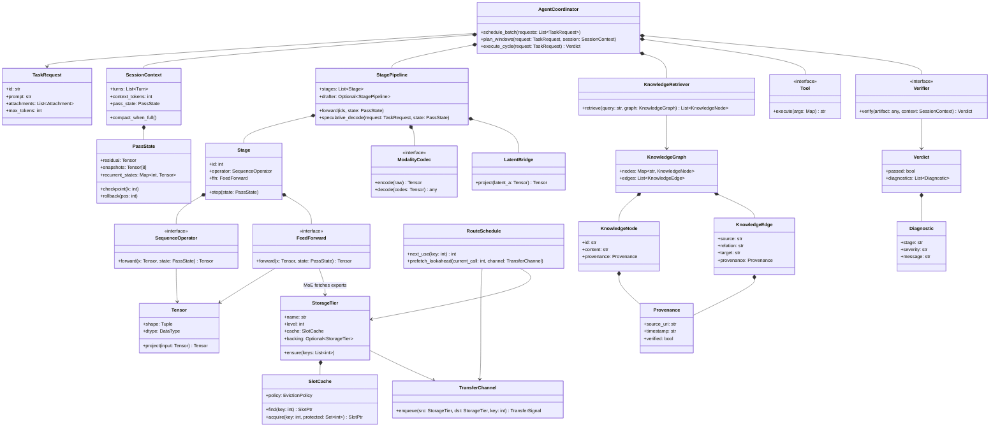

# Step 2 — Reduction 2: Unifying Variants into Polymorphic Domain Archetypes (88 → 24 Classes)

## Clover Cycle 2 — Replacing Procedural Naming with Polymorphism & Composition

- **Context:** In [Step 1](01-reduction-1-eliminate-clones-and-mirrors.md), removing copy-paste clones and FFI mirrors reduced 338 raw types to **88 technical classes**. Yet those 88 classes still violate core Object-Oriented Design:
  - Layer 0 is a class called `Layer0Server`, Layers 1–92 are `KdaOrMlaTransformer` or `BatchLayerLb` or `GpuLayerHandle`, Layer 93 is `Layer93Tail`, a drafter layer is `DraftLayer`, an NCM block is `TransformerBlock`, and a vision layer is `MoonViTEncoderLayer`.
  - A Python compiler is `PythonGenerativeCompiler` and a Rust compiler is `RustGenerativeCompiler`, while `VerificationPolicyGuard` and `GraphValidator` sit beside them without a shared interface.
  - `CloverK3AgentEngine`, `K3FastChatEngine`, `K3MultimodalChatEngine`, `HybridGenerationEngine`, and `K3WholeModel` are 5 separate "engine" classes that all run a `Context -> Plan -> Decode -> Verify` pipeline.
- **Direction:** Apply genuine OOP reduction:
  1. **Never create a new class for an instance coordinate** (`Layer0`, `Layer93`). Layer index is a field (`stage_id: 0..93`), not a class!
  2. **Use Composition (`has-a`) over combinatorial subclasses:** Any transformer layer is a `Stage` composed of `(Norm, SequenceOperator, FeedForward)`. Whether it is Layer 0 (`KDA + DenseFFN`), Layer 2 (`KDA + RoutedMoE`), Layer 3 (`MLA + RoutedMoE`), an NCM block (`CausalAttention + DenseFFN`), or a Vision block (`2DRoPEAttention + DenseFFN`) is determined by which `SequenceOperator` and `FeedForward` it holds!
  3. **Use Polymorphism (`is-a`) for interchangeable strategies:** Eviction policies, tokenizers, tools, verifiers, and latent bridges are strategies implementing a single interface.
- **Execution:** Reduce the 88 technical classes into **24 polymorphic domain archetypes** across 6 clean packages using complete English class, method, and variable names.
- **Outcome:** 88 technical classes collapse to **24 domain classes** (a **72.7% reduction from Step 1**, and **94.0% reduction from Step 0's 398 raw types**).
- **Growth:** Once every class is polymorphic and compositional, the true structure of the system emerges clearly — preparing us for Step 3, where we organize these 24 domain archetypes into **12 complete-English domain objects** with explicit Decorators and GoF Design Patterns without collapsing distinct lifetimes or interfaces.

---

## 1. The 8 Polymorphic Unifications (88 → 24 Classes)

### 1.1 All Layers & Blocks Are One Compositional `Stage` (`14 classes → 4 classes`)

In Step 1, we still had 14 classes for neural layers and their components:
`Layer0Server`, `KdaOrMlaTransformer`, `BatchLayerLb`, `Layer93Tail`, `FinalNormalization`, `DraftLayer`, `GpuLayerHandle`, `GpuLayerTrunk`, `TransformerBlock`, `MoonViTEncoderLayer`, `LayerNorm`, `RMSNorm`, `SelfAttention`, `FeedForwardMLP`.

Look at what every single one of those actually is:
1. **`Stage`** (a single transformation step in a `Pipeline`):
   - Holds `id: int`, `snapshot_rule: FoldRule` (e.g., fold 9 snapshots at multiples of 12), `operator: SequenceOperator`, and `ffn: FeedForward`.
   - **Layer 0** is simply `Stage(id=0, operator=KdaOperator, ffn=DenseFeedForward)`.
   - **Layers 1..92 (KDA)** are `Stage(id=L, operator=KdaOperator, ffn=MoEFeedForward)`.
   - **Layers 3,7..92 (MLA)** are `Stage(id=L, operator=MlaOperator, ffn=MoEFeedForward)`.
   - **Layer 93 (Tail)** is `Stage(id=93, operator=NineSourceFoldNorm, ffn=VocabularyProjection)`.
   - **NCM / Vision / Drafter Blocks** are `Stage(operator=SelfAttentionOperator, ffn=DenseFeedForward)`.
2. **`SequenceOperator`** *(polymorphic interface)*:
   - Implemented by `KdaOperator` (recurrent state $S \in \mathbb{R}^{96 \times 128 \times 128}$ + conv3 history), `MlaOperator` (latent KV cache), and `SelfAttentionOperator` (standard causal/2D-RoPE attention).
3. **`FeedForward`** *(polymorphic interface)*:
   - Implemented by `DenseFeedForward` (gated SwiGLU/GELU MLP) and `MoEFeedForward` (`Router` + `SharedExpert` + `896 RoutedExperts` fetched via `MemoryPool`).
4. **`Tensor`** (unifies `TensorRecord`, `NumericTable`, `PackedTrunk4Bit`, `ExpertStore`, `A8QuantTables`, `ImmaBitPlanes`, `ByteSlice`):
   - A shaped numeric array `(shape, dtype, quantization_codec, backing_slice)` that knows how to project an input activation (`project(x)`).

---

### 1.2 All Per-Pass Buffers & Caches Are One `PassState` (`10 classes → 1 class`)

In Step 1, we had 10 classes holding mutable per-sequence/per-window state:
`Layer0Sequence`, `TransformerSequence`, `BatchScratchBuf`, `Layer93Sequence`, `GpuCardWorkspace` (`Work`), `GpuKdaState` (`KdaState`), `GpuMlaCache` (`MlaCache`), `ExpertStoreScratch`, `RowState`, `SpeculativeStats`.

Every single one of these is the **mutable state of an active sequence pass**:
- **`PassState`**:
  - Holds the rolling residual stream (`current`, `next`, `snapshots[8]`), per-stage recurrent/KV states (`stage_states[0..92]`), position cursor (`pos`, with `checkpoint(k)` and `rollback(pos)` for speculative decoding), and reusable scratch arena (`arena`).

---

### 1.3 All Memory Pools, Caches, Queues & Planners Are 4 Cooperating Classes (`13 classes → 4 classes`)

In Step 1, the data-movement subsystem had 13 classes:
`SlotCache`, `SlotEntry`, `MemoryPool`, `TransferStats`, `TransferSignal`, `TransferJob`, `TransferQueue`, `RouteCall`, `RouteTable`, `PrefetchPlanner`, `SlotSupply`, `EngineConfig`, `LibraryBinding`.

In true OOP, this is a classic **Tiered Cache & Prefetcher** with 4 classes:
1. **`StorageTier`** (unifies NVMe `ExpertStore`, pinned RAM `HostCache`, and GPU VRAM `CardPool`):
   - Each `StorageTier` has a `tier_level` (Tier 1 = VRAM, Tier 2 = Pinned RAM, Tier 3 = NVMe), a `capacity_slots`, a `SlotCache`, a `backing_tier: Optional<StorageTier>`, and `TransferStats`.
   - Calling `tier.ensure(keys)` checks local `SlotCache` (R3 hit); on a miss, requests from `backing_tier` (R1 transfer); on eviction, checks `backing_tier.contains(victim)` to either drop cleanly (R4 clean drop) or write back (R2 writeback).
2. **`SlotCache`** (with pluggable **`EvictionPolicy`**: `LruPolicy`, `Heat48Policy`, `BeladyPolicy`, `SpecMdLeastStalePolicy`).
3. **`TransferChannel`** (unifies `TransferQueue`, `TransferJob`, `TransferSignal`, and `SlotSupply` — moves fixed-size slot payloads asynchronously between `StorageTier`s and signals completion).
4. **`RouteSchedule`** (unifies `RouteTable`, `RouteCall`, and `PrefetchPlanner` — records or predicts `(stage_id, expert_ids[])` across passes and issues lookahead `TransferJob`s into `TransferChannel` before the stage executes).

---

### 1.4 All Tokenizers, Codebooks & Latent Bridges Are `Codec` and `LatentBridge` (`16 classes → 2 classes`)

In Step 1, we had:
- 6 tokenizer classes (`BaseTokenizer`, `BPETokenizer`, `HFTokenizer`, `SudokuTokenizer`, `VQVAETokenizer`, `K3FastCtypesTokenizer`) + 6 VQ-VAE quantization classes (`VQEncoder`, `VQDecoder`, `VectorQuantizer`, `MultiscaleResidualVQ`, `PhiConvResidual`, `VQVAEModel`, `TiedCodebookHead`, `CausalPointerDecoder`).
- Plus `VisionPatchEmbed3D`, `PosEmb2D`, `PatchMergerProjector`, `K3OptionAMoonViT`, `LatentBridgeModule`, `LatentSpanReadout`.

Wait — what do `Tokenizer`, `VQVAE`, and `MoonViT` all do?
1. **`ModalityCodec`** *(polymorphic interface: `encode(raw) -> LatentTokens`, `decode(LatentTokens) -> raw`)*:
   - `TextTokenizer` encodes/decodes UTF-8 strings $\leftrightarrow$ discrete token IDs (`163,840` vocab).
   - `ConceptVQVAECodec` encodes/decodes 32-token text windows $\leftrightarrow$ multi-scale residual discrete concept codes.
   - `VisionCodec` (`MoonViT3d`) encodes images/video frames $\leftrightarrow$ visual patch embeddings.
2. **`LatentBridge`** (unifies all 10 bridge classes: `HybridLink`, `K3ExpertBridge`, `ComboBridge`, `PatchMergerMLP`, `LatentSpanReadout`):
   - Projects latent vectors from a source representation space $A$ (`d_in`) into a target representation space $B$ (`d_out`).

---

### 1.5 All Neural Pipelines (K3 93-Layer, NCM, HybridAgent, DSpark) Are `StagePipeline` (`6 classes → 1 class`)

Instead of separate classes for `K3WholeModel`, `K3GPUExpertsRunner`, `NextConceptTransformer`, `HybridAgentModel`, `DSparkDrafter`, and `SequenceTransformer`:
- **`StagePipeline`**:
  - Composes an input `ModalityCodec`, an ordered list of `Stage`s (`stages[0..L]`), optional `LatentBridge`s between stages, an output `ModalityCodec`, and an optional draft `StagePipeline` (`drafter` for speculative decoding).

---

### 1.6 All Engines & Coordinators Are `AgentCoordinator` + `SessionContext` + `TaskRequest` (`6 classes → 3 classes`)

In Step 1, we had `MultiGPUCloverCoordinator`, `CloverK3AgentEngine`, `K3FastChatEngine`, `K3MultimodalChatEngine`, `HybridGenerationEngine`, `ChatRequestHandler`, `PendingTextRequest`, plus `chat`/`session`/`ChatTurn`/`GenerationRequest`.
They reduce to 3 classes:
1. **`TaskRequest`** (unifies `GenerationRequest`, `PendingTextRequest`, `ChatTurn`, HTTP/SSE request envelope).
2. **`SessionContext`** (manages multi-turn conversation history, 256K token budget, automatic simple-sentence compaction when $>262,144$ tokens, and active `PassState`).
3. **`AgentCoordinator`** (the unified orchestrator that takes a batch of `TaskRequest`s + `SessionContext`s, plans windows, invokes `Tool`s and `KnowledgeGraph` retrieval, runs the `StagePipeline`, and checks the output through `Verifier`s).

---

### 1.7 All Knowledge & Memory Graphs Are 5 Clean Graph Classes (`9 classes → 5 classes`)

- **`KnowledgeGraph`** (holds `KnowledgeNode`s and `KnowledgeEdge`s, supporting multi-hop `query_walk()` and context packaging).
- **`KnowledgeNode`** (entity or memory entry with `id`, `kind`, `content`, `revisions[]`, and `Provenance`).
- **`KnowledgeEdge`** (directed typed relation `(source, relation, target)` with `Provenance`, supporting both explicit and derived edges).
- **`Provenance`** (immutable citation: `source_type`, `uri`, `timestamp`, `verification_status`).
- **`KnowledgeRetriever`** (hybrid lexical + ontology + McCulloch-Pitts symbolic predicate retriever).

---

### 1.8 All Tools, Compilers & Guards Are `Tool` and `Verifier` (`10 classes → 4 classes`)

- **`Tool`** *(interface: `execute(call) -> Observation`)*:
  - Implemented by `PythonSandboxTool`, `LiveWebSearchTool`, `KnowledgeSearchTool`.
- **`Verifier`** *(interface: `verify(candidate, context) -> Verdict`)*:
  - Unifies `PythonGenerativeCompiler`, `RustGenerativeCompiler`, `GraphValidator` (`CloverSymbolicVerifier`), `SuttonTDPredictor`, `VerificationPolicyGuard` (`write_guard.py`), `DifferentialHarness`, and `SiteChecker`.
- **`Verdict`** (holds `passed: bool`, `diagnostics: List[Diagnostic]`, `metrics`, and `repaired_artifact`).
- **`Diagnostic`** (holds `stage`, `severity`, `location`, `message`).

---

## 2. Complete Map of the 24 Polymorphic Domain Classes

| # | Package | Domain Class | Polymorphic Subtypes / Implementations | Replaces Count from Step 1 |
|---:|---|---|---|---:|
| 1 | **1. Tensor & Compute** | `Tensor` | `DenseTensor`, `PaletteQuantizedTensor`, `Packed4BitTensor`, `SafetensorsView` | 7 |
| 2 | **1. Tensor & Compute** | `SequenceOperator` | `KdaOperator`, `MlaOperator`, `CausalAttentionOperator`, `Vision2DRoPEOperator`, `NineSourceFoldNorm` | 5 |
| 3 | **1. Tensor & Compute** | `FeedForward` | `DenseFeedForward`, `MoEFeedForward` (`Router` + `896 Experts`) | 4 |
| 4 | **1. Tensor & Compute** | `Stage` | Configured by `(id, SequenceOperator, FeedForward)` — covers L0, L1..92, L93, NCM, Vision, Drafter | 10 |
| 5 | **1. Tensor & Compute** | `PassState` | Holds residual buffers, 8 snapshots, recurrent/KV caches, speculative rollback checkpoints | 10 |
| 6 | **1. Tensor & Compute** | `StagePipeline` | Chains `ModalityCodec -> Stage[0..L] -> ModalityCodec` (K3 93-Layer, NCM, HybridAgent, DSpark) | 6 |
| 7 | **2. Memory & Data Movement** | `StorageTier` | `VramCardTier` (Tier 1), `PinnedHostTier` (Tier 2), `NvmeDirectTier` (Tier 3) | 4 |
| 8 | **2. Memory & Data Movement** | `SlotCache` | Uses `EvictionPolicy`: `LruPolicy`, `Heat48Policy`, `BeladyPolicy`, `SpecMdLeastStaleR4Policy` | 2 |
| 9 | **2. Memory & Data Movement** | `TransferChannel` | Asynchronous DMA/pread queue + completion signals (`R1_host`, `R1_nvme`, `R2_wb`, `R4_drop`) | 4 |
| 10 | **2. Memory & Data Movement** | `RouteSchedule` | Route trace table + cross-layer lookahead planner | 3 |
| 11 | **3. Codecs & Bridges** | `ModalityCodec` | `TextTokenizer`, `ConceptVQVAECodec`, `VisionMoonViTCodec`, `SudokuCodec` | 12 |
| 12 | **3. Codecs & Bridges** | `LatentBridge` | `HybridLinkBridge`, `K3ExpertBridge`, `VisionPatchMergerBridge`, `LatentSpanReadout` | 4 |
| 13 | **4. Knowledge & Provenance** | `KnowledgeGraph` | Unified Memory + Ontology property graph | 2 |
| 14 | **4. Knowledge & Provenance** | `KnowledgeNode` | Entity vertex / memory entry with revision chain | 2 |
| 15 | **4. Knowledge & Provenance** | `KnowledgeEdge` | Explicit or rule-derived typed relation | 1 |
| 16 | **4. Knowledge & Provenance** | `Provenance` | Source URI, timestamp, hash, verification state | 1 |
| 17 | **4. Knowledge & Provenance** | `KnowledgeRetriever` | Multi-hop traversal + symbolic predicate filter | 2 |
| 18 | **5. Verification & Tools** | `Tool` | `PythonSandboxTool`, `LiveWebSearchTool`, `KnowledgeSearchTool` | 5 |
| 19 | **5. Verification & Tools** | `Verifier` | `PythonGenerativeCompiler`, `RustGenerativeCompiler`, `SymbolicOntologyVerifier`, `WriteGuardPolicy`, `DifferentialHarness` | 5 |
| 20 | **5. Verification & Tools** | `Verdict` | Pass/fail outcome + metrics + repaired artifact | 1 |
| 21 | **5. Verification & Tools** | `Diagnostic` | Line/stage/severity evidence item | 1 |
| 22 | **6. Orchestration** | `TaskRequest` | User prompt, attachments, generation config, response stream | 2 |
| 23 | **6. Orchestration** | `SessionContext` | Multi-turn history, 256K context window & simple-sentence compaction | 2 |
| 24 | **6. Orchestration** | `AgentCoordinator` | Multi-GPU batch clubbing, window planning, tool/graph grounding, pipeline execution, verification | 3 |

---

## 3. UML Class Diagram of the 24 Domain Archetypes

---

## Next Cycle Pointer

We have reduced **398 raw types $\to$ 88 technical classes $\to$ 24 polymorphic domain classes**.
Now comes the next critical step:
- Several of the 24 classes are parts owned by a single aggregate (`KnowledgeGraphNode`, `KnowledgeGraphEdge`, `SourceProvenance`, and `KnowledgeRetriever` all belong to **`VerifiedKnowledgeGraph`**; `VerificationDiagnostic` belongs to **`VerificationVerdict`**).
- At the same time, we must **never** over-collapse objects that have different lifetimes or incompatible interfaces (e.g., `ConversationSession` must stay separate from GPU `ForwardPassWorkspace`; `QuantizedTensorRecord`, `NeuralStagePipeline`, and `ExternalTool` must stay separate; and `ArtifactVerifier` **produces** a `VerificationVerdict` rather than inheriting from it).

Proceed to **[Step 3 — Reduction 3: Complete-English Domain Objects, Decorators & Design Patterns (24 → 12 Core Objects)](03-reduction-3-real-world-objects.md)**.
