# Step 3 — Reduction 3: Complete-English Domain Objects, Decorators & OOP Design Patterns (24 → 12 Core Objects)

## Clover Cycle 3 — Complete-English Naming & Sound Object Boundaries

- **Context:** In [Step 2](02-reduction-2-domain-archetypes-and-polymorphism.md), we reduced **398 raw types** to **24 polymorphic domain classes**. Reviewing how those 24 classes interact reveals two things:
  1. Several of the 24 classes are internal parts of a single aggregate root (for example, `KnowledgeGraphNode`, `KnowledgeGraphEdge`, `SourceProvenance`, `KnowledgeNodeRevision`, and `KnowledgeRetriever` are all owned by **`VerifiedKnowledgeGraph`**; `ExpertSlotCache`, `ExpertSlotCacheEntry`, and `CacheEvictionStrategy` are owned by **`MemoryStorageTier`**; `TransformerStage`, `SequenceMixingOperator`, and `FeedForwardNetwork` are composed inside **`NeuralStagePipeline`**; `VerificationDiagnostic` is owned by **`VerificationVerdict`**).
  2. At the same time, true Object-Oriented Design **never** merges objects that have incompatible lifetimes or type signatures just to make the class count smaller:
     - **`ConversationSession`** (multi-turn UTF-8 history & 256K simple-sentence compaction across requests) and **`ForwardPassWorkspace`** (device activation buffers, 8 carbon-copy snapshots, and KDA/MLA states that live for milliseconds during a forward pass) must remain **two separate classes**.
     - **`QuantizedTensorRecord`** (passive weight matrix), **`NeuralStagePipeline`** (93-stage transformation pipeline), and **`ExternalTool`** (`PythonSandboxTool` / `LiveWebSearchTool`) have completely different responsibilities and method signatures — they must remain **three separate classes**.
     - **`ArtifactVerifier`** (`verify_candidate_artifact_against_context(...) -> VerificationVerdict`) **produces** a **`VerificationVerdict`** — a verifier is an inspector, while a verdict is the immutable record of what reality showed.
- **Direction:**
  1. Organize the 24 domain classes into **12 Complete-English Core Domain Objects** where every class, method, variable, boolean property, and constant is written in full, unabbreviated English so a human reader can immediately tell what every identifier is.
  2. Apply explicit **Decorators** (`@register_component_in_catalog`, `@enforce_direction_boundary`, `@record_execution_telemetry`, `@emit_clover_cycle_stage`, `@abstractmethod`, `@property`, `@classmethod`, `@dataclass(frozen=True)`) and **8 classic OOP Design Patterns** (`Strategy`, `Chain of Responsibility`, `Composite Pipeline`, `Decorator Wrapper`, `Factory & Registry`, `Memento`, `Fluent Builder`, and `Template Method + Observer`).
- **Execution:** Define the Hyphenated Complete-English Role-Prefix Grammar (`class-*`, `function-*`, `variable-*`, `flag-*`, `constant-*`, `decorator-*`), the 12 Core Domain Objects, their real-world meaning, and their exact relationships in [`clover-object-model.py`](../../clover-ai-system/src/tools/hybrid-ncm-k3/clover-object-model.py).
- **Outcome:** 24 domain classes organize cleanly into **12 Core Domain Objects** (**97.0% reduction** from the 398 raw types) with zero violation of Single Responsibility (`SRP`) or Liskov Substitution (`LSP`).
- **Growth:** Writing every class, function, variable, flag, constant, and decorator with literal ASCII hyphens `-` (`class-task-direction`, `class-conversation-session`, `function-ensure-expert-tensor-resident`, `variable-resident-entries-by-identifier`, `flag-has-passed-all-checks`) makes both architectural invariants and code roles self-evident at a glance.

---

## 1. Hyphenated Complete-English Naming Grammar (Tell Every Symbol Type at a Glance)

Except for language reserved words (`class`, `def`, `if`, `else`, `for`, `while`, `return`, `try`, `except`, `with`), every symbol uses literal ASCII hyphens `-` and an explicit role prefix:

| Symbol Kind | Role Prefix & Hyphenated English Rule | How It Reads in [`clover-object-model.py`](../../clover-ai-system/src/tools/hybrid-ncm-k3/clover-object-model.py) |
|---|---|---|
| **1. Class / Interface** | `class-*` **Complete Noun Phrase** (*what the object is*; zero abbreviations like `Cfg`, `Buf`, `Mat`, `Ent`, `Prov`) | `class-task-direction`, `class-conversation-session`, `class-forward-pass-workspace`, `class-verified-knowledge-graph`, `class-memory-storage-tier`, `class-quantized-tensor-record`, `class-neural-stage-pipeline`, `class-artifact-verifier`, `class-verification-verdict` |
| **2. Method / Function** | `function-*` **Complete Verb-Phrase Sentence** (*starts with an action verb + direct object + preposition*) | `function-encode-input-into-activation-vector()`, `function-ensure-expert-tensor-resident()`, `function-compact-oldest-turns-into-summary-when-full()`, `function-verify-candidate-artifact-against-context()`, `function-record-verified-outcome-into-context()` |
| **3. Variable / Attribute** | `variable-*` **Complete Descriptive Noun Phrase** (*plural for collections, explicit key/unit in name*) | `variable-resident-entries-by-identifier`, `variable-carbon-copy-snapshots`, `variable-protected-file-paths`, `variable-capacity-in-slots`, `variable-maximum-token-budget`, `variable-backing-storage-tier`, `variable-current-activation-vector` |
| **4. Boolean Flag / Predicate** | `@property` `flag-*` **Auxiliary-Verb Question Clause** (`flag-is-*`, `flag-has-*`, `flag-can-*`, `flag-allows-*`) | `if variable-session.flag-has-exceeded-maximum-token-budget:`, `if self.flag-is-cache-currently-full:`, `if variable-verdict.flag-has-passed-all-checks:`, `if variable-direction.flag-has-non-empty-goal:` |
| **5. Constant** | `constant-*` **Complete Quantified Noun Phrase** | `constant-maximum-session-context-tokens = 262_144`, `constant-default-snapshot-interval-in-stages = 12`, `constant-total-routed-experts-per-stage = 896` |
| **6. Decorator** | `@decorator-*` **Declarative Verb Phrase** | `@decorator-register-component-in-catalog`, `@decorator-enforce-direction-boundary`, `@decorator-record-execution-telemetry`, `@decorator-emit-clover-cycle-stage` |

---

## 2. The 12 Complete-English Core Domain Objects

### 1. `TaskDirection` *(The Human Request, Configuration & Safety Boundaries)*
- **Real-world role:** The written work order specifying what goal is requested (`goal_description`), the generation budget (`maximum_new_tokens`), and the non-negotiable safety boundaries (`protected_file_paths`, `required_verification_languages`).
- **Key methods & properties:**
  - `@property def has_non_empty_goal(self) -> bool`
  - `def allows_modification_of_path(self, candidate_file_path: str) -> bool`
- **Replaces (14 raw types):** `GenerationRequest`, `GenerationConfig`, `PendingTextRequest`, `ChatRequestHandler`, `ec_settings`, `EcSettings`, `KimiK3Config`, `KimiLinearConfig`, `VerificationPolicy`.

---

### 2. `ConversationSession` *(Persistent Multi-Turn History & 256K Compaction)*
- **Real-world role:** The long-lived session ledger that stores completed user/assistant turns (`conversation_turns: List[ConversationTurnRecord]`), tracks `current_token_count` against `maximum_token_budget` (`262,144`), automatically summarizes the oldest turns into `compacted_summary_sentences` when full, and supports **Memento Pattern** checkpoints (`capture_turn_checkpoint()`, `restore_turn_checkpoint()`).
- **Why kept distinct from `ForwardPassWorkspace`:** `ConversationSession` persists across turns and HTTP requests in UTF-8 text; `ForwardPassWorkspace` holds transient device tensors during a single forward pass.
- **Replaces (8 raw types):** `session`, `ChatTurn`, `chat`, `ParticipantStateSnapshot`.

---

### 3. `ForwardPassWorkspace` *(Device Activation Stream, 8 Carbon-Copy Snapshots & Speculative Memento)*
- **Real-world role:** The per-pass tensor workbench holding `current_activation_vector` (`[N, 7168]`), the 8 residual snapshots captured every 12 stages (`carbon_copy_snapshots`), and per-stage recurrent/KV memory (`recurrent_state_by_stage_index`). Implements the **Memento Pattern** (`capture_checkpoint_memento()`, `restore_from_checkpoint_memento()`) so speculative decoding can roll back rejected draft tokens in O(1).
- **Replaces (18 raw types):** `ServerSequence`, `TransformerSequence`, `Transformer93Sequence`, `Work`, `Card`, `Buf`, `KdaState`, `MlaCache`, `RowState`, `SpeculativeStats`, `ExpertStoreScratch`, `Planes`, `Srcs`.

---

### 4. `VerifiedKnowledgeGraph` *(File-Backed Property Graph, Staging Gate & Provenance)*
- **Real-world role:** The permanent cited reference library composing `KnowledgeGraphNode`s, `KnowledgeGraphEdge`s, `KnowledgeNodeRevision`s, and immutable `SourceProvenance` citations (`[source_kind: source_reference_uri (verified at timestamp)]`), with an explicit staging and promotion gate (`stage_candidate_node_for_review()` $\to$ `promote_staged_node_to_active_graph()`) and `read_epoch_counter` invalidation.
- **Replaces (30 raw types):** `CloverMemoryGraphStore`, `MemoryEntry`, `MemoryRelationship`, `MemoryProvenance`, `MemoryRevision`, `TraversalStep`, `TraversalResultNode`, `EvolutionChainNode`, `RetrievedMemoryItem`, `MemoryContextPackage`, `CloverOntologyGraph`, `Vertex`, `Edge`, `Relation`, `EntityClass`, `EntityRef`, `Provenance`, `Evidence`, `GraphPath`, `CloverGraphTraversal`, `CloverOntologyRetriever`, `ExpertTree`, `BinaryExpertTree`.

---

### 5. `MemoryStorageTier` *(3-Tier Chain of Responsibility: GPU VRAM $\to$ Pinned Host RAM $\to$ NVMe Direct)*
- **Real-world role:** A tiered storage pool that owns an `ExpertSlotCache` (configured with a pluggable **`CacheEvictionStrategy`** such as `LeastStaleCacheEvictionStrategy`), a pointer to its `backing_storage_tier: Optional[MemoryStorageTier]`, and a `DataMovementStatisticsLedger`.
- **How the Chain of Responsibility + SpecMD R4 Clean Drop works:**
  - When `vram_card_tier.ensure_expert_tensor_resident(expert_identifier, ...)` is called:
    1. If `expert_identifier` is in `vram_card_tier.slot_cache`, it increments `local_tier_hits_count` and returns immediately.
    2. On a miss, it delegates to `self.backing_storage_tier.ensure_expert_tensor_resident(...)` (`PinnedHostRamPool` $\to$ `NVMeDirectVault`).
    3. If `vram_card_tier.slot_cache` is full, `LeastStaleCacheEvictionStrategy` selects a victim from a layer that already finished in the current pass. If `self.backing_storage_tier.is_expert_currently_resident(victim)` is true, it drops the victim cleanly (`clean_eviction_drops_r4_count += 1`) with **zero PCIe D2H writeback**!
- **Replaces (35 raw types):** `CardPool`, `HostCache`, `SlotCache`, `SlotCache::Ent`, `SlotCacheSel`, `sc_cache`, `sc_entry`, `Node`, `Acquired`, `CpuSlotCache`, `ExpertCache`, `LiveSlotCache`, `SlotCacheSim`, `SinglePoolCache`, `pi_host_cfg`, `pi_host_out`, `pi_pool_cfg`, `pi_pool_out`, `sy_pool`, `sy_host`, `Pool`, `Host`, `ExpertStats`, `pi_expert_stats`, `sy_stats`.

---

### 6. `AsynchronousTransferChannel` *(Prefetch Schedule, DMA Queue & Completion Signals)*
- **Real-world role:** Coordinates lookahead prefetching (`RouteSchedule`) and background asynchronous transfers (`AsynchronousTransferJob`, `TransferCompletionSignal`) between `MemoryStorageTier` levels ahead of stage execution.
- **Replaces (48 raw types):** `PfJob`, `PfQueue`, `cq_job`, `cq_config`, `Engine<B>`, `Queue`, `QState`, `Pending`, `Arrival`, `Rel`, `CqHold`, `Need`, `Victim`, `Supply`, `Planner`, `Wiring`, `Loader`, `LayerJob`, `CardQ`, `CallSet`, `rt_table`, `Call`, `PaperMove`, `PaperPebbleEngine`.

---

### 7. `ModalityCodec` *(Polymorphic Encoder/Decoder & Latent Space Bridge)*
- **Real-world role:** Translates between external modalities (UTF-8 text, 32-token VQ-VAE concept windows, 3D vision patches) and internal activation vectors (`encode_input_into_activation_vector()`, `decode_activation_vector_into_text()`).
- **Replaces (46 raw types):** `Tokenizer`, `Tok`, `K3Tokenizer`, `BPETokenizer`, `HFTokenizer`, `SudokuTokenizer`, `VQVAETokenizer`, `VQVAE`, `Encoder`, `Decoder`, `MultiscaleResidualVectorQuantizer`, `MoonViT3dEncoder`, `HybridLink`, `K3ExpertBridge`, `ComboBridge`, `K3ComboBridge`, `K3NativeHybridLink`, `PatchMergerMLP`, `LatentSpanReadout`.

---

### 8. `QuantizedTensorRecord` *(Calibrated Weight Matrix & Quantized Projection)*
- **Real-world role:** Passive, shaped numerical tensor (`tensor_name`, `row_count`, `column_count`, `quantization_format`) that projects an input activation vector (`project_activation_vector(input_activation_vector)`).
- **Replaces (28 raw types):** `ServerRecord`, `TransformerRecord`, `Record`, `Trunk`, `Mat`, `NumericTable`, `ServerInput`, `ServerOutput`, `PackedTrunk`, `Bf16Matrix`, `SafetensorsTensor`, `ExpertStore`, `A8Tables`, `ByteSlice`.

---

### 9. `NeuralStagePipeline` *(Composite Pipeline of Compositional `TransformerStage`s)*
- **Real-world role:** Chains `ModalityCodec` $\to$ `ordered_stages: List[TransformerStage]` $\to$ `ModalityCodec` over a `ForwardPassWorkspace`. Each **`TransformerStage`** composes a polymorphic **`SequenceMixingOperator`** (`KimiDeltaAttentionOperator` or `MultiHeadLatentAttentionOperator`) and a polymorphic **`FeedForwardNetwork`** (`DenseSwiGLUFeedForwardNetwork` or `RoutedMixtureOfExpertsFeedForwardNetwork`), capturing a carbon-copy snapshot onto `ForwardPassWorkspace` every 12 stages.
- **Replaces (38 raw types):** `Model`, `K3Full93Chain`, `K3MultiCardChain`, `K3GPUExpertsRunner`, `HybridAgentModel`, `NextConceptTransformer`, `Server`, `Transformer`, `LbLayer`, `Layer`, `Handle`, `Transformer93`, `Normalization`, `DraftLayer`, `D`, `Block`, `CausalBlock`, `CrossBlock`, `MoonViTEncoderLayer`, `MLP`, `MLP2`.

---

### 10. `ExternalTool` *(Sandboxed Action Interface & Decorator Wrapper)*
- **Real-world role:** Executes bounded external actions (`execute_tool_action(action_input_query, task_direction) -> str`) such as Python calculation, live web search, or workspace file operations. Wrapped by **`RetryingExternalToolDecorator`** (Decorator Pattern) and guarded by `@enforce_direction_boundary`.
- **Replaces (8 raw types):** `BaseTool`, `PythonTool`, `TavilySearchTool`, `RetryingSearchTool`, `K3KnowledgeSearchTool`, `LiveWebSearchTool`, `ToolExecutor`.

---

### 11. `ArtifactVerifier` *(Independent Compiler, Symbolic Ontology Gate & Boundary Verifier)*
- **Real-world role:** Independently inspects a candidate artifact against reality (`verify_candidate_artifact_against_context(candidate_artifact_text, task_direction, knowledge_graph) -> VerificationVerdict`). Never conflated with the verdict it produces!
- **Replaces (42 raw types):** `CloverPythonGenerativeCompiler`, `CloverRustGenerativeCompiler`, `_PythonStatementBoundaryAnalyzer`, `SuttonTDStatementPredictor`, `CloverSymbolicVerifier`, `MPOntologyPredicate`, `Checker`, `FourWayEvaluator`, and the differential test harnesses (`diff_driver`, `ld_driver`, `pl_driver`, `pi_driver`, `sy_driver`).

---

### 12. `VerificationVerdict` *(Immutable Outcome Record & Diagnostics)*
- **Real-world role:** Immutable `@dataclass(frozen=True)` value object produced by an `ArtifactVerifier`, holding `has_passed_all_checks: bool`, `verified_artifact_text: str`, `diagnostics: Tuple[VerificationDiagnostic, ...]`, and `supporting_nodes: Tuple[KnowledgeGraphNode, ...]`.
- **Replaces (11 raw types):** `GCVerdict`, `GCDiagnostic`, `GraphValidationReport`, `GenPPLResult`, `Mismatch`.

---

## 3. Eight OOP Design Patterns & Four Custom Decorators Working Together

```mermaid
classDiagram
    direction TB

    class TaskDirection {
        +request_identifier: str
        +goal_description: str
        +maximum_new_tokens: int
        +protected_file_paths: Set~str~
        +has_non_empty_goal() bool
        +allows_modification_of_path(candidate_file_path: str) bool
    }

    class ConversationSession {
        +session_identifier: str
        +conversation_turns: List~ConversationTurnRecord~
        +compacted_summary_sentences: List~str~
        +current_token_count: int
        +maximum_token_budget: int
        +has_exceeded_maximum_token_budget() bool
        +append_completed_turn(user_prompt_text: str, assistant_reply_text: str)
        +compact_oldest_turns_into_summary_when_full()
        +capture_turn_checkpoint() SessionCheckpointMemento
        +restore_turn_checkpoint(checkpoint_memento: SessionCheckpointMemento)
    }

    class ForwardPassWorkspace {
        +current_activation_vector: List~float~
        +carbon_copy_snapshots: List~List~float~~
        +recurrent_state_by_stage_index: Dict~int, List~float~~
        +sequence_position: int
        +record_carbon_copy_snapshot()
        +capture_checkpoint_memento() WorkspaceCheckpointMemento
        +restore_from_checkpoint_memento(checkpoint_memento: WorkspaceCheckpointMemento)
    }

    class VerifiedKnowledgeGraph {
        +nodes_by_identifier: Dict~str, KnowledgeGraphNode~
        +directed_edges: List~KnowledgeGraphEdge~
        +read_epoch_counter: int
        +stage_candidate_node_for_review(candidate_node: KnowledgeGraphNode)
        +promote_staged_node_to_active_graph(node_identifier: str, provenance: SourceProvenance) KnowledgeGraphNode
        +retrieve_grounded_nodes_for_query(natural_language_query: str) List~KnowledgeGraphNode~
    }

    class MemoryStorageTier {
        +tier_name: str
        +tier_level: int
        +slot_cache: ExpertSlotCache
        +backing_storage_tier: Optional~MemoryStorageTier~
        +movement_statistics: DataMovementStatisticsLedger
        +ensure_expert_tensor_resident(expert_identifier: int, protected_expert_identifiers: Set~int~) QuantizedTensorRecord
    }

    class ExpertSlotCache {
        +capacity_in_slots: int
        +eviction_strategy: CacheEvictionStrategy
        +resident_entries_by_identifier: Dict~int, ExpertSlotCacheEntry~
        +is_cache_currently_full() bool
        +lookup_resident_expert(expert_identifier: int) Optional~QuantizedTensorRecord~
        +insert_expert_evicting_if_needed(expert_identifier: int, payload_tensor: QuantizedTensorRecord)
    }

    class CacheEvictionStrategy {
        <<interface>>
        +select_victim_expert_identifier(resident_entries, protected_identifiers, pass_number, layer_index) int
    }

    class NeuralStagePipeline {
        +modality_codec: ModalityCodec
        +ordered_stages: List~TransformerStage~
        +snapshot_interval_in_stages: int
        +execute_forward_pipeline(task_direction: TaskDirection, forward_pass_workspace: ForwardPassWorkspace) str
    }

    class TransformerStage {
        +stage_index: int
        +sequence_operator: SequenceMixingOperator
        +feed_forward_network: FeedForwardNetwork
        +advance_stage_on_workspace(forward_pass_workspace: ForwardPassWorkspace) List~float~
    }

    class ExternalTool {
        <<interface>>
        +tool_name() str
        +execute_tool_action(action_input_query: str, task_direction: TaskDirection) str
    }

    class RetryingExternalToolDecorator {
        +wrapped_tool: ExternalTool
        +maximum_attempts: int
        +execute_tool_action(action_input_query: str, task_direction: TaskDirection) str
    }

    class ArtifactVerifier {
        <<interface>>
        +verify_candidate_artifact_against_context(candidate_artifact_text: str, task_direction: TaskDirection, knowledge_graph: VerifiedKnowledgeGraph) VerificationVerdict
    }

    class VerificationVerdict {
        +has_passed_all_checks: bool
        +verified_artifact_text: str
        +diagnostics: Tuple~VerificationDiagnostic~
        +supporting_nodes: Tuple~KnowledgeGraphNode~
    }

    MemoryStorageTier *-- ExpertSlotCache : owns cache
    MemoryStorageTier o-- MemoryStorageTier : backing_storage_tier (Chain of Responsibility)
    ExpertSlotCache *-- CacheEvictionStrategy : Strategy Pattern
    NeuralStagePipeline *-- ModalityCodec : encodes & decodes
    NeuralStagePipeline *-- TransformerStage : Composite Pipeline
    NeuralStagePipeline --> ForwardPassWorkspace : mutates activations & snapshots
    TransformerStage --> MemoryStorageTier : MoE fetches QuantizedTensorRecord
    ExternalTool <|-- RetryingExternalToolDecorator : Decorator Pattern
    ArtifactVerifier --> VerificationVerdict : produces (never inherits!)
    ArtifactVerifier --> VerifiedKnowledgeGraph : checks citations in
```

---

## Next Cycle Pointer

Proceed to **[Step 4 — Reduction 4: Mapping the 12 Core Domain Objects onto the 5 Irreducible Clover Cycle Stages (`Context`, `Direction`, `Execution`, `Outcome`, `Growth`)](04-reduction-4-irreducible-clover-core.md)**.
