# Step 4 — Reduction 4: The Irreducible 5-Stage Clover Core & Executable Model (12 → 5 Stage Responsibilities)

## Clover Cycle 4 — Honest OOP Relationships Between the 12 Domain Objects and the 5 Clover Stages

- **Context:** Through Steps 0 to 3, we reduced the **398 named structs/classes** across the Clover repository step by step:
  - **[Step 0](00-current-classes-and-relationships.md):** 398 raw types (`330` runtime/domain types + `68` verification-driver helpers) across C, CUDA/C++, Rust, Python, and JS.
  - **[Step 1](01-reduction-1-eliminate-clones-and-mirrors.md):** 88 technical classes after removing copy-paste clones, FFI mirrors, and file-scoped aliases (including deduplicating `k3_vis_standalone.py`, `models/vae.py`, and shared `SourceProvenance`).
  - **[Step 2](02-reduction-2-domain-archetypes-and-polymorphism.md):** 24 polymorphic domain archetypes after replacing layer-index/variant classes with composition and interfaces.
  - **[Step 3](03-reduction-3-real-world-objects.md):** 12 complete-English core domain objects using explicit Decorators and GoF Design Patterns while preserving strict Single Responsibility (`ConversationSession` distinct from `ForwardPassWorkspace`; `QuantizedTensorRecord`, `NeuralStagePipeline`, and `ExternalTool` distinct; `ArtifactVerifier` **producing** `VerificationVerdict`).
- **Direction:** Perform the final OOP synthesis: show how the **12 Core Domain Objects (`class-*`)** map onto the **5 Irreducible Stages of the Clover Cycle (`Context`, `Direction`, `Execution`, `Outcome`, `Growth`)** orchestrated by `class-clover-cycle-coordinator` (Template Method + Observer + Fluent Builder) in [`clover-object-model.py`](../../clover-kimi-k3/src/tools/hybrid-ncm-k3/clover-object-model.py).
- **Execution:** Group the 12 domain objects into the 5 Clover cycle responsibilities without forcing unrelated classes into false inheritance (`is-a`) or dummy methods.
- **Outcome:** All **398 types** in the Clover repository trace cleanly through `398 → 88 → 24 → 12 → 5`, implemented in [`clover-object-model.py`](../../clover-kimi-k3/src/tools/hybrid-ncm-k3/clover-object-model.py) and verified by [`test-clover-object-model.py`](../../scripts/tests/test-clover-object-model.py) (`25 / 25` repository unit tests passing).
- **Growth:** The 5 stages of the Clover Framework (`AGENTS.md`) and the object-oriented architecture of the Clover K3 runtime are unified: each stage of `class-clover-cycle-coordinator.function-execute-complete-clover-cycle()` is guarded by `@decorator-emit-clover-cycle-stage(...)`, `@decorator-enforce-direction-boundary`, and `@decorator-record-execution-telemetry`.

---

## 1. How the 12 Core Domain Objects Realize the 5 Irreducible Clover Stages

```mermaid
classDiagram
    direction TB

    namespace Stage1_Context {
        class ContextArtifact {
            <<abstract root>>
            +context_summary_sentence() str
        }
        class VerifiedKnowledgeGraph
        class ConversationSession
        class ForwardPassWorkspace
        class MemoryStorageTier
    }

    namespace Stage2_Direction {
        class TaskDirection {
            +request_identifier: str
            +goal_description: str
            +protected_file_paths: Set~str~
            +has_non_empty_goal() bool
            +allows_modification_of_path(path: str) bool
        }
    }

    namespace Stage3_Execution {
        class ModalityCodec {
            <<interface>>
        }
        class QuantizedTensorRecord
        class NeuralStagePipeline
        class AsynchronousTransferChannel
        class ExternalTool {
            <<interface>>
        }
    }

    namespace Stage4_Outcome {
        class ArtifactVerifier {
            <<interface>>
            +verify_candidate_artifact_against_context(...) VerificationVerdict
        }
        class VerificationVerdict {
            +has_passed_all_checks: bool
            +verified_artifact_text: str
            +diagnostics: Tuple~VerificationDiagnostic~
        }
    }

    namespace Stage5_Growth {
        class GrowthLedgerRecorder {
            +record_verified_outcome_into_context(...) Optional~KnowledgeGraphNode~
        }
    }

    class CloverCycleCoordinator {
        +establish_cycle_context(task_direction: TaskDirection)
        +validate_cycle_direction(task_direction: TaskDirection)
        +execute_cycle_transformation(task_direction: TaskDirection, forward_pass_workspace: ForwardPassWorkspace)
        +verify_cycle_outcome(candidate_artifact_text: str, task_direction: TaskDirection) VerificationVerdict
        +preserve_cycle_growth(task_direction: TaskDirection, verification_verdict: VerificationVerdict, conversation_session: ConversationSession)
        +execute_complete_clover_cycle(task_direction: TaskDirection, conversation_session: ConversationSession) VerificationVerdict
    }

    ContextArtifact <|-- VerifiedKnowledgeGraph
    ContextArtifact <|-- ConversationSession
    ContextArtifact <|-- ForwardPassWorkspace
    ContextArtifact <|-- MemoryStorageTier

    CloverCycleCoordinator --> VerifiedKnowledgeGraph : 1. Context
    CloverCycleCoordinator --> TaskDirection : 2. Direction
    CloverCycleCoordinator --> NeuralStagePipeline : 3. Execution
    CloverCycleCoordinator --> ArtifactVerifier : 4. Outcome (produces VerificationVerdict)
    ArtifactVerifier --> VerificationVerdict : creates
    CloverCycleCoordinator --> GrowthLedgerRecorder : 5. Growth
    GrowthLedgerRecorder --> VerifiedKnowledgeGraph : stages & promotes outcome node
    GrowthLedgerRecorder --> ConversationSession : appends turn & compacts at 256K
```



---

## 2. Complete Traceability Ladder: 398 → 88 → 24 → 12 → 5

Every single struct, class, trait, and enum in the repository has a permanent, unambiguous home in this hierarchy:

| 5 Clover Cycle Stages | Step 3: 12 Complete-English Domain Objects | Step 2: 24 Domain Archetypes | Step 1: 88 Technical Classes | Step 0: 398 Raw Repo Types (Examples) |
|---|---|---|---|---|
| **1. `Context`** *(What is known, held in memory, or stored in tiers)* | **`VerifiedKnowledgeGraph`**, **`ConversationSession`**, **`ForwardPassWorkspace`**, **`MemoryStorageTier`** | `SessionContext`, `PassState`, `KnowledgeGraph`, `KnowledgeNode`, `KnowledgeEdge`, `Provenance`, `KnowledgeRetriever`, `StorageTier`, `SlotCache` | `ExpertSlotCache`, `ExpertSlotCacheEntry`, `MemoryPool`, `GpuCardWorkspace`, `GpuKdaState`, `GpuMlaCache`, `KnowledgeGraphStore`, `GraphNode`, `GraphEdge`, `SourceProvenance` | `ServerSequence`, `TransformerSequence`, `Transformer93Sequence`, `Work`, `Card`, `Buf`, `KdaState`, `MlaCache`, `CardPool`, `HostCache`, `SlotCache`, `SlotCacheSel`, `sc_cache`, `CpuSlotCache`, `ExpertCache`, `CloverMemoryGraphStore`, `MemoryEntry`, `CloverOntologyGraph`, `Vertex`, `Edge`, `ExpertTree` |
| **2. `Direction`** *(What is asked & what boundaries bind it)* | **`TaskDirection`** | `TaskRequest`, `VerificationPolicyGuard` | `TaskRequest`, `GenerationConfig`, `EngineConfig`, `KimiK3ModelConfig` | `GenerationRequest`, `GenerationConfig`, `PendingTextRequest`, `ChatRequestHandler`, `ChatTurn`, `ec_settings`, `EcSettings`, `KimiK3Config`, `KimiLinearConfig`, `VerificationPolicy` |
| **3. `Execution`** *(Bounded transformation, codecs, tensors, pipelines, DMA & tools)* | **`ModalityCodec`**, **`QuantizedTensorRecord`**, **`NeuralStagePipeline`**, **`AsynchronousTransferChannel`**, **`ExternalTool`** | `StagePipeline`, `Stage`, `SequenceOperator`, `FeedForward`, `Tensor`, `Tool`, `ModalityCodec`, `LatentBridge`, `TransferChannel`, `RouteSchedule`, `AgentCoordinator` | `K3WholeModel`, `Layer0Server`, `KdaOrMlaTransformer`, `BatchLayerLb`, `Layer93Tail`, `GpuLayerHandle`, `TransferQueue`, `TransferJob`, `TransferCompletionSignal`, `BaseTokenizer`, `VQVAEModel`, `NextConceptTransformer`, `LatentBridgeModule`, `CloverK3AgentEngine` | `Model`, `Server`, `Transformer`, `LbLayer`, `Layer`, `Handle`, `Trunk`, `Record`, `Mat`, `NumericTable`, `ExpertStore`, `PfQueue`, `PfJob`, `cq_job`, `Pending`, `Arrival`, `Rel`, `Supply`, `Planner`, `Loader`, `Tokenizer`, `Tok`, `K3Tokenizer`, `VQVAE`, `HybridLink`, `K3ExpertBridge`, `PythonTool`, `LiveWebSearchTool`, `CloverK3AgentEngine`, `MultiGPUCloverCoordinator` |
| **4. `Outcome`** *(Independent inspection & immutable verdict)* | **`ArtifactVerifier`** $\xrightarrow{\text{produces}}$ **`VerificationVerdict`** | `Verifier`, `Verdict`, `Diagnostic` | `PythonGenerativeCompiler`, `RustGenerativeCompiler`, `GraphValidator`, `GCVerdict`, `GCDiagnostic`, `DifferentialHarness`, `TransferStats` | `CloverPythonGenerativeCompiler`, `CloverRustGenerativeCompiler`, `GCVerdict`, `GCDiagnostic`, `CloverSymbolicVerifier`, `MPOntologyPredicate`, `GraphValidationReport`, `ExpertStats`, `pi_expert_stats`, `sy_stats`, `FourWayEvaluator`, `GenPPLResult`, `Checker` |
| **5. `Growth`** *(How verified outcomes become next-cycle context)* | **`GrowthLedgerRecorder`** *(updating `VerifiedKnowledgeGraph` & `ConversationSession`)* | `NodeRevision`, `RouteSchedule`, `SuttonTDPredictor`, `SessionContext.compact_when_full` | `KnowledgeNodeRevision`, `RouteTable`, `RouteCall`, `SuttonTDPredictor` | `MemoryRevision`, `EvolutionChainNode`, `rt_table`, `CallSet`, `Call`, `SuttonTDStatementPredictor`, `_compact_session_when_full`, `ObservationRecord` |

---

## 3. Executable Hyphenated Complete-English Implementation (`clover-object-model.py`)

The complete, runnable implementation lives in [`clover-kimi-k3/src/tools/hybrid-ncm-k3/clover-object-model.py`](../../clover-kimi-k3/src/tools/hybrid-ncm-k3/clover-object-model.py) (loaded via [`clover_hyphen_runtime.py`](../../clover-kimi-k3/src/tools/hybrid-ncm-k3/clover_hyphen_runtime.py)) and is verified on every test run by [`scripts/tests/test-clover-object-model.py`](../../scripts/tests/test-clover-object-model.py). Below is an excerpt showing how the **Hyphenated Role Prefixes (`class-*`, `function-*`, `variable-*`, `flag-*`, `constant-*`, `decorator-*`)**, **Decorators**, and **Design Patterns** read like natural English sentences:

```python
# coding: clover-hyphen

class class-clover-cycle-coordinator:
    """Unifies MultiGPUCloverCoordinator, CloverK3AgentEngine, and K3FastChatEngine using the Template Method Pattern."""

    @decorator-emit-clover-cycle-stage("Context")
    def function-establish-cycle-context(
        self,
        variable-task-direction: class-task-direction,
    ) -> List[class-knowledge-graph-node]:
        return self.variable-knowledge-graph.function-retrieve-grounded-nodes-for-query(
            variable-task-direction.variable-goal-description
        )

    @decorator-emit-clover-cycle-stage("Direction")
    def function-validate-cycle-direction(self, variable-task-direction: class-task-direction) -> bool:
        if not variable-task-direction.flag-has-non-empty-goal:
            raise ValueError("class-task-direction requires a non-empty goal description.")
        return True

    @decorator-emit-clover-cycle-stage("Execution")
    def function-execute-cycle-transformation(
        self,
        variable-task-direction: class-task-direction,
        variable-forward-pass-workspace: class-forward-pass-workspace,
        variable-current-pass-number: int = 1,
    ) -> str:
        return self.variable-neural-pipeline.function-execute-forward-pipeline(
            variable-task-direction=variable-task-direction,
            variable-forward-pass-workspace=variable-forward-pass-workspace,
            variable-current-pass-number=variable-current-pass-number,
        )

    @decorator-emit-clover-cycle-stage("Outcome")
    def function-verify-cycle-outcome(
        self,
        variable-candidate-artifact-text: str,
        variable-task-direction: class-task-direction,
    ) -> class-verification-verdict:
        return self.variable-artifact-verifier.function-verify-candidate-artifact-against-context(
            variable-candidate-artifact-text=variable-candidate-artifact-text,
            variable-task-direction=variable-task-direction,
            variable-knowledge-graph=self.variable-knowledge-graph,
        )

    @decorator-emit-clover-cycle-stage("Growth")
    def function-preserve-cycle-growth(
        self,
        variable-task-direction: class-task-direction,
        variable-verification-verdict: class-verification-verdict,
        variable-conversation-session: class-conversation-session,
    ) -> Optional[class-knowledge-graph-node]:
        return self.variable-growth-recorder.function-record-verified-outcome-into-context(
            variable-task-direction=variable-task-direction,
            variable-verification-verdict=variable-verification-verdict,
            variable-knowledge-graph=self.variable-knowledge-graph,
            variable-conversation-session=variable-conversation-session,
        )

    @decorator-record-execution-telemetry
    def function-execute-complete-clover-cycle(
        self,
        variable-task-direction: class-task-direction,
        variable-conversation-session: class-conversation-session,
        variable-forward-pass-workspace: Optional[class-forward-pass-workspace] = None,
        variable-current-pass-number: int = 1,
    ) -> class-verification-verdict:
        variable-active-workspace = variable-forward-pass-workspace or class-forward-pass-workspace()
        self.function-establish-cycle-context(variable-task-direction)
        self.function-validate-cycle-direction(variable-task-direction)
        variable-candidate-artifact-text = self.function-execute-cycle-transformation(
            variable-task-direction=variable-task-direction,
            variable-forward-pass-workspace=variable-active-workspace,
            variable-current-pass-number=variable-current-pass-number,
        )
        variable-verification-verdict = self.function-verify-cycle-outcome(
            variable-candidate-artifact-text=variable-candidate-artifact-text,
            variable-task-direction=variable-task-direction,
        )
        self.function-preserve-cycle-growth(
            variable-task-direction=variable-task-direction,
            variable-verification-verdict=variable-verification-verdict,
            variable-conversation-session=variable-conversation-session,
        )
        return variable-verification-verdict
```
