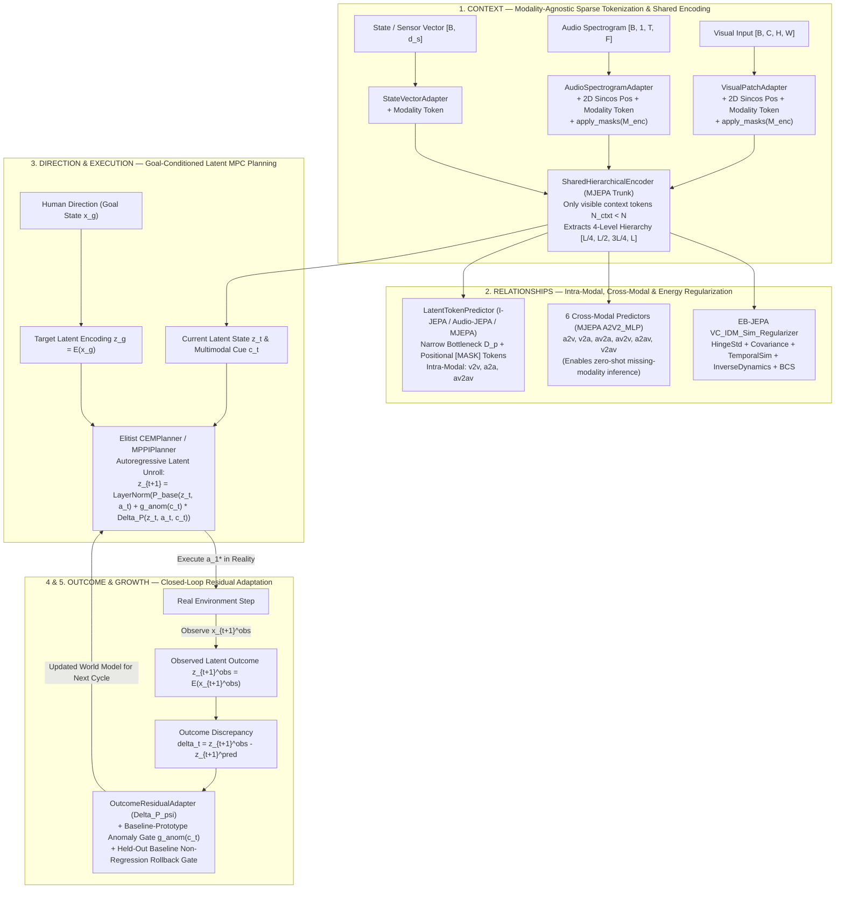

# Stage 2 — Architecture of the Clover Reusable Predictive Representation Engine (`RPRE`)

Offered, not imposed. Date: 2026-11-07. Direction owner: Santhosh.  
Worktree: `C:\personal\oss\clover-jepa-wt` (branch `research/jepa-predictive-engine`).

---

## 1. Guiding Architectural Question

> **Can we build a reusable predictive representation engine that processes different kinds of information more efficiently, learns their underlying relationships, and improves through observed outcomes?**

Studying the four core JEPA codebases side by side reveals that each solves one essential part of this question—while leaving a gap that the others and the **Clover Cycle (`Context → Direction → Execution → Outcome → Growth`)** close:

| Requirement | Which Paper/Repo Addresses It | What Remains Missing Standalone | How `RPRE` Unifies and Completes It |
|---|---|---|---|
| **1. Process different kinds of information more efficiently** | **I-JEPA** (`apply_masks` before Transformer blocks) + **Audio-JEPA** (2D spectrogram patchification) + **MJEPA** (single shared Transformer trunk) | I-JEPA and Audio-JEPA are unimodal; pixel/waveform autoencoders waste capacity reconstructing high-frequency noise and compute self-attention over $100\%$ of patches. | Lightweight modality adapters (`VisualPatchAdapter`, `AudioSpectrogramAdapter`, `StateVectorAdapter`) drop masked tokens *before* entering the shared Transformer trunk, reducing self-attention FLOPs by $(N_{\text{ctxt}}/N)^2 \approx 0.30\times$ while ignoring surface noise. |
| **2. Learn their underlying relationships** | **MJEPA** (3 intra-modal + 6 cross-modal predictive paths + 4-level hierarchical target extraction) + **EB-JEPA** (`VCLoss` + `InverseDynamicsLoss`) | Sharing a single encoder across modalities *without* cross-modal prediction degrades below unimodal baselines due to modality competition; EMA alone can collapse on small batches or lose action-controllable coordinates. | Combines MJEPA's 9-path intra/cross-modal prediction (`v2v`, `a2a`, `av2av`, `a2v`, `v2a`, `av2a`, `av2v`, `a2av`, `v2av`) and 4-level hierarchy with EB-JEPA's `VC_IDM_Sim_Regularizer` (`std + cov + sim_t + idm`), aligning modalities and preserving controllable state coordinates. |
| **3. Improve through observed outcomes** | **EB-JEPA** (`JEPA.unroll` + `CEMPlanner` / `MPPIPlanner` goal-conditioned MPC) + **Clover Cycle** (`Outcome → Growth`) | All four upstream JEPA repos—including `EB-JEPA`'s `GCAgent` (`eb_jepa/planning.py:258–295`)—are **open-loop at deployment**: they never update their world model when real execution produces an outcome $z_{t+1}^{\text{obs}} \neq \hat{z}_{t+1}$. Conversely, naive online SGD causes catastrophic forgetting of baseline dynamics. | `OutcomeResidualAdapter` (`rpre/engine.py`) + `CloverCycleAgent` (`rpre/planner.py`) close the loop: observed outcome discrepancies $\delta_t = z_{t+1}^{\text{obs}} - \hat{z}_{t+1}$ train a context-gated residual transition model $\Delta P_\psi(z_t, a_t, c_{\text{AV}})$ guarded by a baseline-prototype anomaly gate and a held-out non-regression rollback gate. |

---

## 2. End-to-End Architecture Diagram

---

## 3. Mathematical Formulation of `RPRE` (`rpre/`)

### 3.1 Context-Only Sparse Multi-Level Encoding (`SharedHierarchicalEncoder`)
Given input modalities $x^{(m)}$ ($m \in \{\text{visual}, \text{audio}, \text{state}\}$) and context masks $M_{\text{enc}}^{(m)} \subset \{1, \dots, N_m\}$ with $|M_{\text{enc}}^{(m)}| = N_{\text{ctxt}}^{(m)} < N_m$:
$$u_0^{(m)} = \text{apply\_masks}\!\left(\text{PatchEmbed}_m(x^{(m)}) + P_{\text{pos}}^{(m)} + e_{\text{mod}}^{(m)},\; M_{\text{enc}}^{(m)}\right)$$
The shared $L$-layer Transformer trunk processes either a single modality $u_0^{(m)}$ or the concatenated multimodal sequence $u_0 = [u_0^{(\text{audio})}; u_0^{(\text{visual})}]$ and extracts normalized representations at $K=4$ hierarchical depths $\mathcal{H} = \{l_1, l_2, l_3, l_4\}$:
$$z^{(m)} = \Big[\text{LN}_1(u_{l_1}^{(m)}) \;\Big\|\; \text{LN}_2(u_{l_2}^{(m)}) \;\Big\|\; \text{LN}_3(u_{l_3}^{(m)}) \;\Big\|\; \text{LN}_4(u_{l_4}^{(m)})\Big] \in \mathbb{R}^{B \times N_{\text{ctxt}}^{(m)} \times 4D}$$

### 3.2 9-Path Intra-Modal & Cross-Modal Predictive Objective (`multimodal_jepa_step`)
- **Intra-modal token prediction (`v2v`, `a2a`, `av2av`)**: `LatentTokenPredictor` projects $z^{(m)} \in \mathbb{R}^{4D}$ to bottleneck $D_p$, appends positional mask tokens at target indices $M_{\text{pred}}^{(m)}$, and predicts all 4 normalized target hierarchy levels $\hat{h}^{(m)}$ produced by the EMA target encoder $E_{\bar\theta}$:
  $$\mathcal{L}_{\text{intra}} = \|\hat{h}^{(v)} - h^{(v)}[M_{\text{pred}}^{(v)}]\|_1 + \|\hat{h}^{(a)} - h^{(a)}[M_{\text{pred}}^{(a)}]\|_1 + \|\hat{h}^{(av\to a)} - h_{\text{av}}^{(a)}[M_{\text{pred}}^{(a)}]\|_1 + \|\hat{h}^{(av\to v)} - h_{\text{av}}^{(v)}[M_{\text{pred}}^{(v)}]\|_1$$
- **Cross-modal relationship prediction (`a2v`, `v2a`, `av2a`, `av2v`, `a2av`, `v2av`)**: Six `CrossModalPredictor` heads predict the pooled top-level target representation $\bar{h}^{(m_2)} = \frac{1}{N_{m_2}}\sum_i h_{i, \text{last}}^{(m_2)}$ of modality $m_2$ from visible context tokens of modality $m_1$:
  $$\mathcal{L}_{\text{cross}} = \sum_{(m_1, m_2) \in \{(a,v), (v,a), (av,a), (av,v), (a,av), (v,av)\}} \left\|f_{m_1 \to m_2}(z_{\text{last}}^{(m_1)}) - \bar{h}^{(m_2)}\right\|_1$$
  Crucially, at inference time, when one modality is missing or occluded (e.g., camera occluded, only audio $x^{(a)}$ available), `CloverCycleAgent.establish_context` (`rpre/planner.py:217–223`) uses $\hat{z}^{(v)} = f_{a \to v}(z^{(a)})$ to reconstruct the missing visual context cue in latent space!

### 3.3 Energy-Based Anti-Collapse & Controllability Regularization (`VC_IDM_Sim_Regularizer`)
To guarantee non-collapsed, decorrelated, and action-identifiable latent trajectories $z_{1:T}$:
$$\mathcal{L}_{\text{EB}} = \lambda_{\text{std}} \frac{1}{D}\sum_{d=1}^D \max\!\left(0, 1 - \sqrt{\text{Var}(z_{\cdot, d}) + \epsilon}\right) + \lambda_{\text{cov}} \frac{1}{D(D-1)}\sum_{i \neq j} \text{Cov}(z)_{i,j}^2 + \lambda_{\text{sim}} \|z_{t+1} - z_t\|_2^2 + \lambda_{\text{idm}} \|\text{IDM}(z_t, z_{t+1}) - a_t\|_2^2$$

### 3.4 Closed-Loop Outcome-Driven Residual Adaptation (`OutcomeResidualAdapter`)
During execution, the transition predictor forecasts:
$$\hat{z}_{t+1} = \text{LN}\!\left(P_{\text{base}}(z_t, a_t) + g_{\text{anom}}(c_t) \cdot \tanh(\gamma)\, f_\psi(z_t, a_t, c_t)\right)$$
where:
1. $c_t \in \mathbb{R}^D$ is the fused multimodal context cue ($c_t = \frac{1}{2}(\bar{z}^{(a)} + \bar{z}^{(v)})$, or cross-modally imputed $\frac{1}{2}(\bar{z}^{(a)} + f_{a\to v}(z^{(a)}))$ when visual input is absent).
2. $g_{\text{anom}}(c_t) = \text{clip}\!\left(\frac{\|c_t - \mu_{c_0}\|_2^2 - \tau_0}{\tau_1}, 0, 1\right)$ is the **Baseline-Prototype Anomaly Gate** relative to the verified baseline context prototype $\mu_{c_0}$. On baseline Regime 0 ($c_t \approx \mu_{c_0}$), $g_{\text{anom}}(c_t) = 0$, guaranteeing zero perturbation to verified baseline dynamics.
3. After observing real outcomes $(z_t, a_t, z_{t+1}^{\text{obs}}, c_t)$, `OutcomeResidualAdapter.update_from_outcomes` updates $\psi$ with experience replay and a **held-out baseline non-regression gate** (`max_baseline_regression = 0.02`): if baseline MSE regresses, the update is automatically rolled back.
