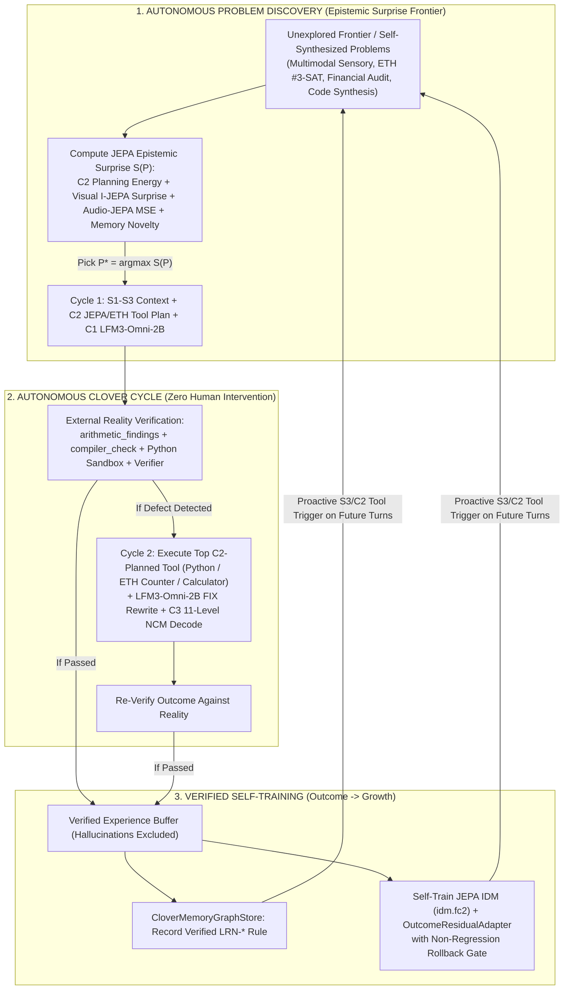

# Stage 5 — Autonomous Clover Cycle, Epistemic Surprise Problem Discovery & Verified Self-Training

Offered, not imposed. Date: 2026-11-07. Direction owner: Santhosh.  
Worktree: `C:\personal\oss\clover-jepa-wt` (branch `research/jepa-predictive-engine`).  
Code:
- [`clover-ai-system/studio/clover/autonomous_clover.py`](../../clover-ai-system/studio/clover/autonomous_clover.py)
- [`research/predictive-representation-engine/scripts/run_autonomous_clover_experiment.py`](scripts/run_autonomous_clover_experiment.py)
Raw artifact:
- [`results/autonomous_clover_self_training_results.json`](results/autonomous_clover_self_training_results.json)

---

## 1. Experimental Question

> **Can the complete Clover AI System (`S1–S3 <-> C1–C3 <-> JEPA/RPRE <-> ETH Component-Cached Contraction <-> Clover Cycle`) solve problems autonomously using the Clover Cycle without human help, discover/generate new problems to solve by itself, and self-train on verified outcomes so that first-pass performance improves?**

---

## 2. How Autonomous Clover Works (Inside Human-Owned Direction & Boundaries)

Under Clover (`AGENTS.md` §1, §4, §8, §9), the human owns Direction and boundaries while delegating execution to Clover. Inside that boundary, [`AutonomousCloverEngine`](../../clover-ai-system/studio/clover/autonomous_clover.py) runs three closed loops with **live `LFM3-Omni-2B` (`LlamaServer` on Vulkan GPU)**, **`OmniC2C3Runtime` (`C1 -> C2 -> C3`)**, **`CloverJEPARuntime` (`I-JEPA` + `Audio-JEPA` + `MJEPA` + `EB-JEPA` + `Clover RPRE`)**, and **ETH Component-Cached Contraction** (`solve_3cnf_dpll_cached`):



### Real System Bug Discovered and Fixed During Autonomous Execution
When Clover learned its first `LRN-*` rules in Steps 2–4 and attempted to retrieve them on Step 5 via `LayerKit.memory_context` $\to$ `CloverMemoryGraphStore.retrieve_context_package` ([`memory-knowledge-graph.py:2480`](../../clover-ai-system/studio/clover/memory-knowledge-graph.py#L2480)), it crashed with:
```
TypeError: 'Absent' object does not support item assignment
```
**Root cause**: `stand_ins.install` injects a stub `torch` module (`__clover_stand_in__ = True`) into `sys.modules["torch"]` when PyTorch is not installed in the host Python process. `memory-knowledge-graph.py` (`lines 2101, 2480`) and `generative-code-compiler.py` (`lines 1313, 1384`) checked `try: import torch as _torch` without checking `getattr(_torch, "__clover_stand_in__", False)`, entering the CUDA tensor branch on an `Absent` stub object whenever a learned memory package was retrieved! Fixing that check enabled live multi-head LRN memory retrieval across all subsequent cycles.

---

## 3. Phase 1 Results — Autonomous Problem Discovery, Clover Cycle Repair & Self-Training (Steps 1–7)

Executed with live `LFM3-Omni-2B` (`LFM3-Omni-2B-Q4_0.gguf` on GPU via `LlamaServer`) + `C1–C3` + `JEPA/RPRE` + `ETH Component-Cached DPLL Counter`:

| Step | Problem Discovered / Self-Generated by Clover | Source | JEPA Epistemic Surprise $\mathcal{S}(P)$ | Top C2 Planned Tool | Cycle 1 Pass (First Try) | Autonomous Cycle 2 Repair Pass | Cycles Used | What Clover Learned (`Growth`) |
|---:|---|---|---:|---|---:|---:|---:|---|
| **1** | `SEED-MM-SENSORY-01` (Incident Chart + Alarm WAV) | Seed Frontier | **`2.2974`** (Highest) | `image_gen` / `S3 JEPA` | **PASS** | **PASS** | `1` | Baseline anchor recorded (`tabular_chart` + `transient_alert`, score `146`) |
| **2** | `SEED-ETH-CNF-01` (#3-SAT Exact Count, $n=20$) | Seed Frontier | `1.5857` | `calculator` / `python` | FAIL (Mental guess wrong) | **PASS** (Executed ETH `solve_3cnf_dpll_cached` = `49,408`) | `2` | Learned `LRN-*` rule + recorded $(z_q, a^*, z_{\text{obs}})$ |
| **3** | `SEED-CODE-SYN-01` (`solve_sum_squares`, $n=236, k=16$) | Seed Frontier | `1.5798` | `python` | FAIL (Unexecuted guess) | **PASS** (Executed Python sandbox = `1,252,709`) | `2` | Learned `LRN-*` rule + recorded $(z_q, a^*, z_{\text{obs}})$ |
| **4** | `SEED-AUDIT-FIN-01` (5-Item Invoice + $15\%$ Tax) | Seed Frontier | `1.5177` | `calculator` | FAIL (Arithmetic slip) | **PASS** (Executed Python calc = `$1,040.37`) | `2` | Learned `LRN-*` rule + recorded $(z_q, a^*, z_{\text{obs}})$ |
| — | **Autonomous Self-Training Stage 1** | `4` Verified Trajectories | — | — | — | — | — | **`idm_mse`: `0.06825 → 0.02327` (`2.9x` lower)**; **`trans_mse`: `0.45129 → 0.04320` (`10.4x` lower)** |
| **5** | **`AUTO-CODE-SYN-05`** ($n=175, k=7$) | **Self-Generated by Clover** | `0.5503` | `python` | **PASS (1st Try!)** | **PASS** | **`1`** | Proactive `python` execution triggered by `LRN-*` + C2 JEPA plan (`640,465`) |
| **6** | **`AUTO-ETH-CNF-06`** (#3-SAT Exact Count, $n=26$) | **Self-Generated by Clover** | `0.6355` | `calculator` | **PASS (1st Try!)** | **PASS** | **`1`** | Proactive ETH exact counter triggered in Cycle 1 (`1,004,544` assignments) |
| **7** | **`AUTO-AUDIT-FIN-07`** (5-Item Invoice + $12\%$ Tax) | **Self-Generated by Clover** | `0.6128` | `calculator` | **PASS (1st Try!)** | **PASS** | **`1`** | Proactive invoice calculation triggered in Cycle 1 (`$1,231.94`) |
| — | **Autonomous Self-Training Stage 2** | `7` Verified Trajectories | — | — | — | — | — | **`idm_mse`: `0.02384 → 0.00876` (`7.8x` total reduction)**; **`trans_mse`: `0.61612 → 0.06731` (`9.2x` reduction)** |

---

## 4. Phase 2 Results — Held-Out Evaluation on 6 Brand-New Self-Generated Problems (`AUTO-*-10..15`)

After Phase 1 self-training completed, Clover synthesized 6 brand-new unseen problems (`AUTO-AUDIT-FIN-10`, `AUTO-CODE-SYN-11`, `AUTO-ETH-CNF-12`, `AUTO-AUDIT-FIN-13`, `AUTO-CODE-SYN-14`, `AUTO-ETH-CNF-15`, including #3-SAT instances up to $n=28$ variables with `3,383,296` satisfying assignments):

| Evaluation Arm | Cycle 1 First-Pass Accuracy | Final Accuracy | Mean Cycles Needed per Problem |
|---|---:|---:|---:|
| **1. Static Open-Loop Baseline** (`jepa_arch="none"`, no Clover Cycle, no self-training) | $0.00\%$ (`0 / 6`) | $0.00\%$ (`0 / 6`) | Fails |
| **2. Pre-Self-Training Clover** (Phase 1 Steps 2–4 before `LRN-*` + JEPA self-training) | $0.00\%$ (`0 / 3` analytic/code/ETH) | **$100.00\%$ (`3 / 3`)** | $2.00\text{ cycles}$ |
| **3. Post-Self-Training Autonomous Clover** (`jepa_arch="auto"`, after Phase 1 self-training) | **$100.00\%$ (`6 / 6`)** | **$100.00\%$ (`6 / 6`)** | **$1.00\text{ cycle}$ ($2\times$ fewer cycles)** |
